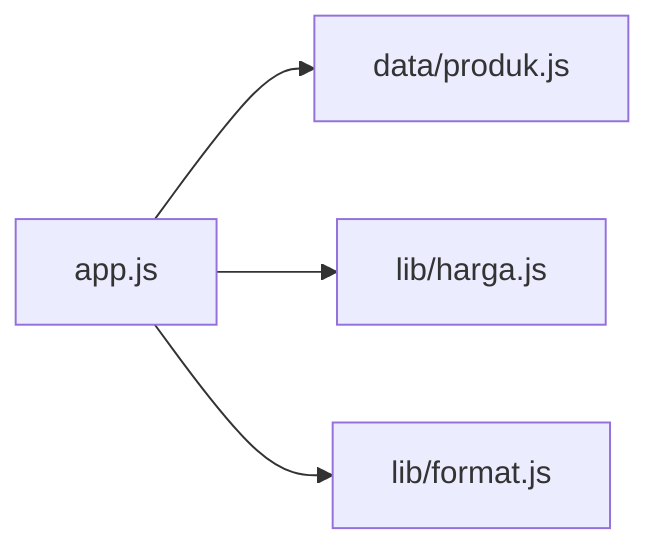

## Tujuan pembelajaran

Setelah mempelajari bab ini, kamu dapat:

- Menjelaskan apa itu modul dan mengapa kode dipecah menjadi banyak file.
- Menyiapkan proyek agar Node.js memperlakukan file sebagai ES Module.
- Memakai `export` dan `import`, baik *named* maupun *default*.
- Memakai modul bawaan Node.js dengan awalan `node:`.
- Menyusun proyek kecil dari beberapa file.
- Mengenali CommonJS (`require` dan `module.exports`) dan membedakannya dari ES Modules.
- Memahami pesan error modul yang paling umum.

Bab ini memakai hampir semua materi sebelumnya: fungsi, array, objek, dan penanganan error. Berbeda dari bab lain, contohnya terdiri dari **beberapa file**, jadi ikuti nama file dan folder dengan teliti.

## Pendahuluan: satu file tidak cukup

Sampai bab 10, setiap contoh cukup satu file. Program nyata bisa terdiri dari ratusan fungsi. Menaruh semuanya dalam satu file akan seperti menulis satu buku tebal tanpa bab: sulit dicari, sulit dibaca, dan sulit dikerjakan bersama orang lain.

Solusinya adalah membagi kode menjadi **modul**: satu file untuk satu tugas, misalnya satu file untuk perhitungan harga dan satu file untuk format tampilan. Analoginya lemari berlaci. Setiap laci (modul) berisi barang sejenis, dan kita membuka laci yang diperlukan saja.

Manfaatnya:

- **Terorganisir.** Kode yang berkaitan berada di tempat yang sama.
- **Dapat dipakai ulang.** Satu fungsi ditulis sekali dan dipakai di banyak file.
- **Aman dari bentrok nama.** Setiap modul punya scope sendiri (ingat bab 7), jadi `total` di satu file tidak mengganggu `total` di file lain.

## Dua sistem modul

Node.js mengenal dua sistem modul:

| | ES Modules (ESM) | CommonJS (CJS) |
|---|---|---|
| Sintaks | `import` dan `export` | `require()` dan `module.exports` |
| Asal | Standar resmi JavaScript | Sistem asli Node.js yang lebih tua |
| Status | Pilihan utama untuk kode baru | Masih banyak ditemui di kode lama |

Bab ini memakai **ES Modules** sebagai pilihan utama, lalu membahas CommonJS pada akhirnya agar kamu bisa membaca kode lama.

!!! note "Mengapa contoh bab sebelumnya jalan tanpa persiapan?"
    Jika tidak ada pengaturan apa pun, Node.js menjalankan file `.js` sebagai **CommonJS**. Itulah yang terjadi pada bab 1 sampai 10. Beberapa perilaku di bab itu, misalnya variabel tanpa `let` yang menjadi global (bab 7), bergantung pada mode ini. Dalam ES Modules, perilaku tersebut menjadi error.

## Menyiapkan proyek ES Modules

Buat folder baru bernama `modul-belajar`. Di dalamnya buat file `package.json` berikut:

```json title="package.json"
{ "type": "module" }
```

`package.json` adalah file pengaturan proyek Node.js. Baris `"type": "module"` memberi tahu Node.js bahwa semua file `.js` di folder ini adalah ES Modules. Alternatifnya, beri file ekstensi `.mjs` (ES Module) atau `.cjs` (CommonJS), yang selalu berlaku apa pun isi `package.json`.

## Named export dan import

### Mengekspor dari sebuah modul

Secara bawaan, semua yang ada di dalam sebuah file bersifat **privat**. Agar bisa dipakai file lain, kita harus **mengekspornya** dengan kata kunci `export`.

Buat file `matematika.js`:

```javascript title="matematika.js"
export const PI = 3.14;

export function tambah(a, b) {
  return a + b;
}

export const kali = (a, b) => a * b;

const rahasia = 42;
```

Lalu buat file `app.js` di folder yang sama:

```javascript title="app.js"
import { PI, tambah, kali } from "./matematika.js";

console.log(tambah(3, 4));
console.log(kali(5, 6));
console.log(PI);
```

Jalankan dari folder `modul-belajar`:

```bash
node app.js
```

Output:

```text
7
30
3.14
```

Penjelasan:

| Kode | Artinya |
|---|---|
| `export const PI` | Membuat `PI` dan sekaligus membukanya untuk modul lain |
| `import { PI, tambah, kali }` | Mengambil tiga nama dari modul. Nama di dalam `{ }` harus sama dengan nama yang diekspor |
| `from "./matematika.js"` | Lokasi modul. `./` berarti "dari folder ini", dan ekstensi `.js` **wajib** ditulis |
| `rahasia` | Tidak diekspor, jadi hanya ada di dalam `matematika.js` |

Ada dua aturan penting pada alamat modul sendiri: harus diawali `./` (folder ini) atau `../` (folder di atasnya), dan harus menyertakan ekstensi file.

### Mengganti nama dan mengekspor di akhir

Dua variasi yang berguna, simpan sebagai `geometri.js` dan `app-geometri.js`:

```javascript title="geometri.js"
const luasPersegi = (s) => s * s;
const kelilingPersegi = (s) => 4 * s;

export { luasPersegi, kelilingPersegi };
```

```javascript title="app-geometri.js"
import { luasPersegi as luas, kelilingPersegi } from "./geometri.js";

console.log(luas(5));
console.log(kelilingPersegi(5));
```

```bash
node app-geometri.js
```

Output:

```text
25
20
```

- `export { a, b }` di akhir file sama dengan menulis `export` di depan masing-masing deklarasi. Banyak orang menyukainya karena daftar yang diekspor terlihat sekaligus di satu tempat.
- `luasPersegi as luas` memberi **nama lain** saat mengimpor. Berguna jika namanya terlalu panjang atau bentrok dengan nama di file ini.

## Default export

Sebuah modul boleh punya **satu** ekspor utama yang disebut *default export*. Buat file `kuadrat.js` dan `app-kuadrat.js`:

```javascript title="kuadrat.js"
export default function kuadrat(x) {
  return x * x;
}

export const versi = 1;
```

```javascript title="app-kuadrat.js"
import hitungKuadrat, { versi } from "./kuadrat.js";

console.log(hitungKuadrat(7));
console.log(versi);
```

```bash
node app-kuadrat.js
```

Output:

```text
49
1
```

Perbedaan dengan named export:

| | Named export | Default export |
|---|---|---|
| Jumlah per file | Banyak | Satu |
| Cara mengimpor | `import { nama } from ...` (nama harus sama) | `import namaApaSaja from ...` (tanpa kurung kurawal, nama bebas) |
| Menulis ekspor | `export const x` | `export default x` |

Pada contoh, `kuadrat` diimpor dengan nama `hitungKuadrat`. Karena nama bebas bisa membingungkan, banyak tim memilih memakai **named export** saja agar nama konsisten di semua file.

### Mengimpor semuanya

Tanda `* as` mengumpulkan semua ekspor sebuah modul ke dalam satu objek (bab 9). Buat `app-semua.js`:

```javascript title="app-semua.js"
import * as m from "./kuadrat.js";

console.log(Object.keys(m));
console.log(m.versi);
console.log(m.default(3));
```

```bash
node app-semua.js
```

Output:

```text
[ 'default', 'versi' ]
1
9
```

Default export tersimpan di dalam properti bernama `default`.

## Aturan penting tentang modul

### Setiap modul dijalankan sekali

Walaupun diimpor berkali-kali, sebuah modul hanya dijalankan satu kali. Buat `sekali.js` dan `app-sekali.js`:

```javascript title="sekali.js"
console.log("modul dimuat");

export const x = 1;
```

```javascript title="app-sekali.js"
import "./sekali.js";
import { x } from "./sekali.js";

console.log(x);
```

```bash
node app-sekali.js
```

Output:

```text
modul dimuat
1
```

`import "./sekali.js"` (tanpa nama) hanya menjalankan modulnya. Meski ada dua `import`, tulisan `modul dimuat` hanya muncul sekali.

### Nilai yang diimpor tidak boleh diubah

Variabel hasil `import` bersifat seperti `const`. Mencoba mengubahnya menghasilkan error. Buat `salah-ubah.js`:

```javascript title="salah-ubah.js"
import { PI } from "./matematika.js";

PI = 3;
```

```bash
node salah-ubah.js
```

Output (dipersingkat):

```text
TypeError: Assignment to constant variable.
```

Jika modul perlu memberi tahu perubahan, buat fungsi di dalam modul itu dan ekspor fungsinya.

### `import` selalu di bagian atas

Konvensi yang baik adalah menaruh semua `import` di bagian paling atas file, sebelum kode lain. Dengan begitu daftar kebutuhan sebuah file langsung terlihat.

## Modul bawaan Node.js

Node.js datang dengan banyak modul siap pakai. Cara mengimpornya sama, tetapi nama modul diawali **`node:`** dan tidak memakai `./`. Buat `app-bawaan.js`:

```javascript title="app-bawaan.js"
import { basename, extname } from "node:path";
import { writeFileSync, readFileSync } from "node:fs";

console.log(basename("/folder/laporan.pdf"));
console.log(extname("laporan.pdf"));

writeFileSync("halo.txt", "Halo dari file");
console.log(readFileSync("halo.txt", "utf8"));
```

```bash
node app-bawaan.js
```

Output:

```text
laporan.pdf
.pdf
Halo dari file
```

| Modul | Fungsi |
|---|---|
| `node:path` | Mengolah alamat file. `basename` mengambil nama file, `extname` mengambil ekstensinya |
| `node:fs` | *File system*: membaca dan menulis file. `writeFileSync` menulis, `readFileSync` membaca |

Setelah menjalankan contoh ini, akan muncul file `halo.txt` di folder kerjamu. Modul `fs`, `path`, dan modul bawaan lain dibahas lengkap di bagian Node.js.

## Mengumpulkan ekspor dalam satu pintu

Pada proyek besar, folder sering punya satu file `index.js` yang menjadi "pintu depan", mengumpulkan ekspor dari file-file lain. Buat folder `alat` berisi `index.js`:

```javascript title="alat/index.js"
export { tambah, kali } from "../matematika.js";
export { luasPersegi } from "../geometri.js";
```

```javascript title="app-pintu.js"
import { tambah, luasPersegi } from "./alat/index.js";

console.log(tambah(2, 3));
console.log(luasPersegi(4));
```

```bash
node app-pintu.js
```

Output:

```text
5
16
```

`export { ... } from "..."` mengimpor sekaligus mengekspor ulang. File yang memakai cukup mengimpor dari satu tempat, tanpa perlu tahu letak aslinya.

## Contoh praktis: struk belanja dari tiga modul

Kita buat proyek kecil dengan pembagian tugas yang jelas. Di dalam folder `modul-belajar`, buat folder `struk` dengan struktur berikut:

```text
struk/
  app.js
  data/produk.js
  lib/harga.js
  lib/format.js
```



Data barang:

```javascript title="struk/data/produk.js"
export const produk = [
  { nama: "Pensil", harga: 2000, jumlah: 10 },
  { nama: "Buku", harga: 8000, jumlah: 3 },
  { nama: "Pulpen", harga: 3000, jumlah: 5 },
];
```

Perhitungan harga:

```javascript title="struk/lib/harga.js"
export const hitungSubtotal = (item) => item.harga * item.jumlah;

export function hitungTotal(daftar) {
  return daftar.reduce((jumlah, item) => jumlah + hitungSubtotal(item), 0);
}

export function hitungDiskon(total) {
  return total >= 50000 ? (total * 10) / 100 : 0;
}
```

Format tampilan:

```javascript title="struk/lib/format.js"
export const rupiah = (angka) => `Rp ${angka.toLocaleString("id-ID")}`;
```

Program utama:

```javascript title="struk/app.js"
import { produk } from "./data/produk.js";
import { hitungSubtotal, hitungTotal, hitungDiskon } from "./lib/harga.js";
import { rupiah } from "./lib/format.js";

for (const item of produk) {
  console.log(`${item.nama} x${item.jumlah}: ${rupiah(hitungSubtotal(item))}`);
}

const total = hitungTotal(produk);
const diskon = hitungDiskon(total);

console.log(`Total: ${rupiah(total)}`);
console.log(`Diskon: ${rupiah(diskon)}`);
console.log(`Bayar: ${rupiah(total - diskon)}`);
```

```bash
node struk/app.js
```

Output:

```text
Pensil x10: Rp 20.000
Buku x3: Rp 24.000
Pulpen x5: Rp 15.000
Total: Rp 59.000
Diskon: Rp 5.900
Bayar: Rp 53.100
```

Penjelasan:

1. `app.js` mengimpor dari tiga modul. Alamat relatif dihitung dari lokasi `app.js`, bukan dari folder tempat kamu menjalankan `node`.
2. `hitungTotal` memakai `hitungSubtotal` yang berada di file yang sama, sehingga tidak perlu diimpor.
3. `toLocaleString("id-ID")` adalah cara bawaan angka untuk menulis dengan format Indonesia (titik sebagai pemisah ribuan).
4. Karena total 59.000 sudah mencapai 50.000, diskon 10% (5.900) berlaku.

Keuntungan pembagian ini: jika aturan diskon berubah, kamu hanya mengubah `lib/harga.js`. Jika format mata uang berubah, cukup `lib/format.js`.

## CommonJS

Kamu akan sering menemukan kode dengan `require`. Untuk membacanya, kenali pola berikut. Di folder `modul-belajar` (yang bertipe `module`), file CommonJS harus berekstensi **`.cjs`**. Buat `lama.cjs` dan `pakai-lama.cjs`:

```javascript title="lama.cjs"
const sapa = (nama) => `Halo, ${nama}`;

module.exports = { sapa, versi: 1 };
```

```javascript title="pakai-lama.cjs"
const { sapa, versi } = require("./lama.cjs");
const fs = require("node:fs");

console.log(sapa("Budi"), versi);
console.log(typeof fs.readFileSync);
console.log(typeof module, typeof exports, typeof __dirname);
```

```bash
node pakai-lama.cjs
```

Output:

```text
Halo, Budi 1
function
object object string
```

| ES Modules | CommonJS |
|---|---|
| `export const x = 1` | `module.exports = { x: 1 }` |
| `import { x } from "./a.js"` | `const { x } = require("./a.js")` |
| `import fs from "node:fs"` | `const fs = require("node:fs")` |
| Tidak ada `module`, `exports`, `__dirname` | Ketiganya tersedia |

Pada CommonJS, `module.exports` adalah apa yang dikeluarkan sebuah file, dan `require(...)` mengambilnya. Hasil `require` bisa langsung dibongkar dengan destructuring (bab 9).

### Mencampur keduanya

File ES Module boleh mengimpor file CommonJS. Buat `campur.js`:

```javascript title="campur.js"
import lama from "./lama.cjs";
import { sapa } from "./lama.cjs";

console.log(lama.versi, sapa("Sari"));
```

```bash
node campur.js
```

Output:

```text
1 Halo, Sari
```

Default import mendapatkan seluruh `module.exports`. Arah sebaliknya, file CommonJS memakai `import`, tidak diizinkan (lihat kesalahan umum). Untuk menghindari kerumitan, pilih satu sistem untuk satu proyek.

## Kesalahan umum

### 1. Lupa ekstensi `.js`

Buat `salah-ekstensi.js`:

```javascript title="salah-ekstensi.js"
import { tambah } from "./matematika";
```

```bash
node salah-ekstensi.js
```

Output (dipersingkat):

```text
Error [ERR_MODULE_NOT_FOUND]: Cannot find module
```

Pada ES Modules, ekstensi tidak boleh dilewatkan. **Perbaikan:** `"./matematika.js"`.

### 2. Mengimpor nama yang tidak diekspor

Buat `salah-nama.js`:

```javascript title="salah-nama.js"
import { rahasia } from "./matematika.js";
```

```bash
node salah-nama.js
```

Output (dipersingkat):

```text
SyntaxError: The requested module './matematika.js' does not provide an export named 'rahasia'
```

Ada dua kemungkinan: salah ketik nama, atau lupa menulis `export` di modulnya. Pada contoh ini `rahasia` memang sengaja tidak diekspor.

### 3. Mengubah nilai hasil `import`

Seperti pada contoh `salah-ubah.js`: variabel impor tidak boleh diisi ulang.

### 4. Memakai `require` di ES Module

Buat `salah-require.js`:

```javascript title="salah-require.js"
const fs = require("node:fs");
```

```bash
node salah-require.js
```

Output (dipersingkat):

```text
ReferenceError: require is not defined in ES module scope, you can use import instead
```

**Perbaikan:** `import fs from "node:fs"`, atau ubah file menjadi `.cjs`.

### 5. Memakai `import` di file CommonJS

Buat `salah-import.cjs`:

```javascript title="salah-import.cjs"
import { sapa } from "./lama.cjs";
```

```bash
node salah-import.cjs
```

Output (dipersingkat):

```text
SyntaxError: Cannot use import statement outside a module
```

**Perbaikan:** pakai `require`, atau jadikan file itu ES Module.

### 6. Tidak menyatakan `"type": "module"`

Jika file `.js` memakai `import` tetapi proyek belum menyatakan tipenya, hasilnya bergantung pada versi Node.js. Pada Node.js 24, sintaks `import` dikenali otomatis dan file tetap berjalan, tetapi muncul peringatan `MODULE_TYPELESS_PACKAGE_JSON` jika ada `package.json` tanpa `type`. Pada versi lama, hasilnya `SyntaxError: Cannot use import statement outside a module`. **Perbaikan:** selalu tulis `"type": "module"` secara eksplisit agar perilakunya sama di semua versi.

### 7. Alamat relatif dikira dari folder terminal

Alamat pada `import` selalu relatif terhadap **file yang berisi `import`**, bukan folder tempat `node` dijalankan. Itulah sebabnya `struk/app.js` bisa menulis `./lib/harga.js`.

### 8. Saling mengimpor (*circular dependency*)

Jika modul A mengimpor B dan B mengimpor A, urutan pemuatan menjadi rumit dan nilai bisa belum tersedia saat dibutuhkan. Hindari dengan memindahkan kode bersama ke modul ketiga yang dipakai keduanya.

## Ringkasan

- **Modul** adalah file yang punya scope sendiri. Memecah kode menjadi modul membuatnya terorganisir dan dapat dipakai ulang.
- Aktifkan ES Modules dengan `"type": "module"` di `package.json`, atau pakai ekstensi `.mjs`. File CommonJS berekstensi `.cjs`.
- `export` membuka sesuatu dari sebuah modul. Yang tidak diekspor tetap privat.
- Named: `export const x` lalu `import { x } from "./a.js"`. Default: `export default x` lalu `import nama from "./a.js"`.
- Alamat modul sendiri diawali `./` atau `../` dan wajib memakai ekstensi.
- Modul dijalankan sekali, dan nilai yang diimpor tidak boleh diubah.
- Modul bawaan Node.js diimpor dengan awalan `node:`, misalnya `node:path` dan `node:fs`.
- CommonJS memakai `require()` dan `module.exports`. ES Module boleh mengimpor CommonJS, tetapi tidak sebaliknya.
- Pisahkan data, logika, dan tampilan ke modul yang berbeda.

## Latihan

Kerjakan sendiri dulu sebelum melihat jawaban. Buat folder baru dengan `package.json` berisi `{ "type": "module" }` untuk setiap latihan, atau lanjutkan di `modul-belajar`.

### Latihan 1: Prediksi output

File `a.js` berisi `console.log("A dimuat");` dan `export const nilai = 10;`. File `b.js` berisi:

```javascript
import "./a.js";
import { nilai } from "./a.js";

console.log(nilai * 2);
```

Apa yang tampil ketika menjalankan `node b.js`?

??? success "Jawaban"
    Output: `A dimuat` lalu `20`. Modul `a.js` hanya dijalankan sekali walaupun diimpor dua kali.

### Latihan 2: Perbaiki impor

Impor ini menghasilkan `ERR_MODULE_NOT_FOUND`. Perbaiki:

```javascript
import { tambah } from "matematika";
```

??? success "Jawaban"
    Alamat modul sendiri harus diawali `./` dan memakai ekstensi:
    ```javascript
    import { tambah } from "./matematika.js";
    ```
    Tanpa `./`, Node.js menganggap `matematika` sebagai nama paket yang dipasang dari luar.

### Latihan 3: Sapaan dengan default export

Buat `sapa.js` dengan default export berupa fungsi `sapa(nama)` yang mengembalikan `Halo, <nama>!`, dan named export `versi` bernilai 1. Di `main.js`, impor keduanya dan tampilkan `Halo, Budi! (v1)`.

??? success "Contoh jawaban"
    ```javascript title="sapa.js"
    export default function sapa(nama) {
      return `Halo, ${nama}!`;
    }

    export const versi = 1;
    ```

    ```javascript title="main.js"
    import sapa, { versi } from "./sapa.js";

    console.log(`${sapa("Budi")} (v${versi})`);
    ```
    Output: `Halo, Budi! (v1)`

### Latihan 4: Pindahkan ke modul

Pindahkan fungsi berikut ke file `persegi-panjang.js` sebagai named export, lalu panggil dari `main2.js` dengan p = 8 dan l = 5. Hasil yang tampil adalah `40` lalu `26`.

```javascript
const luas = (p, l) => p * l;
const keliling = (p, l) => 2 * (p + l);
```

??? success "Contoh jawaban"
    ```javascript title="persegi-panjang.js"
    export const luas = (p, l) => p * l;
    export const keliling = (p, l) => 2 * (p + l);
    ```

    ```javascript title="main2.js"
    import { luas, keliling } from "./persegi-panjang.js";

    console.log(luas(8, 5));
    console.log(keliling(8, 5));
    ```
    Output: `40` lalu `26`.

### Latihan 5: Modul `node:path`

Dari alamat `"/data/laporan-2025.pdf"`, tampilkan nama file dan ekstensinya dengan `node:path`.

??? success "Contoh jawaban"
    ```javascript
    import { basename, extname } from "node:path";

    const alamat = "/data/laporan-2025.pdf";
    console.log(basename(alamat));
    console.log(extname(alamat));
    ```
    Output:
    ```text
    laporan-2025.pdf
    .pdf
    ```

### Latihan 6: Pintu depan

Dari `persegi-panjang.js` (latihan 4) dan `sapa.js` (latihan 3), buat `pintu.js` yang mengekspor ulang `luas` dan `versi`. Lalu impor dari `pintu.js` dan tampilkan `luas(3, 4)` dan `versi`.

??? success "Contoh jawaban"
    ```javascript title="pintu.js"
    export { luas } from "./persegi-panjang.js";
    export { versi } from "./sapa.js";
    ```

    ```javascript title="main3.js"
    import { luas, versi } from "./pintu.js";

    console.log(luas(3, 4));
    console.log(versi);
    ```
    Output: `12` lalu `1`.

### Latihan 7: CommonJS

Buat `hitung.cjs` yang mengekspor fungsi `kuadrat(x)` dengan `module.exports`, lalu pakai dari `pakai-hitung.cjs` memakai `require` untuk menampilkan kuadrat dari 9.

??? success "Contoh jawaban"
    ```javascript title="hitung.cjs"
    const kuadrat = (x) => x * x;

    module.exports = { kuadrat };
    ```

    ```javascript title="pakai-hitung.cjs"
    const { kuadrat } = require("./hitung.cjs");

    console.log(kuadrat(9));
    ```
    Output: `81`
