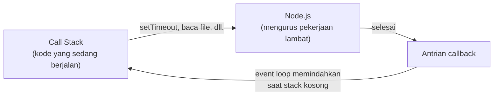

## Tujuan pembelajaran

Setelah mempelajari bab ini, kamu dapat:

- Menjelaskan perbedaan kode sinkron dan asinkron.
- Menjelaskan secara konsep bagaimana *event loop* mengatur urutan eksekusi.
- Memakai `setTimeout` dan `setInterval`.
- Memahami *callback* dan masalah yang muncul ketika callback bersarang.
- Membuat dan memakai *Promise* dengan `.then()`, `.catch()`, dan `.finally()`.
- Menulis kode asinkron yang mudah dibaca dengan `async` dan `await`.
- Menjalankan beberapa pekerjaan sekaligus dengan `Promise.all`.
- Menangani error pada kode asinkron.

Bab ini memakai fungsi (bab 6), penanganan error (bab 10), dan modul (bab 11). Semua contoh ada di folder `modul-belajar` dari bab 11, yaitu folder yang sudah berisi `package.json` bertipe `module`. Itu penting, karena beberapa contoh memakai `await` langsung di tingkat paling atas file, yang hanya diizinkan di ES Modules.

## Pendahuluan: jangan berdiri menunggu

Bayangkan kamu memesan makanan di restoran. Setelah memesan, kamu tidak berdiri di depan dapur sampai makanan jadi. Kamu duduk, mengobrol, membuka ponsel, dan ketika makanan siap, pelayan memanggilmu. Pelayan pun tidak berhenti melayani tamu lain hanya karena satu pesanan belum jadi.

JavaScript bekerja dengan cara serupa. Sampai bab 11, semua kode berjalan **sinkron**: satu baris selesai dulu, baru baris berikutnya. Namun ada pekerjaan yang lambat: membaca file, memanggil server di internet, menunggu timer. Jika program berdiri menunggu setiap pekerjaan itu, seluruh program membeku.

Pekerjaan **asinkron** menyelesaikan masalah ini: kita memulai pekerjaan lambat, meneruskan pekerjaan lain, dan JavaScript memanggil kita kembali ketika hasilnya siap.

## Sinkron vs asinkron

Fungsi bawaan `setTimeout(fungsi, ms)` menjadwalkan sebuah fungsi untuk dijalankan **nanti**, setelah `ms` milidetik (1000 ms = 1 detik). Buat file `urutan.js`:

```javascript title="urutan.js"
console.log("1. Mulai");

setTimeout(() => {
  console.log("3. Timer selesai");
}, 100);

console.log("2. Selesai membaca kode");
```

```bash
node urutan.js
```

Output:

```text
1. Mulai
2. Selesai membaca kode
3. Timer selesai
```

Urutan output berbeda dari urutan penulisan. Penjelasannya:

1. `console.log("1. Mulai")` dijalankan.
2. `setTimeout` **mendaftarkan** fungsi ke timer dan langsung selesai. JavaScript tidak menunggu 100 ms.
3. `console.log("2. ...")` dijalankan.
4. Setelah semua kode di atas selesai dan 100 ms berlalu, fungsi yang dijadwalkan dipanggil dan mencetak `3. ...`.

Fungsi yang diberikan ke `setTimeout` adalah contoh **callback**, yaitu fungsi yang akan dipanggil kembali nanti. Konsep yang sama sudah kamu pakai pada `map` dan `filter` di bab 8.

### Event loop secara konsep

Bagaimana JavaScript mengatur ini semua padahal ia hanya mengerjakan **satu hal pada satu waktu**? Dengan **event loop**. Bayangkan tiga bagian:



- **Call stack**: tempat kode yang sedang dijalankan.
- **Node.js** (di belakang layar): mengurus timer, file, dan jaringan tanpa menghalangi stack.
- **Antrian callback**: callback yang sudah siap menunggu giliran.
- **Event loop** terus memeriksa: jika stack kosong, ambil callback berikutnya dari antrian dan jalankan.

Konsekuensi penting: **callback tidak pernah memotong kode yang sedang berjalan**. Ia baru berjalan setelah kode saat ini selesai, bahkan jika waktu tunggunya 0 ms. Simpan sebagai `event-loop.js`:

```javascript title="event-loop.js"
console.log("1. Mulai");

setTimeout(() => console.log("4. Timer 0 ms"), 0);

Promise.resolve().then(() => console.log("3. Promise"));

console.log("2. Selesai membaca kode");
```

```bash
node event-loop.js
```

Output:

```text
1. Mulai
2. Selesai membaca kode
3. Promise
4. Timer 0 ms
```

Timer 0 ms tetap berjalan setelah semua kode sinkron. Callback dari Promise (dibahas di bawah) punya antrian sendiri yang diprioritaskan lebih dulu daripada antrian timer. Kamu tidak perlu menghafal detailnya: cukup ingat bahwa **semua kode sinkron selesai lebih dulu**, baru callback.

### Mengulang dengan `setInterval`

`setInterval(fungsi, ms)` memanggil fungsi **berulang kali** setiap `ms` milidetik, sampai dihentikan dengan `clearInterval`. Buat `interval.js`:

```javascript title="interval.js"
let hitung = 3;

const id = setInterval(() => {
  console.log(hitung);
  hitung--;

  if (hitung === 0) {
    clearInterval(id);
    console.log("Selesai!");
  }
}, 50);
```

```bash
node interval.js
```

Output:

```text
3
2
1
Selesai!
```

`setInterval` mengembalikan sebuah nilai pengenal yang disimpan di `id`. Ketika hitungan mencapai 0, `clearInterval(id)` menghentikan pengulangan. Tanpa `clearInterval`, program tidak akan pernah berhenti.

## Callback

Cara tertua menangani hasil asinkron adalah menyerahkan sebuah fungsi untuk dipanggil saat pekerjaan selesai. Dalam Node.js ada konvensi: callback menerima dua argumen, **error lebih dulu**, lalu hasilnya. Jika tidak ada error, argumen pertama bernilai `null`. Buat `callback.js`:

```javascript title="callback.js"
function ambilPengguna(id, callback) {
  setTimeout(() => {
    if (id <= 0) {
      callback(new Error("ID tidak valid"));
      return;
    }
    callback(null, { id, nama: "Budi" });
  }, 50);
}

function tampilkan(error, pengguna) {
  if (error) {
    console.log("Gagal:", error.message);
    return;
  }
  console.log("Berhasil:", pengguna);
}

ambilPengguna(1, tampilkan);
ambilPengguna(0, tampilkan);
```

```bash
node callback.js
```

Output:

```text
Berhasil: { id: 1, nama: 'Budi' }
Gagal: ID tidak valid
```

Kedua panggilan menunggu 50 ms. Pekerjaan yang didaftarkan lebih dulu selesai lebih dulu, sehingga `Berhasil` muncul sebelum `Gagal`. Di dalam callback, hasil dan error harus dicek manual dengan `if (error)`.

### Masalah: callback bersarang

Jika langkah kedua bergantung pada langkah pertama, callback harus ditaruh di dalam callback. Buat `neraka.js`:

```javascript title="neraka.js"
function langkah(nama, callback) {
  setTimeout(() => {
    console.log(nama);
    callback();
  }, 10);
}

langkah("Ambil pengguna", () => {
  langkah("Ambil pesanan", () => {
    langkah("Hitung total", () => {
      console.log("Selesai");
    });
  });
});
```

```bash
node neraka.js
```

Output:

```text
Ambil pengguna
Ambil pesanan
Hitung total
Selesai
```

Setiap langkah baru menggeser kode makin ke kanan, membentuk piramida yang sulit dibaca. Dengan penanganan error di tiap tingkat, hasilnya jauh lebih buruk. Fenomena ini dijuluki **callback hell**. Promise dan `async/await` lahir untuk mengatasinya.

## Promise

### Konsep

**Promise** adalah objek yang mewakili hasil pekerjaan asinkron yang **belum selesai**, seperti struk pesanan di restoran: bukan makanannya, tetapi janji bahwa makanan akan datang (atau pesanan gagal). Sebuah Promise selalu berada di salah satu dari tiga keadaan:

| Keadaan | Artinya |
|---|---|
| `pending` | Pekerjaan masih berjalan |
| `fulfilled` | Berhasil, hasilnya tersedia |
| `rejected` | Gagal, alasan kegagalan (biasanya objek `Error`) tersedia |

Promise yang sudah `fulfilled` atau `rejected` tidak akan berubah lagi.

### Membuat Promise

Kita buat dua fungsi pendukung yang akan dipakai di sisa bab ini. Pertama, `bantu.js`:

```javascript title="bantu.js"
export const tunggu = (ms) => new Promise((resolve) => setTimeout(resolve, ms));
```

Lalu `data.js`, yang menyimulasikan pengambilan data dari server:

```javascript title="data.js"
const namaPengguna = { 1: "Budi", 2: "Sari", 3: "Andi" };

const daftarPesanan = {
  1: [{ barang: "Pensil", harga: 2000 }, { barang: "Buku", harga: 8000 }],
  2: [{ barang: "Pulpen", harga: 3000 }],
  3: [],
};

export function ambilPengguna(id) {
  return new Promise((resolve, reject) => {
    setTimeout(() => {
      if (!namaPengguna[id]) {
        reject(new Error("Pengguna tidak ditemukan"));
        return;
      }
      resolve({ id, nama: namaPengguna[id] });
    }, 20);
  });
}

export function ambilPesanan(idPengguna) {
  return new Promise((resolve) => {
    setTimeout(() => resolve(daftarPesanan[idPengguna]), 20);
  });
}
```

Cara kerja `new Promise((resolve, reject) => { ... })`:

- Fungsi yang diberikan dijalankan langsung dan menerima dua fungsi: `resolve` dan `reject`.
- Panggil `resolve(nilai)` ketika pekerjaan **berhasil**. Promise menjadi `fulfilled` dengan `nilai` itu.
- Panggil `reject(error)` ketika **gagal**. Promise menjadi `rejected`.
- Pada `tunggu`, `resolve` diberikan langsung ke `setTimeout` sebagai callback, jadi Promise berhasil setelah `ms` milidetik tanpa nilai.

### Memakai Promise: `then`, `catch`, `finally`

Buat `promise-dasar.js`:

```javascript title="promise-dasar.js"
import { ambilPengguna } from "./data.js";

ambilPengguna(1)
  .then((pengguna) => {
    console.log("Pengguna:", pengguna);
    return pengguna.nama.toUpperCase();
  })
  .then((huruf) => {
    console.log("Nama besar:", huruf);
  })
  .catch((error) => {
    console.log("Gagal:", error.message);
  })
  .finally(() => {
    console.log("Selesai");
  });
```

```bash
node promise-dasar.js
```

Output:

```text
Pengguna: { id: 1, nama: 'Budi' }
Nama besar: BUDI
Selesai
```

| Perintah | Dijalankan ketika |
|---|---|
| `.then(f)` | Promise berhasil. `f` menerima hasilnya |
| `.catch(f)` | Promise (atau langkah sebelumnya dalam rantai) gagal. `f` menerima error |
| `.finally(f)` | Selalu, baik berhasil maupun gagal |

Setiap `.then` menghasilkan **Promise baru**, sehingga bisa dirantai. Nilai yang di-`return` pada satu `.then` menjadi masukan `.then` berikutnya (di sini nama huruf besar). Jika satu langkah gagal, rantai melompat ke `.catch` terdekat. Mari lihat kasus gagal. Buat `promise-gagal.js`:

```javascript title="promise-gagal.js"
import { ambilPengguna } from "./data.js";

ambilPengguna(99)
  .then((pengguna) => {
    console.log("Tidak sampai sini:", pengguna);
  })
  .catch((error) => {
    console.log("Gagal:", error.message);
  })
  .finally(() => {
    console.log("Selesai");
  });
```

```bash
node promise-gagal.js
```

Output:

```text
Gagal: Pengguna tidak ditemukan
Selesai
```

### Merantai pekerjaan yang saling bergantung

Jika sebuah `.then` mengembalikan Promise lain, rantai akan **menunggu** Promise itu selesai dulu. Inilah pengganti callback bersarang. Buat `promise-rantai.js`:

```javascript title="promise-rantai.js"
import { ambilPengguna, ambilPesanan } from "./data.js";

ambilPengguna(1)
  .then((pengguna) => ambilPesanan(pengguna.id))
  .then((pesanan) => {
    console.log("Jumlah pesanan:", pesanan.length);
  })
  .catch((error) => {
    console.log("Gagal:", error.message);
  });
```

```bash
node promise-rantai.js
```

Output:

```text
Jumlah pesanan: 2
```

Kodenya tetap rata ke bawah, tidak menjorok ke kanan, dan satu `.catch` di akhir menangani error dari semua langkah.

### Menjalankan banyak pekerjaan sekaligus

Jika pekerjaannya tidak saling bergantung, jalankan bersamaan dengan `Promise.all`. Ia menerima array Promise dan menghasilkan Promise baru yang berisi array hasil, **dengan urutan sama seperti urutan input**. Buat `promise-all.js`:

```javascript title="promise-all.js"
import { ambilPengguna } from "./data.js";

Promise.all([ambilPengguna(1), ambilPengguna(2), ambilPengguna(3)]).then((hasil) => {
  console.log(hasil.map((p) => p.nama));
});

Promise.all([ambilPengguna(1), ambilPengguna(99)]).catch((error) => {
  console.log("Salah satu gagal:", error.message);
});

Promise.allSettled([ambilPengguna(1), ambilPengguna(99)]).then((hasil) => {
  console.log(hasil.map((h) => h.status));
});
```

```bash
node promise-all.js
```

Output:

```text
[ 'Budi', 'Sari', 'Andi' ]
Salah satu gagal: Pengguna tidak ditemukan
[ 'fulfilled', 'rejected' ]
```

| Perintah | Hasil |
|---|---|
| `Promise.all([...])` | Berhasil jika **semua** berhasil. Gagal segera begitu **salah satu** gagal |
| `Promise.allSettled([...])` | Selalu menunggu semuanya selesai dan melaporkan status tiap Promise (`fulfilled` atau `rejected`) |
| `Promise.race([...])` | Mengikuti Promise yang **paling dulu** selesai |

Urutan baris output mengikuti waktu selesai tiap rantai. Ketiganya berjalan bersamaan, jadi jangan mengandalkan urutan antara pekerjaan yang saling bersaing. Yang pasti urutannya hanyalah **isi array hasil**: ia selalu sama dengan urutan input.

## `async` dan `await`

Rantai `.then()` sudah jauh lebih baik daripada callback bersarang, tetapi masih terasa berbeda dari kode biasa. `async` dan `await` membuat kode asinkron **terbaca seperti kode sinkron**.

- Kata **`async`** di depan fungsi membuat fungsi itu selalu mengembalikan Promise.
- Kata **`await`** di dalam fungsi `async` berarti "tunggu Promise ini selesai, lalu beri aku hasilnya". Selama menunggu, JavaScript bebas mengerjakan hal lain di luar fungsi itu.

Buat `async-dasar.js`:

```javascript title="async-dasar.js"
import { ambilPengguna, ambilPesanan } from "./data.js";

async function tampilkanPesanan(id) {
  const pengguna = await ambilPengguna(id);
  const pesanan = await ambilPesanan(pengguna.id);
  return `${pengguna.nama} punya ${pesanan.length} pesanan`;
}

console.log(await tampilkanPesanan(1));
console.log(await tampilkanPesanan(3));

const janji = tampilkanPesanan(2);
console.log(janji);
console.log(await janji);
```

```bash
node async-dasar.js
```

Output:

```text
Budi punya 2 pesanan
Andi punya 0 pesanan
Promise { <pending> }
Sari punya 1 pesanan
```

Penjelasan:

1. `await ambilPengguna(id)` menunggu Promise selesai dan mengembalikan **nilainya langsung**, bukan Promise. Kodenya mirip contoh `promise-rantai.js`, tetapi terbaca dari atas ke bawah.
2. `return` di fungsi `async` membungkus nilai dalam Promise. Karena itu `tampilkanPesanan(2)` tanpa `await` menghasilkan `Promise { <pending> }`.
3. Di ES Modules, `await` boleh dipakai **langsung di tingkat paling atas file** (*top-level await*), seperti pada `console.log(await ...)`. Di luar ES Modules, `await` hanya boleh ada di dalam fungsi `async`.

### Menangani error dengan `try...catch`

Dengan `await`, error dari Promise yang gagal dilempar seperti error biasa, sehingga `try...catch` dari bab 10 bisa dipakai kembali. Buat `async-error.js`:

```javascript title="async-error.js"
import { ambilPengguna } from "./data.js";

async function cari(id) {
  try {
    const pengguna = await ambilPengguna(id);
    console.log("Ditemukan:", pengguna.nama);
  } catch (error) {
    console.log("Gagal:", error.message);
  } finally {
    console.log("Selesai mencari", id);
  }
}

await cari(2);
await cari(99);
```

```bash
node async-error.js
```

Output:

```text
Ditemukan: Sari
Selesai mencari 2
Gagal: Pengguna tidak ditemukan
Selesai mencari 99
```

### Berurutan atau bersamaan?

Setiap `await` membuat kode menunggu. Jika tiga pekerjaan tidak saling bergantung, menunggunya satu per satu membuang waktu. Buat `async-paralel.js`:

```javascript title="async-paralel.js"
import { tunggu } from "./bantu.js";

let mulai = Date.now();
await tunggu(100);
await tunggu(100);
await tunggu(100);
const berurutan = Date.now() - mulai;

mulai = Date.now();
await Promise.all([tunggu(100), tunggu(100), tunggu(100)]);
const bersamaan = Date.now() - mulai;

console.log("Berurutan (sekitar 300 ms), minimal 250:", berurutan >= 250);
console.log("Bersamaan (sekitar 100 ms), di bawah 250:", bersamaan < 250);
```

```bash
node async-paralel.js
```

Output:

```text
Berurutan (sekitar 300 ms), minimal 250: true
Bersamaan (sekitar 100 ms), di bawah 250: true
```

`Date.now()` memberi waktu saat ini dalam milidetik, sehingga selisihnya adalah lama proses. Tiga pekerjaan 100 ms yang ditunggu berurutan memakan sekitar 300 ms, sedangkan dengan `Promise.all` hanya sekitar 100 ms. **Aturan praktis:** jika pekerjaan saling bergantung, `await` satu per satu. Jika tidak, jalankan bersamaan dengan `Promise.all`.

### Modul bawaan versi Promise

Banyak modul bawaan Node.js punya versi Promise yang cocok dengan `await`. Di bab 11 kita memakai `readFileSync` yang bersifat sinkron (menghentikan program sampai selesai). Versi asinkronnya ada di `node:fs/promises`. Buat `file-async.js`:

```javascript title="file-async.js"
import { writeFile, readFile } from "node:fs/promises";

await writeFile("catatan.txt", "Belajar async");
const isi = await readFile("catatan.txt", "utf8");

console.log(isi);
```

```bash
node file-async.js
```

Output:

```text
Belajar async
```

Untuk program yang melayani banyak pengguna sekaligus, versi asinkron lebih baik karena tidak menahan pekerjaan lain selagi menunggu disk.

!!! note "Mengambil data dari internet"
    Node.js punya fungsi bawaan `fetch(alamat)` yang mengembalikan Promise untuk memanggil server di internet. Pola penggunaannya sama persis: `const respons = await fetch(alamat);`. Karena butuh koneksi internet, contohnya tidak kita jalankan di sini. Pembahasannya ada di bagian Node.js.

## Contoh praktis: laporan pelanggan

Gabungkan semuanya: ambil beberapa pengguna bersamaan, hitung total pesanan, dan tangani pengguna yang tidak ada tanpa menghentikan yang lain. Buat `laporan.js`:

```javascript title="laporan.js"
import { ambilPengguna, ambilPesanan } from "./data.js";

async function laporan(id) {
  try {
    const pengguna = await ambilPengguna(id);
    const pesanan = await ambilPesanan(pengguna.id);
    const total = pesanan.reduce((jumlah, p) => jumlah + p.harga, 0);
    return `${pengguna.nama}: ${pesanan.length} barang, total ${total}`;
  } catch (error) {
    return `Pengguna ${id}: ${error.message}`;
  }
}

const hasil = await Promise.all([1, 2, 3, 99].map(laporan));
hasil.forEach((baris) => console.log(baris));
```

```bash
node laporan.js
```

Output:

```text
Budi: 2 barang, total 10000
Sari: 1 barang, total 3000
Andi: 0 barang, total 0
Pengguna 99: Pengguna tidak ditemukan
```

Proses eksekusinya:

1. `[1, 2, 3, 99].map(laporan)` memanggil `laporan` untuk setiap id. Karena `laporan` adalah fungsi `async`, hasilnya adalah array berisi empat Promise yang sudah berjalan bersamaan.
2. `Promise.all` menunggu keempatnya dan mengembalikan array hasil dengan urutan sama seperti input.
3. Untuk id 99, `ambilPengguna` gagal. `try...catch` di dalam `laporan` mengubahnya menjadi teks, sehingga satu kegagalan tidak membatalkan `Promise.all`.

## Kesalahan umum

### 1. Lupa `await`

Buat `lupa-await.js`:

```javascript title="lupa-await.js"
import { ambilPengguna } from "./data.js";

const pengguna = ambilPengguna(1);

console.log(pengguna);
console.log(pengguna.nama);
```

```bash
node lupa-await.js
```

Output:

```text
Promise { <pending> }
undefined
```

Tanpa `await`, `pengguna` adalah Promise, bukan datanya. **Perbaikan:** `const pengguna = await ambilPengguna(1);`.

### 2. `try...catch` tanpa `await`

Buat `salah-catch.js`:

```javascript title="salah-catch.js"
import { ambilPengguna } from "./data.js";

try {
  ambilPengguna(99);
} catch (error) {
  console.log("Tertangkap");
}

console.log("Program lanjut");
```

```bash
node salah-catch.js
```

Output (dipersingkat):

```text
Program lanjut
Error: Pengguna tidak ditemukan
```

`ambilPengguna(99)` hanya **memulai** pekerjaan dan langsung selesai, sehingga `try` tidak melihat error apa pun. Kegagalan terjadi belakangan, di luar jangkauan `catch`, dan Node.js menghentikan program karena ada Promise gagal yang tidak ditangani (*unhandled rejection*). **Perbaikan:** `await ambilPengguna(99)` di dalam `try`, atau tambahkan `.catch(...)`.

### 3. `await` di fungsi biasa

Buat `salah-await.js`:

```javascript title="salah-await.js"
function ambil() {
  const x = await Promise.resolve(1);
}
```

```bash
node salah-await.js
```

Output (dipersingkat):

```text
SyntaxError: Unexpected reserved word
```

`await` hanya boleh ada di dalam fungsi `async` (atau di tingkat atas ES Module). **Perbaikan:** `async function ambil() { ... }`.

### 4. `forEach` dengan `async` tidak ditunggu

Buat `salah-foreach.js`:

```javascript title="salah-foreach.js"
import { tunggu } from "./bantu.js";

[1, 2, 3].forEach(async (n) => {
  await tunggu(10);
  console.log("item", n);
});

console.log("Selesai forEach");
```

```bash
node salah-foreach.js
```

Output:

```text
Selesai forEach
item 1
item 2
item 3
```

`forEach` tidak menunggu callback `async`-nya. Ia memulai ketiganya lalu langsung lanjut, sehingga `Selesai forEach` tercetak lebih dulu. **Perbaikan:** pakai `for...of` dengan `await` jika harus berurutan. Buat `benar-foreach.js`:

```javascript title="benar-foreach.js"
import { tunggu } from "./bantu.js";

for (const n of [1, 2, 3]) {
  await tunggu(10);
  console.log("item", n);
}

console.log("Selesai for...of");
```

```bash
node benar-foreach.js
```

Output:

```text
item 1
item 2
item 3
Selesai for...of
```

Jika urutan tidak penting, gunakan `await Promise.all(array.map(async (n) => { ... }))`.

### 5. Menunggu berurutan padahal bisa bersamaan

Tiga `await` berurutan untuk pekerjaan yang tidak saling bergantung membuat program lebih lambat dari seharusnya, seperti pada `async-paralel.js`. Gunakan `Promise.all`.

### 6. Mengira `async` berarti banyak pekerjaan jalan sekaligus

JavaScript tetap mengerjakan satu hal pada satu waktu. `async` dan Promise hanya mengatur agar program tidak **menunggu dengan sia-sia** selama pekerjaan lambat berlangsung. Perhitungan berat yang tidak melibatkan menunggu (misalnya perulangan jutaan kali) tetap menahan semuanya.

### 7. Mengandalkan ketepatan `setTimeout`

`setTimeout(f, 100)` berarti "**paling cepat** sekitar 100 ms", bukan tepat 100 ms. Jika stack sedang sibuk, callback menunggu lebih lama. Jangan mengatur logika program berdasarkan selisih waktu yang sangat tipis.

## Ringkasan

- Kode **sinkron** berjalan satu per satu dan menunggu. Kode **asinkron** memulai pekerjaan lambat lalu meneruskan, dan hasilnya datang belakangan.
- **Event loop** menjalankan callback hanya setelah stack kosong. Semua kode sinkron selesai lebih dulu.
- `setTimeout` menjadwalkan sekali, `setInterval` berulang (hentikan dengan `clearInterval`).
- **Callback** sederhana tetapi menjadi sulit dibaca jika bersarang (*callback hell*).
- **Promise** punya tiga keadaan: `pending`, `fulfilled`, dan `rejected`. Gunakan `.then()`, `.catch()`, dan `.finally()`, dan rantai untuk pekerjaan berurutan.
- `Promise.all` menunggu semuanya (gagal jika satu gagal), `allSettled` melaporkan semuanya, `race` mengikuti yang tercepat.
- `async` membuat fungsi mengembalikan Promise. `await` menunggu Promise dan memberi nilainya, dan di ES Modules boleh dipakai di tingkat atas file.
- Tangani error `await` dengan `try...catch`.
- Pekerjaan yang tidak saling bergantung sebaiknya dijalankan bersamaan dengan `Promise.all`.
- Hati-hati: lupa `await`, `try...catch` tanpa `await`, dan `forEach` dengan `async`.

## Latihan

Kerjakan sendiri dulu sebelum melihat jawaban. Latihan memakai `bantu.js` dan `data.js` dari bab ini.

### Latihan 1: Prediksi urutan

Tebak urutan outputnya:

```javascript
console.log("A");
setTimeout(() => console.log("B"), 0);
Promise.resolve().then(() => console.log("C"));
console.log("D");
```

??? success "Jawaban"
    Output: `A`, `D`, `C`, `B` (masing-masing di baris sendiri). Kode sinkron (`A`, `D`) selesai lebih dulu. Lalu callback Promise (`C`) diprioritaskan sebelum callback timer (`B`).

### Latihan 2: Perbaiki `await`

Kode ini mencetak `undefined`. Perbaiki agar mencetak `Budi`:

```javascript
const ambil = () => Promise.resolve({ nama: "Budi" });

const data = ambil();
console.log(data.nama);
```

??? success "Jawaban"
    ```javascript
    const ambil = () => Promise.resolve({ nama: "Budi" });

    const data = await ambil();
    console.log(data.nama);
    ```
    Output: `Budi`. Tanpa `await`, `data` adalah Promise yang belum selesai.

### Latihan 3: Jeda dengan `tunggu`

Dengan `tunggu` dari `bantu.js`, tampilkan `mulai`, tunggu 100 ms, lalu tampilkan `selesai`. Pakai `await`.

??? success "Contoh jawaban"
    ```javascript
    import { tunggu } from "./bantu.js";

    console.log("mulai");
    await tunggu(100);
    console.log("selesai");
    ```
    Output: `mulai` lalu `selesai`.

### Latihan 4: Hasil `Promise.all` tetap berurutan

Buat tiga Promise yang berhasil setelah 30, 10, dan 20 ms dengan nilai `"a"`, `"b"`, `"c"`. Jalankan dengan `Promise.all` dan tampilkan hasilnya. Tebak dulu urutan isi array hasilnya.

??? success "Contoh jawaban"
    ```javascript
    const setelah = (ms, nilai) =>
      new Promise((resolve) => setTimeout(() => resolve(nilai), ms));

    const hasil = await Promise.all([setelah(30, "a"), setelah(10, "b"), setelah(20, "c")]);
    console.log(hasil);
    ```
    Output: `[ 'a', 'b', 'c' ]`. Urutan hasil mengikuti urutan input, bukan urutan selesainya.

### Latihan 5: Tangani error

Buat fungsi `async` `bagi(a, b)` yang melempar `Error("Pembagi tidak boleh nol")` jika `b` adalah 0. Panggil dengan `await` di dalam `try...catch` untuk `bagi(10, 2)` dan `bagi(5, 0)`.

??? success "Contoh jawaban"
    ```javascript
    async function bagi(a, b) {
      if (b === 0) {
        throw new Error("Pembagi tidak boleh nol");
      }
      return a / b;
    }

    for (const [a, b] of [[10, 2], [5, 0]]) {
      try {
        console.log(await bagi(a, b));
      } catch (error) {
        console.log("Gagal:", error.message);
      }
    }
    ```
    Output:
    ```text
    5
    Gagal: Pembagi tidak boleh nol
    ```
    `throw` di dalam fungsi `async` menjadikan Promise yang dikembalikan berstatus `rejected`.

### Latihan 6: Hitung mundur

Dengan `setInterval` setiap 50 ms, cetak `3`, `2`, `1`, lalu `Selesai!`, kemudian hentikan intervalnya. (Contoh `interval.js` boleh dilihat sebagai acuan struktur, tetapi tulis sendiri.)

??? success "Jawaban"
    Lihat `interval.js`. Intinya: simpan hasil `setInterval` ke variabel, kurangi penghitung di setiap putaran, dan panggil `clearInterval` saat penghitung mencapai 0.

### Latihan 7: Laporan yang tahan gagal

Jalankan `ambilPengguna` untuk id 1 dan 99 dengan `Promise.allSettled`, lalu tampilkan status tiap hasil, dan untuk yang berhasil tampilkan namanya.

??? success "Contoh jawaban"
    ```javascript
    import { ambilPengguna } from "./data.js";

    const hasil = await Promise.allSettled([ambilPengguna(1), ambilPengguna(99)]);

    hasil.forEach((h) => {
      if (h.status === "fulfilled") {
        console.log("Berhasil:", h.value.nama);
      } else {
        console.log("Gagal:", h.reason.message);
      }
    });
    ```
    Output:
    ```text
    Berhasil: Budi
    Gagal: Pengguna tidak ditemukan
    ```
    Setiap hasil `allSettled` punya `status`, dan `value` (jika berhasil) atau `reason` (jika gagal).
