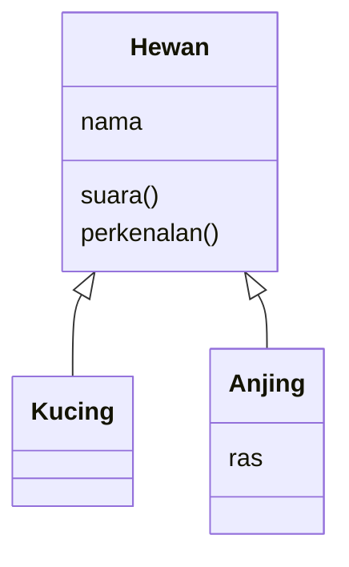

## Tujuan pembelajaran

Setelah mempelajari bab ini, kamu dapat:

- Menjelaskan perbedaan *class* dan *object* (instance), dan kapan class berguna.
- Membuat class dengan `constructor`, method, dan field.
- Membuat objek dengan `new` dan memahami `this` di dalam class.
- Melindungi data dengan *private field* (`#`), *getter*, dan *setter*.
- Memakai member `static`.
- Membuat turunan class dengan `extends` dan `super`, serta *method overriding*.
- Membuat jenis error sendiri dengan `extends Error`.
- Memahami mengapa `this` bisa hilang dan cara mengatasinya.

Bab ini memakai fungsi, objek, error, dan modul. Seperti bab 11 dan 12, contohnya ada di folder `modul-belajar` yang bertipe `module`.

## Pendahuluan: cetakan dan hasil cetak

Di bab 9 kita membuat objek satu per satu, misalnya `rekening` milik Budi. Bagaimana jika kita butuh seratus rekening, masing-masing dengan data sendiri tetapi aturan yang sama (`setor`, `tarik`)? Menyalin objek dan method-nya seratus kali jelas melelahkan dan rawan salah.

Analoginya **cetakan kue**. Cetakan menentukan bentuk dan cara kerjanya, dan dari satu cetakan kamu bisa membuat banyak kue, masing-masing dengan isi dan hiasan sendiri.

- **Class** adalah cetakannya: rancangan yang menjelaskan data apa yang dimiliki dan apa yang bisa dilakukan.
- **Instance** (objek) adalah kue hasil cetakan: wujud nyata dengan datanya sendiri.

Gaya memrogram yang menyusun program dari objek-objek semacam ini disebut **Object-Oriented Programming (OOP)**.

## Membuat class

Buat file `class-dasar.js`:

```javascript title="class-dasar.js"
class Siswa {
  constructor(nama, nilai) {
    this.nama = nama;
    this.nilai = nilai;
  }

  perkenalan() {
    return `Saya ${this.nama}, nilai saya ${this.nilai}`;
  }

  naikNilai(poin) {
    this.nilai += poin;
  }
}

const budi = new Siswa("Budi", 80);
const sari = new Siswa("Sari", 92);

console.log(budi.perkenalan());
budi.naikNilai(5);
console.log(budi.perkenalan());
console.log(sari.perkenalan());
console.log(budi);
console.log(typeof Siswa, budi instanceof Siswa);
```

```bash
node class-dasar.js
```

Output:

```text
Saya Budi, nilai saya 80
Saya Budi, nilai saya 85
Saya Sari, nilai saya 92
Siswa { nama: 'Budi', nilai: 85 }
function true
```

Penjelasan bagian-bagiannya:

| Kode | Artinya |
|---|---|
| `class Siswa { ... }` | Mendefinisikan cetakan bernama `Siswa`. Nama class diawali huruf besar (konvensi) |
| `constructor(nama, nilai)` | Method khusus yang dijalankan **otomatis** setiap kali objek baru dibuat. Tugasnya menyiapkan data awal |
| `this.nama = nama` | Menyimpan argumen sebagai **properti** objek yang sedang dibuat |
| `perkenalan()`, `naikNilai()` | **Method**: fungsi milik objek. Ditulis tanpa kata `function`, dan tanpa koma di antaranya |
| `new Siswa("Budi", 80)` | Membuat instance baru. `new` memanggil `constructor` dan mengembalikan objeknya |
| `budi instanceof Siswa` | Memeriksa apakah sebuah objek dibuat dari class tertentu |

Di dalam class, `this` berarti **objek yang sedang dipakai**. Ketika `budi.naikNilai(5)` dipanggil, `this` adalah `budi`, sehingga yang bertambah hanya nilai Budi. `sari` tidak terpengaruh, karena setiap instance membawa datanya sendiri.

!!! note "`typeof Siswa` adalah `function`"
    Di balik layar, class adalah fungsi khusus. Detail mekanismenya (disebut *prototype*) tidak perlu kamu pelajari sekarang. Sintaks `class` sudah cukup untuk hampir semua kebutuhan.

## Field dan state

Selain di `constructor`, properti bisa dideklarasikan langsung di badan class sebagai **field** dengan nilai awal. Simpan sebagai `field.js`:

```javascript title="field.js"
class Rekening {
  saldo = 0;
  riwayat = [];

  constructor(pemilik) {
    this.pemilik = pemilik;
  }

  setor(jumlah) {
    this.saldo += jumlah;
    this.riwayat.push(`setor ${jumlah}`);
  }

  tarik(jumlah) {
    if (jumlah > this.saldo) {
      return false;
    }
    this.saldo -= jumlah;
    this.riwayat.push(`tarik ${jumlah}`);
    return true;
  }
}

const a = new Rekening("Budi");
a.setor(100000);
console.log(a.tarik(30000), a.tarik(500000));
console.log(a.saldo, a.riwayat);

const b = new Rekening("Sari");
console.log(b.saldo, b.riwayat);
```

```bash
node field.js
```

Output:

```text
true false
70000 [ 'setor 100000', 'tarik 30000' ]
0 []
```

`saldo = 0;` dan `riwayat = [];` dibuat **baru untuk setiap instance**. Itu sebabnya `b` memulai dari saldo 0 dan riwayat kosong, tidak tercampur dengan `a`. Bandingkan dengan objek `rekening` di bab 9: dengan class, kita bisa membuat rekening sebanyak apa pun dari satu rancangan.

## Enkapsulasi: melindungi data

Pada contoh di atas, siapa pun bisa menulis `a.saldo = 999999999` dan mengubah saldo seenaknya, melewati aturan `setor` dan `tarik`. Dalam OOP, data penting sebaiknya disembunyikan dan hanya bisa diubah lewat method yang aman. Prinsip ini disebut **enkapsulasi**, seperti ATM: kamu tidak membuka brankas, hanya memakai tombol yang disediakan.

### Private field

Field yang namanya diawali **`#`** bersifat privat: hanya bisa diakses dari dalam class itu sendiri. Simpan sebagai `enkapsulasi.js`:

```javascript title="enkapsulasi.js"
class Akun {
  #saldo = 0;

  constructor(pemilik) {
    this.pemilik = pemilik;
  }

  get saldo() {
    return this.#saldo;
  }

  setor(jumlah) {
    if (jumlah <= 0) {
      throw new RangeError("Jumlah setoran harus positif");
    }
    this.#saldo += jumlah;
  }
}

const akun = new Akun("Budi");
akun.setor(50000);
console.log(akun.saldo);

try {
  akun.setor(-10);
} catch (e) {
  console.log(`${e.name}: ${e.message}`);
}

console.log(akun.saldo);
console.log(akun);
```

```bash
node enkapsulasi.js
```

Output:

```text
50000
RangeError: Jumlah setoran harus positif
50000
Akun { pemilik: 'Budi' }
```

Penjelasan:

- `#saldo` hanya bisa dibaca dan diubah di dalam `Akun`. Percobaan mengaksesnya dari luar adalah kesalahan sintaks (lihat kesalahan umum).
- `get saldo()` adalah **getter**: method yang dipakai seperti properti (`akun.saldo`, tanpa tanda kurung). Di sini ia memberi akses **baca saja**.
- `setor` memvalidasi masukan sebelum mengubah saldo, memakai `throw` dari bab 10.
- `console.log(akun)` tidak menampilkan `#saldo`, karena memang tersembunyi.

### Getter dan setter

**Setter** (`set nama(nilai)`) memungkinkan penulisan seperti `objek.nama = nilai` sambil menjalankan kode validasi. Simpan sebagai `getter-setter.js`:

```javascript title="getter-setter.js"
class Suhu {
  #celsius = 0;

  get celsius() {
    return this.#celsius;
  }

  set celsius(nilai) {
    if (nilai < -273.15) {
      throw new RangeError("Di bawah nol mutlak");
    }
    this.#celsius = nilai;
  }

  get fahrenheit() {
    return (this.#celsius * 9) / 5 + 32;
  }
}

const s = new Suhu();
s.celsius = 100;
console.log(s.celsius, s.fahrenheit);

try {
  s.celsius = -300;
} catch (e) {
  console.log(`${e.name}: ${e.message}`);
}
```

```bash
node getter-setter.js
```

Output:

```text
100 212
RangeError: Di bawah nol mutlak
```

Bagi pemakai class, `s.celsius = 100` terlihat seperti mengisi properti biasa, padahal di baliknya ada pemeriksaan. `fahrenheit` hanya punya getter, jadi nilainya selalu dihitung dari `celsius` dan tidak bisa diisi langsung.

## Member `static`

Kata **`static`** membuat sesuatu menjadi milik **class**, bukan milik instance. Kamu sudah memakainya sejak bab 3: `Math.round`, `Number.isNaN`, dan `Object.keys` adalah method static. Simpan sebagai `static.js`:

```javascript title="static.js"
class Siswa {
  static jumlah = 0;

  constructor(nama, nilai) {
    this.nama = nama;
    this.nilai = nilai;
    Siswa.jumlah++;
  }

  static terbaik(a, b) {
    return a.nilai >= b.nilai ? a : b;
  }
}

const budi = new Siswa("Budi", 80);
const sari = new Siswa("Sari", 92);

console.log(Siswa.jumlah);
console.log(Siswa.terbaik(budi, sari).nama);
console.log(budi.jumlah);
```

```bash
node static.js
```

Output:

```text
2
Sari
undefined
```

- `Siswa.jumlah` menghitung berapa siswa yang sudah dibuat. Nilainya satu untuk seluruh class.
- `Siswa.terbaik(...)` dipanggil lewat nama class, bukan lewat instance. Cocok untuk fungsi bantu yang berkaitan dengan class tetapi tidak membutuhkan data sebuah instance.
- `budi.jumlah` adalah `undefined`, karena member static tidak diwariskan ke instance.

## Pewarisan (*inheritance*)

Sering kali beberapa jenis benda punya sifat bersama. Kucing dan anjing sama-sama hewan: keduanya punya nama dan bisa bersuara, tetapi suaranya berbeda. Daripada menulis ulang bagian yang sama, kita buat class **induk** (*parent*) dan class **turunan** (*child*) yang mewarisinya dengan kata kunci **`extends`**.



Simpan sebagai `pewarisan.js`:

```javascript title="pewarisan.js"
class Hewan {
  constructor(nama) {
    this.nama = nama;
  }

  suara() {
    return "...";
  }

  perkenalan() {
    return `${this.nama} berkata ${this.suara()}`;
  }
}

class Kucing extends Hewan {
  suara() {
    return "meong";
  }
}

class Anjing extends Hewan {
  constructor(nama, ras) {
    super(nama);
    this.ras = ras;
  }

  suara() {
    return "guk";
  }

  perkenalan() {
    return `${super.perkenalan()} (ras ${this.ras})`;
  }
}

const daftar = [new Hewan("Makhluk"), new Kucing("Mimi"), new Anjing("Rex", "Labrador")];

for (const hewan of daftar) {
  console.log(hewan.perkenalan());
}

console.log(daftar[2] instanceof Anjing, daftar[2] instanceof Hewan, daftar[1] instanceof Anjing);
```

```bash
node pewarisan.js
```

Output:

```text
Makhluk berkata ...
Mimi berkata meong
Rex berkata guk (ras Labrador)
true true false
```

Penjelasan:

| Kode | Artinya |
|---|---|
| `class Kucing extends Hewan` | `Kucing` mewarisi semua yang dimiliki `Hewan` (properti dan method) |
| `suara() { return "meong"; }` pada `Kucing` | **Override**: menimpa method milik induk dengan versi sendiri |
| `super(nama)` | Memanggil `constructor` induk. Wajib dipanggil di constructor turunan **sebelum** memakai `this` |
| `super.perkenalan()` | Memanggil method induk yang sedang ditimpa, lalu menambahinya |
| `instanceof Hewan` | `true` juga untuk turunannya, karena kucing dan anjing adalah hewan |

Perhatikan `for...of` di akhir: kita memanggil `hewan.perkenalan()` tanpa peduli jenis hewannya, dan setiap objek menjawab sesuai jenisnya. Kemampuan ini disebut **polimorfisme** ("banyak bentuk"). Method `perkenalan` di `Hewan` memanggil `this.suara()`, dan `this.suara()` selalu memilih versi milik jenis objek yang sebenarnya.

### Mengatur tampilan objek dengan `toString`

Method `toString()` menentukan bagaimana sebuah objek diubah menjadi teks, misalnya di dalam template literal. Simpan sebagai `tostring.js`:

```javascript title="tostring.js"
class Titik {
  constructor(x, y) {
    this.x = x;
    this.y = y;
  }

  toString() {
    return `(${this.x}, ${this.y})`;
  }
}

const t = new Titik(3, 4);
console.log(`Titik: ${t}`);
console.log(String(t));
```

```bash
node tostring.js
```

Output:

```text
Titik: (3, 4)
(3, 4)
```

Tanpa `toString()`, objek akan tampil sebagai `[object Object]` ketika disisipkan ke teks.

## `this` yang hilang

`this` ditentukan oleh **cara method dipanggil**, bukan tempat method ditulis. Kalau method dilepas dari objeknya, `this` ikut hilang. Simpan sebagai `this-hilang.js`:

```javascript title="this-hilang.js"
class Penghitung {
  hitung = 0;

  tambah() {
    this.hitung++;
    return this.hitung;
  }

  tambahPanah = () => {
    this.hitung++;
    return this.hitung;
  };

  tambahNanti() {
    setTimeout(() => {
      this.hitung++;
      console.log("Nanti:", this.hitung);
    }, 10);
  }
}

const p = new Penghitung();
console.log(p.tambah());

const lepas = p.tambahPanah;
console.log(lepas());

p.tambahNanti();
```

```bash
node this-hilang.js
```

Output:

```text
1
2
Nanti: 3
```

Dua cara aman menjaga `this`:

- **Arrow function sebagai field** (`tambahPanah = () => { ... }`): `this` terkunci ke instance, jadi method aman dilepas dan dipakai sebagai callback.
- **Arrow function di dalam method** (`setTimeout(() => { this... })`): arrow function tidak punya `this` sendiri dan meminjam `this` dari tempat ia ditulis, yaitu method `tambahNanti`. Itu sebabnya `this.hitung` di dalam timer tetap benar.

Method biasa yang dilepas kehilangan `this`:

```javascript title="this-hilang-salah.js"
class Penghitung {
  hitung = 0;

  tambah() {
    this.hitung++;
    return this.hitung;
  }
}

const p = new Penghitung();
const lepas = p.tambah;

console.log(lepas());
```

```bash
node this-hilang-salah.js
```

Output (dipersingkat):

```text
TypeError: Cannot read properties of undefined (reading 'hitung')
```

`lepas()` dipanggil tanpa objek di depannya, sehingga `this` bernilai `undefined`. Ini juga alasan peringatan di bab 9: pada method objek biasa, arrow function tidak cocok sebagai method karena tidak punya `this` milik objek.

## Error buatan sendiri

Di bab 10 kita memakai `Error`, `TypeError`, dan `RangeError`. Dengan `extends`, kita bisa membuat jenis error sendiri yang membawa informasi tambahan. Simpan sebagai `error-kustom.js`:

```javascript title="error-kustom.js"
class ValidasiError extends Error {
  constructor(pesan, field) {
    super(pesan);
    this.name = "ValidasiError";
    this.field = field;
  }
}

function validasiUmur(umur) {
  if (typeof umur !== "number") {
    throw new ValidasiError("Umur harus angka", "umur");
  }
  if (umur < 0) {
    throw new ValidasiError("Umur tidak boleh negatif", "umur");
  }
  return umur;
}

for (const u of [20, "dua", -5]) {
  try {
    console.log("OK:", validasiUmur(u));
  } catch (e) {
    if (e instanceof ValidasiError) {
      console.log(`${e.name} pada '${e.field}': ${e.message}`);
    } else {
      throw e;
    }
  }
}

console.log(new ValidasiError("x", "y") instanceof Error);
```

```bash
node error-kustom.js
```

Output:

```text
OK: 20
ValidasiError pada 'umur': Umur harus angka
ValidasiError pada 'umur': Umur tidak boleh negatif
true
```

- `super(pesan)` meneruskan pesan ke `Error` bawaan, sehingga `e.message` dan stack trace tetap berfungsi.
- `this.name = "ValidasiError"` mengganti nama jenis error agar tampil jelas.
- `this.field` adalah informasi tambahan khas error kita.
- `e instanceof ValidasiError` memungkinkan `catch` membedakan error ini dari error lain. Ini cara yang lebih rapi daripada memeriksa `e.name` seperti di bab 10. Error yang bukan milik kita dilempar ulang dengan `throw e`.

## Contoh praktis: keranjang belanja

Kita susun proyek kecil dari beberapa class. Satu class mewakili satu jenis benda: `Produk` dan `Keranjang`. Perhatikan bahwa `Keranjang` **berisi** produk, bukan **turunan** dari produk. Hubungan "memiliki" (*has-a*) seperti ini disebut **komposisi**, dan sering lebih tepat daripada pewarisan ("adalah", *is-a*).

Di folder `modul-belajar`, buat folder `toko` dengan tiga file. Class diekspor dengan `export class`, sama seperti bab 11.

```javascript title="toko/produk.js"
export class Produk {
  constructor(nama, harga) {
    if (harga < 0) {
      throw new RangeError("Harga tidak boleh negatif");
    }
    this.nama = nama;
    this.harga = harga;
  }
}
```

```javascript title="toko/keranjang.js"
export class Keranjang {
  #item = [];

  tambah(produk, jumlah = 1) {
    if (jumlah <= 0) {
      throw new RangeError("Jumlah harus lebih dari 0");
    }
    this.#item.push({ produk, jumlah });
    return this;
  }

  get jumlahItem() {
    return this.#item.length;
  }

  get total() {
    return this.#item.reduce((jumlah, { produk, jumlah: banyak }) => jumlah + produk.harga * banyak, 0);
  }

  ringkasan() {
    return this.#item.map(({ produk, jumlah }) => `${produk.nama} x${jumlah}`).join(", ");
  }
}
```

```javascript title="toko/app.js"
import { Produk } from "./produk.js";
import { Keranjang } from "./keranjang.js";

const keranjang = new Keranjang();

keranjang
  .tambah(new Produk("Pensil", 2000), 10)
  .tambah(new Produk("Buku", 8000), 3);

console.log(keranjang.ringkasan());
console.log(keranjang.jumlahItem);
console.log(keranjang.total);

try {
  keranjang.tambah(new Produk("Pulpen", 3000), 0);
} catch (e) {
  console.log(`${e.name}: ${e.message}`);
}
```

```bash
node toko/app.js
```

Output:

```text
Pensil x10, Buku x3
2
44000
RangeError: Jumlah harus lebih dari 0
```

Penjelasan:

1. `Keranjang` menyimpan daftar item di `#item`, yang tidak bisa diubah dari luar. Data hanya berubah lewat `tambah`, yang memvalidasi jumlah.
2. `tambah` diakhiri `return this`, sehingga pemanggilannya bisa **dirantai**: `keranjang.tambah(...).tambah(...)`.
3. `total` dan `jumlahItem` adalah getter, dipakai tanpa tanda kurung.
4. Pada `reduce`, destructuring `{ produk, jumlah: banyak }` mengambil properti `jumlah` dari item dan menyimpannya sebagai `banyak`, supaya tidak bentrok dengan penampung bernama `jumlah`.
5. `Produk` menolak harga negatif di `constructor`. Karena `new Produk(...)` dievaluasi lebih dulu daripada `tambah`, error muncul sebelum produk masuk ke keranjang.

## Kesalahan umum

### 1. Lupa `new`

Buat `lupa-new.js`:

```javascript title="lupa-new.js"
class Siswa {
  constructor(nama) {
    this.nama = nama;
  }
}

const s = Siswa("Budi");
```

```bash
node lupa-new.js
```

Output (dipersingkat):

```text
TypeError: Class constructor Siswa cannot be invoked without 'new'
```

**Perbaikan:** `new Siswa("Budi")`.

### 2. Lupa `this.` di constructor

Buat `lupa-this.js`:

```javascript title="lupa-this.js"
class Siswa {
  constructor(nama) {
    nama = nama;
  }
}

console.log(new Siswa("Budi"));
```

```bash
node lupa-this.js
```

Output:

```text
Siswa {}
```

`nama = nama` hanya mengisi parameter dengan dirinya sendiri, tidak ada yang disimpan ke objek. **Perbaikan:** `this.nama = nama`.

### 3. Memakai `this` sebelum `super()`

Buat `lupa-super.js`:

```javascript title="lupa-super.js"
class Induk {
  constructor(n) {
    this.n = n;
  }
}

class Anak extends Induk {
  constructor(n) {
    this.x = 1;
    super(n);
  }
}

new Anak("a");
```

```bash
node lupa-super.js
```

Output (dipersingkat):

```text
ReferenceError: Must call super constructor in derived class before accessing 'this' or returning from derived constructor
```

**Perbaikan:** panggil `super(...)` sebagai langkah pertama di constructor turunan.

### 4. Mengakses private field dari luar

Buat `private-luar.js`:

```javascript title="private-luar.js"
class Akun {
  #saldo = 1;
}

const a = new Akun();
console.log(a.#saldo);
```

```bash
node private-luar.js
```

Output (dipersingkat):

```text
SyntaxError: Private field '#saldo' must be declared in an enclosing class
```

**Perbaikan:** sediakan getter di dalam class, misalnya `get saldo() { return this.#saldo; }`.

### 5. Mengisi properti yang hanya punya getter

Buat `getter-saja.js`:

```javascript title="getter-saja.js"
class Kotak {
  get luas() {
    return 4;
  }
}

const k = new Kotak();
k.luas = 10;
```

```bash
node getter-saja.js
```

Output (dipersingkat):

```text
TypeError: Cannot set property luas of #<Kotak> which has only a getter
```

**Perbaikan:** tambahkan `set luas(nilai) { ... }`, atau jangan mengisinya.

### 6. Menukar method static dan method instance

Buat `static-instance.js`:

```javascript title="static-instance.js"
class Siswa {
  perkenalan() {
    return "hai";
  }
}

console.log(Siswa.perkenalan());
```

```bash
node static-instance.js
```

Output (dipersingkat):

```text
TypeError: Siswa.perkenalan is not a function
```

Method biasa dipanggil lewat **instance** (`new Siswa().perkenalan()`), sedangkan method `static` lewat **class** (`Siswa.nama()`).

### 7. Memberi koma di antara method

Berbeda dari objek biasa, badan `class` tidak memakai koma di antara method. Menulisnya menghasilkan `SyntaxError`.

### 8. Pewarisan yang berlebihan

Pewarisan yang bertingkat-tingkat membuat kode sulit dipahami. Gunakan `extends` hanya jika hubungannya benar-benar "A adalah sejenis B". Jika hubungannya "A memiliki B", simpan B sebagai properti A (komposisi), seperti `Keranjang` yang memiliki produk.

## Ringkasan

- **Class** adalah cetakan, **instance** adalah objek hasil cetak yang dibuat dengan `new`.
- `constructor` menyiapkan data awal, dan `this` merujuk ke objek yang sedang dipakai.
- Field (`saldo = 0;`) dibuat baru untuk setiap instance.
- Data dilindungi dengan private field `#nama`, dan diakses lewat **getter** (`get`) serta **setter** (`set`) yang bisa memvalidasi.
- `static` membuat member milik class, bukan instance.
- `extends` membuat class turunan. `super(...)` memanggil constructor induk dan harus lebih dulu, dan `super.metode()` memanggil method induk. Method turunan bisa menimpa (override) method induk.
- Satu method bisa berperilaku berbeda tergantung jenis objek (polimorfisme).
- `extends Error` membuat error sendiri yang bisa dibedakan dengan `instanceof`.
- `this` ditentukan saat pemanggilan. Method yang dilepas kehilangan `this`. Arrow function (sebagai field atau di dalam method) mengunci atau meminjamnya.
- Gunakan komposisi ("memiliki") sebelum pewarisan ("adalah").

## Latihan

Kerjakan sendiri dulu sebelum melihat jawaban.

### Latihan 1: Prediksi output

Apa yang tampil?

```javascript
class Tamu {
  static hitung = 0;

  constructor() {
    Tamu.hitung++;
  }
}

new Tamu();
new Tamu();
new Tamu();

console.log(Tamu.hitung);
```

??? success "Jawaban"
    Output: `3`. Setiap `new Tamu()` menjalankan constructor yang menaikkan penghitung milik class.

### Latihan 2: Perbaiki pembuatan objek

Kode ini menghasilkan `TypeError`. Perbaiki:

```javascript
class Buku {
  constructor(judul) {
    this.judul = judul;
  }
}

const b = Buku("Laskar Pelangi");
console.log(b.judul);
```

??? success "Jawaban"
    ```javascript
    class Buku {
      constructor(judul) {
        this.judul = judul;
      }
    }

    const b = new Buku("Laskar Pelangi");
    console.log(b.judul);
    ```
    Output: `Laskar Pelangi`. Class harus dipanggil dengan `new`.

### Latihan 3: Class Persegi

Buat class `Persegi` dengan properti `sisi`, method `luas()`, dan method `keliling()`. Buat persegi bersisi 5, lalu tampilkan luas dan kelilingnya.

??? success "Contoh jawaban"
    ```javascript
    class Persegi {
      constructor(sisi) {
        this.sisi = sisi;
      }

      luas() {
        return this.sisi * this.sisi;
      }

      keliling() {
        return 4 * this.sisi;
      }
    }

    const p = new Persegi(5);
    console.log(p.luas());
    console.log(p.keliling());
    ```
    Output: `25` lalu `20`.

### Latihan 4: Nilai yang tervalidasi

Buat class `Nilai` dengan private field `#angka`. Setter `angka` harus melempar `RangeError` jika nilainya di luar 0 sampai 100. Getter `huruf` mengembalikan `"A"` untuk 90 ke atas, `"B"` untuk 80 ke atas, dan `"C"` selain itu. Uji dengan 85 dan 150.

??? success "Contoh jawaban"
    ```javascript
    class Nilai {
      #angka = 0;

      get angka() {
        return this.#angka;
      }

      set angka(nilai) {
        if (nilai < 0 || nilai > 100) {
          throw new RangeError("Nilai harus 0 sampai 100");
        }
        this.#angka = nilai;
      }

      get huruf() {
        if (this.#angka >= 90) {
          return "A";
        }
        if (this.#angka >= 80) {
          return "B";
        }
        return "C";
      }
    }

    const n = new Nilai();
    n.angka = 85;
    console.log(n.angka, n.huruf);

    try {
      n.angka = 150;
    } catch (e) {
      console.log(`${e.name}: ${e.message}`);
    }
    ```
    Output:
    ```text
    85 B
    RangeError: Nilai harus 0 sampai 100
    ```

### Latihan 5: Pewarisan kendaraan

Buat class `Kendaraan` dengan properti `nama` dan method `info()` yang mengembalikan `<nama> adalah kendaraan`. Buat `Mobil extends Kendaraan` dengan properti tambahan `pintu`, dan override `info()` agar memakai `super.info()` lalu menambah ` dengan <pintu> pintu`. Tampilkan `info()` dari `new Mobil("Avanza", 4)`.

??? success "Contoh jawaban"
    ```javascript
    class Kendaraan {
      constructor(nama) {
        this.nama = nama;
      }

      info() {
        return `${this.nama} adalah kendaraan`;
      }
    }

    class Mobil extends Kendaraan {
      constructor(nama, pintu) {
        super(nama);
        this.pintu = pintu;
      }

      info() {
        return `${super.info()} dengan ${this.pintu} pintu`;
      }
    }

    console.log(new Mobil("Avanza", 4).info());
    ```
    Output: `Avanza adalah kendaraan dengan 4 pintu`

### Latihan 6: Antrian

Buat class `Antrian` dengan private field `#data` (array), method `masuk(nama)` yang menambah ke belakang, method `layani()` yang mengeluarkan orang paling depan, dan getter `panjang`. Masukkan "Budi", "Sari", "Andi", layani satu orang, lalu tampilkan siapa yang dilayani dan panjang antrian sekarang.

??? success "Contoh jawaban"
    ```javascript
    class Antrian {
      #data = [];

      masuk(nama) {
        this.#data.push(nama);
      }

      layani() {
        return this.#data.shift();
      }

      get panjang() {
        return this.#data.length;
      }
    }

    const a = new Antrian();
    a.masuk("Budi");
    a.masuk("Sari");
    a.masuk("Andi");

    console.log(a.layani());
    console.log(a.panjang);
    ```
    Output: `Budi` lalu `2`.

### Latihan 7: Error saldo

Buat `SaldoTidakCukupError extends Error` dengan properti tambahan `kekurangan`. Buat class `Dompet` dengan saldo awal 50000 dan method `bayar(jumlah)` yang melempar error itu jika saldo kurang. Coba bayar 80000 dan tangkap errornya dengan `instanceof`, lalu tampilkan pesan dan kekurangannya.

??? success "Contoh jawaban"
    ```javascript
    class SaldoTidakCukupError extends Error {
      constructor(kekurangan) {
        super("Saldo tidak cukup");
        this.name = "SaldoTidakCukupError";
        this.kekurangan = kekurangan;
      }
    }

    class Dompet {
      saldo = 50000;

      bayar(jumlah) {
        if (jumlah > this.saldo) {
          throw new SaldoTidakCukupError(jumlah - this.saldo);
        }
        this.saldo -= jumlah;
      }
    }

    const d = new Dompet();

    try {
      d.bayar(80000);
    } catch (e) {
      if (e instanceof SaldoTidakCukupError) {
        console.log(`${e.message}, kurang ${e.kekurangan}`);
      } else {
        throw e;
      }
    }
    ```
    Output: `Saldo tidak cukup, kurang 30000`
