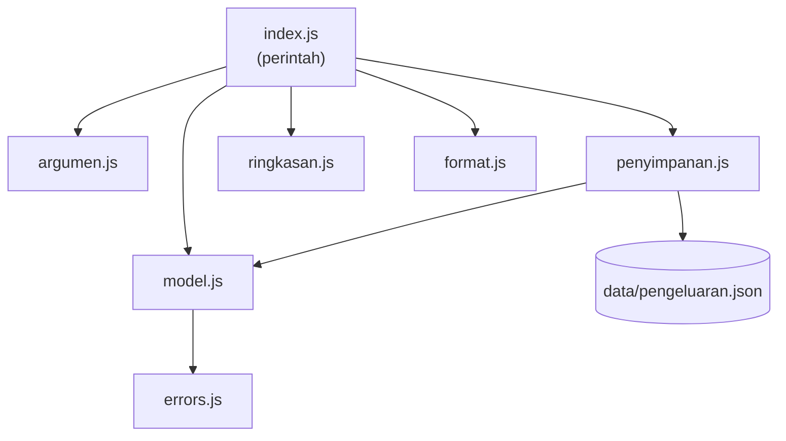

## Tujuan pembelajaran

Setelah mengerjakan bab ini, kamu dapat:

- Merancang program kecil: menentukan fitur, perintah, dan pembagian file.
- Menggabungkan modul, class, fungsi, array, objek, `async/await`, dan error handling dalam satu proyek.
- Membaca argumen dari terminal dengan `process.argv`.
- Menyimpan dan memuat data dari berkas JSON.
- Mengatur kode keluar program (*exit code*) dan pesan error yang ramah.
- Menguji fungsi dengan `node:assert`.
- Memperluas program yang sudah jalan dengan fitur baru.

Ini bab penutup bagian JavaScript. Tidak ada konsep besar yang baru: tugasmu adalah **menyusun** semua yang sudah dipelajari menjadi program yang berguna. Ikuti langkahnya dengan membuat file satu per satu, dan jalankan setiap bagian untuk melihat hasilnya.

## Pendahuluan: dari latihan ke program nyata

Sampai sekarang setiap bab mengajarkan satu alat. Program nyata memakai banyak alat sekaligus, dan tantangan terbesarnya bukan sintaks, melainkan **bagaimana membagi kode agar tetap rapi**. Kita akan membangun **Pencatat Pengeluaran**: program terminal untuk mencatat uang yang keluar, melihat daftarnya, dan menghitung ringkasan per kategori.

Contoh pemakaiannya:

```text
node index.js tambah 15000 makan Nasi goreng --tanggal=2025-03-01
node index.js daftar --kategori=makan
node index.js ringkasan
```

Berikut konsep yang akan terpakai dan di bab mana kamu mempelajarinya:

| Bagian proyek | Konsep | Bab |
|---|---|---|
| Menyimpan data catatan | Objek, array, JSON | 8, 9 |
| Menghitung total dan persentase | `reduce`, `map`, operator | 2, 8 |
| Mengurai argumen perintah | String, perulangan, objek | 3, 5, 9 |
| Memilih perintah | `switch`, `if` | 4 |
| Satu tugas, satu fungsi | Fungsi | 6 |
| Memecah ke banyak file | Modul `import` dan `export` | 11 |
| Membaca dan menulis berkas | `async`, `await`, `node:fs/promises` | 12 |
| Model data dan penyimpanan | Class, private field | 13 |
| Validasi dan pesan salah | `throw`, `try...catch`, error kustom | 10, 13 |

## Rancangan

### Fitur

| Perintah | Fungsi |
|---|---|
| `tambah <jumlah> <kategori> <deskripsi> [--tanggal=YYYY-MM-DD]` | Mencatat pengeluaran baru |
| `daftar [--kategori=<nama>]` | Menampilkan semua catatan (bisa disaring per kategori) |
| `ringkasan` | Total pengeluaran dan rinciannya per kategori |
| `hapus <id>` | Menghapus satu catatan |
| `bantuan` | Menampilkan cara pakai |

Selain itu, ada opsi umum `--berkas=<alamat>` untuk memilih lokasi berkas data. Jika tidak diberikan, datanya disimpan di `data/pengeluaran.json`.

### Pembagian file

Prinsipnya sama seperti proyek struk di bab 11: **satu file, satu tugas**.

```text
pengeluaran/
  package.json
  index.js              pintu masuk: membaca perintah dan menjalankannya
  uji.js                pengujian otomatis
  src/
    errors.js           jenis error milik aplikasi
    model.js            class Pengeluaran (satu catatan + validasinya)
    argumen.js          mengurai argumen dari terminal
    ringkasan.js        fungsi hitung (total, per kategori, saring)
    format.js           tampilan angka dan baris teks
    penyimpanan.js      class Penyimpanan (baca dan tulis berkas JSON)
  data/                 dibuat otomatis saat pertama kali menyimpan
```



Perhatikan arah panah: `index.js` mengatur semuanya, sedangkan file di `src/` tidak saling bergantung kecuali yang memang perlu. Fungsi hitung di `ringkasan.js` tidak tahu apa-apa soal berkas atau terminal, sehingga mudah diuji.

## Langkah 1: siapkan proyek

Di dalam folder `modul-belajar`, buat folder baru `pengeluaran`, lalu isi `package.json`:

```json title="pengeluaran/package.json"
{ "type": "module" }
```

Mulai dari sini, semua perintah `node` dijalankan **dari dalam folder `pengeluaran`**. Itu penting, karena alamat berkas data (`data/pengeluaran.json`) dihitung dari folder tempat perintah dijalankan.

## Langkah 2: jenis error aplikasi

Kita beda-bedakan error yang disebabkan **pengguna** (masukan salah, wajar) dari error yang disebabkan **bug** (tidak terduga). Yang pertama akan ditampilkan sebagai pesan singkat, yang kedua dibiarkan menampilkan detail lengkap agar mudah dilacak. Class `extends Error` dari bab 13 cocok untuk ini.

```javascript title="pengeluaran/src/errors.js"
export class AplikasiError extends Error {
  constructor(pesan) {
    super(pesan);
    this.name = "AplikasiError";
  }
}
```

## Langkah 3: model data

Satu catatan pengeluaran diwakili oleh sebuah class. Validasi ditaruh di `constructor` supaya **tidak mungkin ada catatan yang tidak valid** di dalam program.

```javascript title="pengeluaran/src/model.js"
import { AplikasiError } from "./errors.js";

export class Pengeluaran {
  constructor({ id, jumlah, kategori, deskripsi, tanggal }) {
    if (!Number.isFinite(jumlah) || jumlah <= 0) {
      throw new AplikasiError("Jumlah harus berupa angka lebih dari 0");
    }
    if (!kategori) {
      throw new AplikasiError("Kategori wajib diisi");
    }
    if (!deskripsi) {
      throw new AplikasiError("Deskripsi wajib diisi");
    }
    if (tanggal.length !== 10 || tanggal[4] !== "-" || tanggal[7] !== "-") {
      throw new AplikasiError("Tanggal harus berformat YYYY-MM-DD");
    }

    this.id = id;
    this.jumlah = jumlah;
    this.kategori = kategori.toLowerCase();
    this.deskripsi = deskripsi;
    this.tanggal = tanggal;
  }
}
```

Penjelasan:

- Parameter constructor memakai destructuring objek (bab 9), jadi pemanggilnya menulis `new Pengeluaran({ id: 1, jumlah: 15000, ... })` dan urutan tidak penting.
- `Number.isFinite(jumlah)` bernilai `false` untuk `NaN` maupun `Infinity`, jadi satu pemeriksaan menolak `Number("abc")` (yang menghasilkan `NaN`, bab 3).
- `!kategori` bernilai `true` untuk `undefined` dan string kosong (falsy, bab 4).
- Kategori selalu disimpan dalam huruf kecil agar `Makan` dan `makan` dianggap sama.

## Langkah 4: membaca argumen dari terminal

Node.js menyimpan semua kata yang kamu ketik setelah `node` di array **`process.argv`**. Dua elemen pertama adalah alamat Node.js dan alamat skrip, jadi data milik kita dimulai dari elemen ketiga. Buat `argv-demo.js` untuk melihatnya:

```javascript title="pengeluaran/argv-demo.js"
console.log(process.argv.slice(2));
```

```bash
node argv-demo.js halo 42 --x=1
```

Output:

```text
[ 'halo', '42', '--x=1' ]
```

Semua argumen berupa **string**, termasuk `42`. Kita harus mengubahnya dengan `Number(...)` sendiri (ingat bab 3). Sekarang tulis fungsi yang memisahkan perintah, argumen biasa, dan opsi berbentuk `--nama=nilai`:

```javascript title="pengeluaran/src/argumen.js"
export function parseArgumen(argv) {
  const perintah = argv[0];
  const posisi = [];
  const opsi = {};

  for (const arg of argv.slice(1)) {
    if (arg.startsWith("--") && arg.includes("=")) {
      const batas = arg.indexOf("=");
      opsi[arg.slice(2, batas)] = arg.slice(batas + 1);
    } else {
      posisi.push(arg);
    }
  }

  return { perintah, posisi, opsi };
}
```

Contoh: `["tambah", "15000", "makan", "Nasi", "goreng", "--tanggal=2025-03-01"]` menjadi:

- `perintah`: `"tambah"`
- `posisi`: `["15000", "makan", "Nasi", "goreng"]`
- `opsi`: `{ tanggal: "2025-03-01" }`

Pada opsi, `arg.slice(2, batas)` mengambil nama (membuang `--`), dan `arg.slice(batas + 1)` mengambil nilai setelah tanda `=`. Fungsi ini murni: tidak menyentuh terminal atau berkas, jadi mudah diuji.

## Langkah 5: menghitung dan menampilkan

Fungsi hitung ditaruh terpisah dari tampilan:

```javascript title="pengeluaran/src/ringkasan.js"
export const total = (daftar) => daftar.reduce((jumlah, p) => jumlah + p.jumlah, 0);

export function saring(daftar, kategori) {
  if (!kategori) {
    return daftar;
  }
  return daftar.filter((p) => p.kategori === kategori.toLowerCase());
}

export function perKategori(daftar) {
  const jumlahTotal = total(daftar);
  const peta = {};

  for (const p of daftar) {
    if (!(p.kategori in peta)) {
      peta[p.kategori] = 0;
    }
    peta[p.kategori] += p.jumlah;
  }

  return Object.entries(peta)
    .map(([kategori, subtotal]) => ({
      kategori,
      subtotal,
      persen: Math.round((subtotal / jumlahTotal) * 100),
    }))
    .sort((a, b) => b.subtotal - a.subtotal);
}
```

Cara kerja `perKategori`:

1. `peta` berfungsi seperti tabel kategori ke subtotal, misalnya `{ makan: 40000, belanja: 120000 }`.
2. Untuk setiap catatan, jika kategorinya belum ada di `peta` (`in`, bab 9), mulai dari 0, lalu tambahkan jumlahnya.
3. `Object.entries` mengubah `peta` menjadi array pasangan, `map` mengubah tiap pasangan menjadi objek dengan persentase, dan `sort` mengurutkan dari subtotal terbesar.

Berikutnya bagian tampilan:

```javascript title="pengeluaran/src/format.js"
export const rupiah = (angka) => `Rp ${angka.toLocaleString("id-ID")}`;

export const baris = (p) =>
  `#${p.id} ${p.tanggal} ${p.kategori} ${rupiah(p.jumlah)} - ${p.deskripsi}`;
```

## Langkah 6: penyimpanan ke berkas

Data harus bertahan setelah program berhenti, jadi kita simpan sebagai JSON (bab 9) di sebuah berkas. Class `Penyimpanan` membungkus detailnya, sehingga bagian lain program cukup memanggil `muat()` dan `simpan()`.

```javascript title="pengeluaran/src/penyimpanan.js"
import { readFile, writeFile, mkdir } from "node:fs/promises";
import { dirname } from "node:path";
import { AplikasiError } from "./errors.js";
import { Pengeluaran } from "./model.js";

export class Penyimpanan {
  #berkas;

  constructor(berkas) {
    this.#berkas = berkas;
  }

  async muat() {
    try {
      const teks = await readFile(this.#berkas, "utf8");
      return JSON.parse(teks).map((data) => new Pengeluaran(data));
    } catch (error) {
      if (error.code === "ENOENT") {
        return [];
      }
      if (error instanceof SyntaxError) {
        throw new AplikasiError("Berkas data rusak");
      }
      throw error;
    }
  }

  async simpan(daftar) {
    await mkdir(dirname(this.#berkas), { recursive: true });
    await writeFile(this.#berkas, JSON.stringify(daftar, null, 2));
  }
}
```

Penjelasan:

- Kedua method adalah `async`, karena membaca dan menulis berkas termasuk pekerjaan asinkron (bab 12). Pemanggilnya harus memakai `await`.
- Saat berkas belum ada (pemakaian pertama), Node.js melempar error dengan properti `code` bernilai `"ENOENT"` (*Error NO ENTry*: berkas atau folder tidak ditemukan). Itu bukan masalah, jadi kita kembalikan daftar kosong.
- Jika isi berkas bukan JSON yang valid, `JSON.parse` melempar `SyntaxError` (bab 10). Kita ubah menjadi `AplikasiError` yang pesannya mudah dipahami.
- Error lain yang tidak kita duga dilempar ulang dengan `throw error` agar tidak tersembunyi.
- `mkdir(..., { recursive: true })` membuat folder `data` bila belum ada, dan tidak error bila sudah ada. `dirname` dari `node:path` mengambil nama foldernya.
- `JSON.stringify(daftar, null, 2)` menulis JSON yang rapi (bab 9). Karena `daftar` berisi objek `Pengeluaran`, yang disimpan adalah properti-propertinya.

## Langkah 7: program utama

`index.js` menghubungkan semuanya. Ia hanya mengatur alur; pekerjaan sebenarnya didelegasikan ke modul lain.

```javascript title="pengeluaran/index.js"
import { AplikasiError } from "./src/errors.js";
import { Pengeluaran } from "./src/model.js";
import { Penyimpanan } from "./src/penyimpanan.js";
import { parseArgumen } from "./src/argumen.js";
import { total, saring, perKategori } from "./src/ringkasan.js";
import { rupiah, baris } from "./src/format.js";

const BERKAS_BAWAAN = "data/pengeluaran.json";

const BANTUAN = `Pencatat Pengeluaran

Penggunaan:
  node index.js tambah <jumlah> <kategori> <deskripsi> [--tanggal=YYYY-MM-DD]
  node index.js daftar [--kategori=<nama>]
  node index.js ringkasan
  node index.js hapus <id>
  node index.js bantuan

Opsi umum:
  --berkas=<alamat>   lokasi berkas data (bawaan: ${BERKAS_BAWAAN})`;

async function jalankan(argv) {
  const { perintah, posisi, opsi } = parseArgumen(argv);
  const penyimpanan = new Penyimpanan(opsi.berkas ? opsi.berkas : BERKAS_BAWAAN);

  switch (perintah) {
    case "tambah": {
      const daftar = await penyimpanan.muat();
      const id = daftar.reduce((maks, p) => (p.id > maks ? p.id : maks), 0) + 1;
      const baru = new Pengeluaran({
        id,
        jumlah: Number(posisi[0]),
        kategori: posisi[1],
        deskripsi: posisi.slice(2).join(" "),
        tanggal: opsi.tanggal ? opsi.tanggal : new Date().toLocaleDateString("sv-SE"),
      });
      daftar.push(baru);
      await penyimpanan.simpan(daftar);
      console.log(`Tercatat: ${baris(baru)}`);
      break;
    }

    case "daftar": {
      const daftar = saring(await penyimpanan.muat(), opsi.kategori);
      if (daftar.length === 0) {
        console.log("Belum ada pengeluaran.");
        break;
      }
      daftar.forEach((p) => console.log(baris(p)));
      console.log(`Jumlah: ${daftar.length} catatan, ${rupiah(total(daftar))}`);
      break;
    }

    case "ringkasan": {
      const daftar = await penyimpanan.muat();
      console.log(`Total: ${rupiah(total(daftar))}`);
      for (const { kategori, subtotal, persen } of perKategori(daftar)) {
        console.log(`- ${kategori}: ${rupiah(subtotal)} (${persen}%)`);
      }
      break;
    }

    case "hapus": {
      const id = Number(posisi[0]);
      const daftar = await penyimpanan.muat();
      const indeks = daftar.findIndex((p) => p.id === id);
      if (indeks === -1) {
        throw new AplikasiError(`Pengeluaran #${id} tidak ditemukan`);
      }
      const [dihapus] = daftar.splice(indeks, 1);
      await penyimpanan.simpan(daftar);
      console.log(`Dihapus: ${baris(dihapus)}`);
      break;
    }

    case "bantuan":
    case undefined:
      console.log(BANTUAN);
      break;

    default:
      throw new AplikasiError(`Perintah tidak dikenal: ${perintah}. Jalankan "node index.js bantuan".`);
  }
}

try {
  await jalankan(process.argv.slice(2));
} catch (error) {
  if (error instanceof AplikasiError) {
    console.error(`Kesalahan: ${error.message}`);
    process.exitCode = 1;
  } else {
    throw error;
  }
}
```

Hal-hal yang perlu diperhatikan:

| Bagian | Penjelasan |
|---|---|
| `switch (perintah)` | Memilih blok sesuai kata pertama dari terminal (bab 4). Kasus `bantuan` dan `undefined` (tanpa perintah) berbagi satu blok |
| `case "tambah": { ... }` | Kurung kurawal membuat blok sendiri, sehingga `const daftar` di tiap `case` tidak bentrok (scope blok, bab 7) |
| `id` baru | Id terbesar yang ada ditambah satu, dicari dengan `reduce` |
| `posisi.slice(2).join(" ")` | Semua kata setelah jumlah dan kategori digabung menjadi deskripsi, sehingga deskripsi boleh lebih dari satu kata |
| `new Date().toLocaleDateString("sv-SE")` | Jika `--tanggal` tidak diberikan, pakai tanggal hari ini menurut jam di komputermu. `new Date()` membuat objek waktu saat ini, dan `toLocaleDateString("sv-SE")` menuliskannya sebagai `2025-03-01` (locale Swedia kebetulan memakai format `YYYY-MM-DD`) dengan zona waktu **lokal**. Cara lain yang sering terlihat, `toISOString().slice(0, 10)`, memakai UTC dan bisa menghasilkan tanggal kemarin bagi pengguna di Indonesia pada dini hari |
| `const [dihapus] = daftar.splice(indeks, 1)` | `splice` mengembalikan array elemen yang dihapus. Destructuring array mengambil elemen pertamanya |
| `try { await jalankan(...) }` | Satu tempat untuk menangani semua error. Karena `jalankan` async, `await` wajib agar `catch` bisa menangkapnya (kesalahan umum bab 12) |
| `console.error` dan `process.exitCode = 1` | Pesan masalah dikirim ke jalur error (stderr), dan kode keluar 1 memberi tahu program lain bahwa perintah gagal. Kode 0 berarti sukses |

## Menjalankan program

Semua perintah berikut dijalankan dari folder `pengeluaran`, berurutan, dan setiap perintah memakai data hasil perintah sebelumnya. Mulai dengan bantuan:

```bash
node index.js bantuan
```

Output:

```text
Pencatat Pengeluaran

Penggunaan:
  node index.js tambah <jumlah> <kategori> <deskripsi> [--tanggal=YYYY-MM-DD]
  node index.js daftar [--kategori=<nama>]
  node index.js ringkasan
  node index.js hapus <id>
  node index.js bantuan

Opsi umum:
  --berkas=<alamat>   lokasi berkas data (bawaan: data/pengeluaran.json)
```

Catat empat pengeluaran:

```bash
node index.js tambah 15000 makan Nasi goreng --tanggal=2025-03-01
```

Output:

```text
Tercatat: #1 2025-03-01 makan Rp 15.000 - Nasi goreng
```

```bash
node index.js tambah 8000 transport Ojek ke kampus --tanggal=2025-03-01
```

Output:

```text
Tercatat: #2 2025-03-01 transport Rp 8.000 - Ojek ke kampus
```

```bash
node index.js tambah 25000 makan Makan siang bersama --tanggal=2025-03-02
```

Output:

```text
Tercatat: #3 2025-03-02 makan Rp 25.000 - Makan siang bersama
```

```bash
node index.js tambah 120000 belanja Buku pemrograman --tanggal=2025-03-03
```

Output:

```text
Tercatat: #4 2025-03-03 belanja Rp 120.000 - Buku pemrograman
```

Setelah ini, folder `data` beserta `pengeluaran.json` muncul otomatis. Lihat semua catatan dan saring per kategori:

```bash
node index.js daftar
```

Output:

```text
#1 2025-03-01 makan Rp 15.000 - Nasi goreng
#2 2025-03-01 transport Rp 8.000 - Ojek ke kampus
#3 2025-03-02 makan Rp 25.000 - Makan siang bersama
#4 2025-03-03 belanja Rp 120.000 - Buku pemrograman
Jumlah: 4 catatan, Rp 168.000
```

```bash
node index.js daftar --kategori=makan
```

Output:

```text
#1 2025-03-01 makan Rp 15.000 - Nasi goreng
#3 2025-03-02 makan Rp 25.000 - Makan siang bersama
Jumlah: 2 catatan, Rp 40.000
```

Ringkasan per kategori:

```bash
node index.js ringkasan
```

Output:

```text
Total: Rp 168.000
- belanja: Rp 120.000 (71%)
- makan: Rp 40.000 (24%)
- transport: Rp 8.000 (5%)
```

Hapus satu catatan:

```bash
node index.js hapus 2
```

Output:

```text
Dihapus: #2 2025-03-01 transport Rp 8.000 - Ojek ke kampus
```

Isi berkas `data/pengeluaran.json` sekarang kira-kira berbentuk berikut (hanya catatan pertama yang ditampilkan):

```json
[
  {
    "id": 1,
    "jumlah": 15000,
    "kategori": "makan",
    "deskripsi": "Nasi goreng",
    "tanggal": "2025-03-01"
  },
  ...
]
```

### Menguji perilaku saat salah

Program yang baik tidak hanya berjalan saat semua benar. Coba beberapa masukan yang salah:

```bash
node index.js hapus 99
```

Output:

```text
Kesalahan: Pengeluaran #99 tidak ditemukan
```

```bash
node index.js tambah abc makan Salah
```

Output:

```text
Kesalahan: Jumlah harus berupa angka lebih dari 0
```

```bash
node index.js tambah 5000 makan Es teh --tanggal=2025/03/01
```

Output:

```text
Kesalahan: Tanggal harus berformat YYYY-MM-DD
```

```bash
node index.js foo
```

Output:

```text
Kesalahan: Perintah tidak dikenal: foo. Jalankan "node index.js bantuan".
```

Terakhir, buat berkas rusak untuk menguji penanganan JSON yang tidak valid:

```json title="pengeluaran/rusak.json"
{"id":
```

```bash
node index.js daftar --berkas=rusak.json
```

Output:

```text
Kesalahan: Berkas data rusak
```

Dalam semua kasus, pengguna melihat satu baris pesan yang jelas, bukan tumpukan stack trace. Itulah gunanya memisahkan `AplikasiError` dari error biasa.

## Menguji dengan `node:assert`

Menjalankan perintah satu per satu dan memeriksa dengan mata tidak bisa diandalkan saat kode bertambah. Lebih baik menulis **pengujian otomatis**: kode kecil yang memeriksa bahwa fungsi menghasilkan nilai yang diharapkan. Node.js menyediakan modul `node:assert/strict`, yang melempar error jika harapan tidak terpenuhi.

```javascript title="pengeluaran/uji.js"
import assert from "node:assert/strict";
import { AplikasiError } from "./src/errors.js";
import { Pengeluaran } from "./src/model.js";
import { parseArgumen } from "./src/argumen.js";
import { total, saring, perKategori } from "./src/ringkasan.js";

const buat = (id, jumlah, kategori) =>
  new Pengeluaran({ id, jumlah, kategori, deskripsi: "uji", tanggal: "2025-01-01" });

const contoh = [buat(1, 10000, "makan"), buat(2, 5000, "makan"), buat(3, 20000, "belanja")];

assert.equal(total(contoh), 35000);
assert.deepEqual(perKategori(contoh).map((k) => k.kategori), ["belanja", "makan"]);
assert.equal(saring(contoh, "MAKAN").length, 2);
assert.deepEqual(parseArgumen(["tambah", "100", "--tanggal=2025-01-01"]), {
  perintah: "tambah",
  posisi: ["100"],
  opsi: { tanggal: "2025-01-01" },
});
assert.throws(() => buat(4, -5, "x"), AplikasiError);

console.log("Semua pengujian lulus");
```

```bash
node uji.js
```

Output:

```text
Semua pengujian lulus
```

| Perintah | Memeriksa |
|---|---|
| `assert.equal(a, b)` | `a` sama dengan `b` (ketat, seperti `===`) |
| `assert.deepEqual(a, b)` | Isi array atau objek sama, walaupun bukan objek yang sama |
| `assert.throws(fungsi, Kelas)` | Memanggil `fungsi` melempar error dari `Kelas` |

Jika ada harapan yang tidak terpenuhi, `assert` melempar error dan menunjukkan nilai yang tidak cocok. Coba ubah satu pengujian menjadi `assert.equal(total(contoh), 1)`:

```javascript title="pengeluaran/uji-gagal.js"
import assert from "node:assert/strict";
import { Pengeluaran } from "./src/model.js";
import { total } from "./src/ringkasan.js";

const contoh = [
  new Pengeluaran({ id: 1, jumlah: 10000, kategori: "makan", deskripsi: "uji", tanggal: "2025-01-01" }),
];

assert.equal(total(contoh), 1);
```

```bash
node uji-gagal.js
```

Output (dipersingkat):

```text
AssertionError [ERR_ASSERTION]: Expected values to be strictly equal:
```

Pengujian ini juga membuktikan manfaat memisahkan fungsi murni: `total`, `saring`, `perKategori`, dan `parseArgumen` bisa diuji tanpa menyentuh terminal atau berkas. Node.js juga punya modul `node:test` yang lebih lengkap (pengelompokan, laporan, dan menjalankan semua berkas `*.test.js` sekaligus dengan `node --test`) untuk dipelajari berikutnya.

## Kesalahan umum pada proyek ini

### 1. Menjalankan dari folder yang salah

Alamat `data/pengeluaran.json` dihitung dari folder tempat `node` dijalankan, bukan dari lokasi `index.js`. Jika kamu menjalankannya dari folder lain, data akan tersimpan di tempat yang tidak kamu duga. Selalu jalankan dari dalam `pengeluaran`, atau gunakan `--berkas=` dengan alamat yang jelas.

### 2. Lupa `await`

Jika `await penyimpanan.simpan(daftar)` ditulis tanpa `await`, pesan `Tercatat` muncul sebelum data benar-benar tersimpan, dan jika penyimpanan gagal, error-nya tidak tertangkap `try...catch`. Aturannya (bab 12): setiap pemanggilan fungsi `async` perlu `await`.

### 3. Salah indeks pada `process.argv`

`process.argv[0]` dan `[1]` adalah alamat Node.js dan skrip. Membaca argumen pertama kita dari `process.argv[2]`, atau lebih mudah dengan `process.argv.slice(2)`.

### 4. Lupa mengubah string menjadi angka

Argumen terminal selalu string. `"15000" + 5` menghasilkan `"150005"`. Itulah sebabnya `Number(posisi[0])` dipakai, dan `Number.isFinite` di model menolak hasil `NaN`.

### 5. Lupa `break` pada `switch`

Tanpa `break`, eksekusi mengalir ke `case` berikutnya (bab 4). Pada program ini, perintah `tambah` yang lupa `break` akan ikut menjalankan `daftar`.

### 6. Menelan error

Menulis `catch` yang kosong akan menyembunyikan bug. Perhatikan bahwa kita hanya menangani `AplikasiError` dan melempar ulang sisanya.

### 7. Menyimpan objek yang tidak valid

Jika validasi diletakkan hanya di `index.js`, bagian lain bisa saja membuat data yang salah. Menaruh validasi di `constructor` model menjamin setiap `Pengeluaran` yang ada pasti valid, termasuk yang dimuat dari berkas.

## Pengembangan lanjutan

Program ini sengaja dibuat kecil agar mudah dipahami. Beberapa arah pengembangan setelah kamu selesai:

- Menambah perintah `ubah` untuk mengoreksi catatan.
- Menyaring berdasarkan bulan atau rentang tanggal.
- Mengekspor data ke format CSV.
- Membuat versi interaktif dengan `node:readline` yang bertanya satu per satu.
- Memindahkan pengujian ke `node:test`.
- Mempublikasikan program sebagai perintah global lewat `npm` (dibahas di bagian Node.js).

## Ringkasan

- Proyek nyata disusun dari **banyak file kecil** dengan tugas jelas: model, penyimpanan, fungsi hitung, tampilan, dan satu pintu masuk.
- `process.argv.slice(2)` memberi argumen dari terminal. Semuanya string.
- Fungsi **murni** (tanpa efek ke terminal atau berkas) lebih mudah diuji dan dipakai ulang.
- Class dengan validasi di `constructor` menjamin data selalu valid.
- Operasi berkas bersifat asinkron: gunakan `async`, `await`, dan `node:fs/promises`. Kode error `ENOENT` berarti berkas tidak ada.
- Bedakan error **pengguna** (pesan singkat, `process.exitCode = 1`) dari **bug** (biarkan tampil lengkap dengan `throw`).
- `node:assert` membuat pengujian otomatis sederhana.
- Program yang matang menangani masukan salah dengan pesan yang ramah.

## Latihan

Karena ini bab proyek, latihannya berupa pengembangan fitur. Kerjakan di folder `pengeluaran`. Latihan 1 sampai 4 punya contoh jawaban, sedangkan latihan 5 dan 6 sengaja terbuka.

### Latihan 1: Perintah `cari`

Tambahkan perintah `cari <kata>` yang menampilkan catatan yang **deskripsinya** mengandung kata itu (tanpa membedakan huruf besar atau kecil). Tebakan hasilnya untuk `node index.js cari NASI`, dengan data pada contoh di atas setelah penghapusan #2.

??? success "Contoh jawaban"
    Tambahkan fungsi di `src/ringkasan.js`:
    ```javascript
    export const cari = (daftar, kata) =>
      daftar.filter((p) => p.deskripsi.toLowerCase().includes(kata.toLowerCase()));
    ```
    Impor `cari` di `index.js`, lalu tambahkan sebelum `case "bantuan":`:
    ```javascript
    case "cari": {
      const hasil = cari(await penyimpanan.muat(), posisi[0] ? posisi[0] : "");
      if (hasil.length === 0) {
        console.log("Tidak ada yang cocok.");
        break;
      }
      hasil.forEach((p) => console.log(baris(p)));
      break;
    }
    ```
    Output untuk `node index.js cari NASI`:
    ```text
    #1 2025-03-01 makan Rp 15.000 - Nasi goreng
    ```

### Latihan 2: Saring per bulan

Tambahkan opsi `--bulan=2025-03` pada perintah `daftar` sehingga hanya catatan dengan tanggal berawalan `2025-03` yang tampil.

??? success "Contoh jawaban"
    Ubah `saring` agar menerima parameter ketiga:
    ```javascript
    export function saring(daftar, kategori, bulan) {
      let hasil = daftar;
      if (kategori) {
        hasil = hasil.filter((p) => p.kategori === kategori.toLowerCase());
      }
      if (bulan) {
        hasil = hasil.filter((p) => p.tanggal.startsWith(bulan));
      }
      return hasil;
    }
    ```
    Lalu di `case "daftar"` ubah pemanggilannya menjadi `saring(await penyimpanan.muat(), opsi.kategori, opsi.bulan)`. Perintah `node index.js daftar --bulan=2025-04` menampilkan `Belum ada pengeluaran.`, sedangkan `--bulan=2025-03` menampilkan semua catatan bulan Maret.

### Latihan 3: Ekspor CSV

Buat fungsi murni `keCsv(daftar)` di `src/ekspor.js` yang menghasilkan teks CSV dengan baris judul `id,tanggal,kategori,jumlah,deskripsi`, diikuti satu baris per catatan.

??? success "Contoh jawaban"
    ```javascript
    export function keCsv(daftar) {
      const judul = "id,tanggal,kategori,jumlah,deskripsi";
      const isi = daftar.map((p) => [p.id, p.tanggal, p.kategori, p.jumlah, p.deskripsi].join(","));
      return [judul, ...isi].join("\n");
    }
    ```
    Untuk catatan #1 dan #3 hasilnya:
    ```text
    id,tanggal,kategori,jumlah,deskripsi
    1,2025-03-01,makan,15000,Nasi goreng
    3,2025-03-02,makan,25000,Makan siang bersama
    ```
    Fungsi ini belum menangani deskripsi yang mengandung koma. Itu sebuah tantangan tambahan.

### Latihan 4: Pengujian untuk model

Tambahkan ke `uji.js` dua pengujian: tanggal `"2025/01/01"` ditolak dengan `AplikasiError`, dan kategori `"Makan"` tersimpan sebagai `"makan"`.

??? success "Contoh jawaban"
    ```javascript
    assert.throws(
      () => new Pengeluaran({ id: 1, jumlah: 100, kategori: "x", deskripsi: "y", tanggal: "2025/01/01" }),
      AplikasiError,
    );
    assert.equal(buat(5, 100, "Makan").kategori, "makan");
    ```
    Jika semua benar, `node uji.js` tetap mencetak `Semua pengujian lulus`.

### Latihan 5: Perintah `ubah` (terbuka)

Buat perintah `ubah <id> <jumlah>` yang mengganti jumlah sebuah catatan. Pikirkan: apa yang terjadi bila id tidak ada? Apa yang terjadi bila jumlah baru tidak valid? Tidak ada jawaban baku; ikuti pola `hapus` dan manfaatkan validasi di model.

### Latihan 6: Mode interaktif (terbuka)

Pelajari `node:readline/promises` dan buat perintah `interaktif` yang bertanya jumlah, kategori, dan deskripsi satu per satu, lalu menyimpannya. Bagian ini membutuhkan pembacaan dokumentasi resmi Node.js, yang juga latihan penting: kemampuan membaca dokumentasi sama berharganya dengan menghafal sintaks.

## Penutup bagian JavaScript

Selamat, kamu sudah menempuh seluruh dasar JavaScript: dari variabel sampai program multi-file yang membaca perintah, memvalidasi masukan, menyimpan data, dan diuji otomatis. Beberapa kebiasaan yang layak dibawa ke bagian Node.js:

- Mulai dari rancangan sederhana, lalu pecah kode menjadi bagian yang punya satu tugas.
- Pisahkan logika murni dari hal yang menyentuh dunia luar (terminal, berkas, jaringan).
- Validasi di pintu masuk, dan beri pesan salah yang membantu pengguna.
- Tulis pengujian untuk bagian yang penting.
- Baca pesan error dengan teliti, dan percayai pesan itu lebih dulu daripada tebakan.
