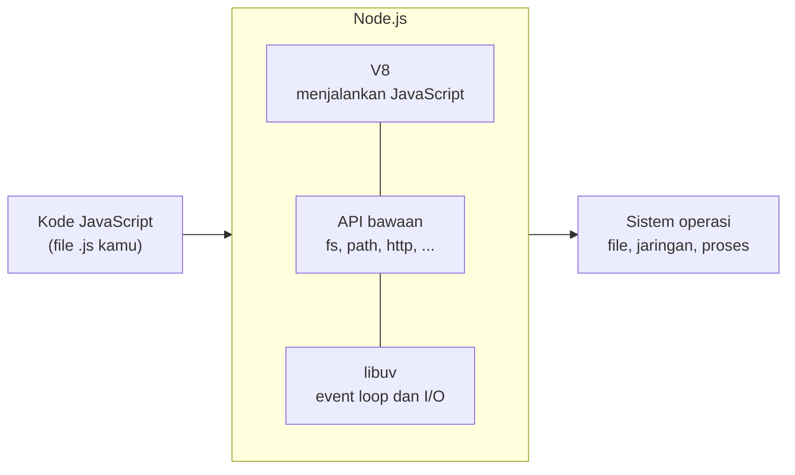

## Tujuan pembelajaran

Setelah mempelajari bab ini, kamu dapat:

- Menjelaskan apa itu Node.js dan apa bedanya dengan JavaScript di browser.
- Menjelaskan secara garis besar bagian-bagian Node.js: V8, libuv, dan API bawaan.
- Memasang Node.js, memilih versi LTS, dan memeriksa versinya.
- Menjalankan kode dengan empat cara: file, REPL, `node -e` atau `-p`, dan `--watch`.
- Menyiapkan folder belajar untuk bagian Node.js.
- Mengenali objek global dan objek `process`.
- Menjelaskan kapan sebuah program Node.js berhenti, dan memakai *exit code*.
- Menemukan jawaban di dokumentasi resmi Node.js.

Bab ini membutuhkan seluruh materi JavaScript Dasar. Tidak ada konsep bahasa baru, hanya cara kerja lingkungan tempat JavaScript dijalankan.

## Pendahuluan: dari browser ke mana saja

JavaScript lahir pada 1995 untuk satu tugas: membuat halaman web bisa bereaksi, misalnya memeriksa isian formulir atau menampilkan menu. Selama belasan tahun, JavaScript hanya hidup di dalam browser.

Tahun 2009, Ryan Dahl merilis **Node.js**. Idenya sederhana: ambil mesin JavaScript yang sudah sangat cepat di Chrome, lalu bungkus supaya bisa dijalankan **di luar browser**, di komputer atau server biasa. Sejak itu JavaScript dipakai untuk server web, alat baris perintah, otomasi, dan banyak alat yang dipakai pengembang sehari-hari.

Analogi: JavaScript adalah **bahasa**, sedangkan browser dan Node.js adalah dua **panggung** yang berbeda. Di panggung browser, pemain punya akses ke layar, tombol, dan isi halaman web. Di panggung Node.js, tidak ada halaman web, tetapi pemain punya akses ke berkas di komputer, jaringan, dan sistem operasi. Naskahnya (bahasa JavaScript) sama, perlengkapan panggungnya berbeda.

## Apa sebenarnya Node.js?

Node.js **bukan bahasa baru** dan **bukan framework**. Node.js adalah ***runtime***: program yang membaca kode JavaScript lalu menjalankannya. Di dalamnya ada tiga bagian utama:



| Bagian | Peran |
|---|---|
| **V8** | Mesin JavaScript buatan Google yang juga dipakai Chrome. Ia yang membaca dan menjalankan kodemu |
| **API bawaan** | Kumpulan modul siap pakai untuk berkas (`fs`), alamat berkas (`path`), jaringan (`http`), dan lainnya. Sebagian sudah kamu pakai di bab 11 sampai 14 |
| **libuv** | Pustaka yang menjalankan *event loop* dan pekerjaan asinkron (membaca berkas, jaringan, timer). Inilah mesin di balik konsep event loop yang kamu pelajari di bab 12 |

Kata kunci yang sering dipakai untuk menggambarkan Node.js adalah ***event-driven*** dan ***non-blocking***: Node.js tidak berdiri menunggu pekerjaan lambat, melainkan meneruskan pekerjaan lain dan dipanggil kembali saat hasilnya siap. Itu persis cerita restoran di bab 12.

## Memasang Node.js dan memeriksa versi

Unduh pemasang dari situs resmi [nodejs.org](https://nodejs.org) dan pilih versi **LTS**. *LTS* (*Long Term Support*) adalah versi yang didukung dan diberi perbaikan keamanan dalam waktu lama, sehingga paling aman untuk belajar dan untuk proyek sungguhan. Versi dengan nomor genap (misalnya 22 dan 24) menjadi LTS. Pemasang ini juga memasang **npm**, alat pengelola paket yang dibahas di bab 16.

Setelah terpasang, buka terminal baru dan periksa:

```bash
node --version
```

Output (contoh, versimu bisa berbeda):

```text
v24.11.1
```

```bash
npm --version
```

Output (contoh, versimu bisa berbeda):

```text
11.6.2
```

Materi ini diuji dengan Node.js v24.11.1. Jika versimu jauh lebih lama, sebagian contoh (dan pesan error) bisa berbeda. Pengembang yang sering berpindah-pindah versi biasanya memakai alat pengelola versi seperti `nvm` atau `fnm`, tetapi itu tidak diperlukan untuk belajar.

## Menyiapkan folder belajar

Untuk seluruh bagian Node.js, buat satu folder bernama `node-belajar`, dan di dalamnya satu berkas `package.json`:

```json title="package.json"
{ "type": "module" }
```

Seperti di bab 11, baris ini membuat semua file `.js` di folder itu diperlakukan sebagai ES Modules, sehingga `import`, `export`, dan `await` di tingkat atas bisa dipakai. Semua perintah `node` di bab ini dijalankan dari dalam folder `node-belajar`.

## Empat cara menjalankan kode

### 1. Menjalankan file

Cara yang sudah kamu pakai sejak bab 1: simpan kode di file, lalu `node nama-file.js`. Inilah cara utama untuk program sungguhan.

### 2. REPL: mencoba kode secara interaktif

Jika `node` dijalankan **tanpa nama file**, Node.js masuk ke mode **REPL** (*Read-Eval-Print Loop*): ia membaca satu baris, menjalankannya, mencetak hasilnya, lalu menunggu baris berikutnya.

```bash
node
```

Contoh sesi (baris yang diawali `>` adalah yang kamu ketik):

```text
Welcome to Node.js v24.11.1.
Type ".help" for more information.
> 2 + 3
5
> "halo".toUpperCase()
'HALO'
> const x = 10
undefined
> x * 2
20
> .exit
```

REPL cocok untuk mencoba satu potong kode dengan cepat tanpa membuat file. Hasil setiap ekspresi langsung dicetak (`const x = 10` menampilkan `undefined` karena deklarasi tidak menghasilkan nilai). Beberapa perintah khusus REPL diawali titik: `.help` menampilkan bantuan dan `.exit` keluar. Menekan `Ctrl + C` dua kali atau `Ctrl + D` juga keluar.

### 3. `node -e` dan `node -p`: satu baris saja

Opsi `-e` (*evaluate*) menjalankan potongan kode dari terminal. Opsi `-p` (*print*) sama, tetapi langsung mencetak hasil ekspresi terakhir.

```bash
node -e "console.log(2 ** 10)"
```

Output:

```text
1024
```

```bash
node -p "'halo'.toUpperCase()"
```

Output:

```text
HALO
```

!!! note "Tanda kutip berbeda antar terminal"
    Contoh di atas memakai tanda kutip ganda di luar dan tunggal di dalam, yang berjalan di Git Bash, PowerShell, dan terminal macOS atau Linux. Jika kodenya mengandung banyak tanda kutip, aturan kutipan tiap terminal berbeda-beda. Untuk kode yang lebih dari satu baris, lebih nyaman memakai file.

### 4. `node --watch`: menjalankan ulang otomatis

Dengan `--watch`, Node.js memantau file dan **menjalankannya ulang setiap kali file disimpan**. Berguna saat kamu sering mengubah dan mencoba kode.

```bash
node --watch nama-file.js
```

Setelah kamu mengubah `nama-file.js` dan menyimpannya, tampilannya kira-kira seperti ini:

```text
versi 1
Completed running 'nama-file.js'. Waiting for file changes before restarting...
Restarting 'nama-file.js'
versi 2
Completed running 'nama-file.js'. Waiting for file changes before restarting...
```

Tekan `Ctrl + C` untuk menghentikannya.

## Browser vs Node.js

Karena panggungnya berbeda, ada hal yang ada di satu sisi tetapi tidak di sisi lain:

| | Browser | Node.js |
|---|---|---|
| Objek global | `window` | `globalThis` (atau `global`) |
| Halaman web (`document`, DOM) | Ada | **Tidak ada** |
| Dialog (`alert`, `prompt`) | Ada | **Tidak ada** |
| Akses berkas komputer | Dibatasi ketat | Penuh (`fs`) |
| Membuat server | Tidak | Ya (`http`) |
| `process` (info proses, argumen, environment) | Tidak | Ada |
| Sistem modul | ES Modules | ES Modules dan CommonJS |

Buktikan sendiri. Simpan sebagai `lingkungan.js`:

```javascript title="lingkungan.js"
console.log(typeof window);
console.log(typeof document);
console.log(typeof process);
console.log(typeof globalThis);
console.log(typeof global, globalThis === global);
console.log(typeof require, typeof __dirname);
```

```bash
node lingkungan.js
```

Output:

```text
undefined
undefined
object
object
object true
undefined undefined
```

Penjelasan:

1. `window` dan `document` tidak ada di Node.js. Ingat dari bab 3 dan 7: `typeof` pada nama yang tidak ada menghasilkan `"undefined"` tanpa error.
2. `process` ada. Ini objek khas Node.js yang membawa informasi tentang program yang sedang berjalan (dibahas berikutnya).
3. `globalThis` adalah objek global yang sama di semua lingkungan JavaScript. Di Node.js ia juga punya nama lama `global`, dan keduanya menunjuk objek yang sama (`true`).
4. `require` dan `__dirname` tidak ada karena folder kita bertipe ES Module (bab 11). Keduanya hanya tersedia di CommonJS.

Fungsi seperti `console.log`, `setTimeout`, `fetch`, dan `JSON` ada di kedua lingkungan, itulah sebabnya contoh-contoh JavaScript Dasar dapat berjalan di mana saja.

## Objek `process`

`process` menggambarkan program Node.js yang sedang berjalan. Kamu sudah memakai `process.argv` di bab 14. Beberapa isi lainnya, simpan sebagai `info-proses.js`:

```javascript title="info-proses.js"
console.log("Sistem operasi:", process.platform);
console.log("Versi Node.js:", process.version);
console.log("Versi V8:", process.versions.v8);
console.log("Folder kerja:", process.cwd());
```

```bash
node info-proses.js
```

Output (contoh, berbeda di setiap komputer):

```text
Sistem operasi: win32
Versi Node.js: v24.11.1
Versi V8: 13.6.233.10-node.28
Folder kerja: C:\Users\kamu\node-belajar
```

| Properti | Isi |
|---|---|
| `process.platform` | Sistem operasi: `"win32"` (Windows), `"darwin"` (macOS), atau `"linux"` |
| `process.version` | Versi Node.js yang menjalankan program |
| `process.versions` | Versi Node.js beserta komponen di dalamnya, termasuk `v8` |
| `process.cwd()` | *Current working directory*: folder tempat perintah `node` dijalankan. Ini sumber kesalahan "menjalankan dari folder yang salah" di bab 14 |
| `process.argv` | Argumen dari terminal (bab 14) |
| `process.exitCode` | Kode keluar program (dibahas di bawah) |
| `process.env` | Variabel lingkungan (dibahas di bab 18) |

## Kapan program Node.js berhenti?

Program Node.js berhenti sendiri ketika **tidak ada lagi pekerjaan yang tertunda**: semua kode sinkron sudah selesai, dan tidak ada timer, berkas, atau koneksi yang menunggu. Simpan sebagai `berhenti.js`:

```javascript title="berhenti.js"
setTimeout(() => console.log("timer selesai"), 100);
console.log("baris terakhir");
```

```bash
node berhenti.js
```

Output:

```text
baris terakhir
timer selesai
```

Meskipun baris terakhir file sudah dijalankan, Node.js tetap hidup karena masih ada timer yang menunggu. Setelah timer berjalan dan tidak ada pekerjaan lain, program berhenti. Sebaliknya, `setInterval` tanpa `clearInterval` dan server yang sedang mendengarkan koneksi membuat program berjalan terus sampai kamu menghentikannya dengan `Ctrl + C`.

### Berhenti paksa dengan `process.exit()`

`process.exit()` menghentikan program **seketika**, tanpa menunggu pekerjaan yang tertunda. Simpan sebagai `berhenti-paksa.js`:

```javascript title="berhenti-paksa.js"
setTimeout(() => console.log("A"), 100);
setTimeout(() => {
  console.log("B");
  process.exit(0);
}, 50);
setTimeout(() => console.log("C"), 200);
```

```bash
node berhenti-paksa.js
```

Output:

```text
B
```

Timer 50 ms berjalan lebih dulu dan memanggil `process.exit(0)`. Timer `A` dan `C` tidak pernah sempat berjalan. Gunakan `process.exit()` dengan hati-hati; biasanya lebih baik membiarkan program selesai sendiri.

### Exit code

Saat berhenti, setiap program memberi tahu sistem operasi satu angka yang disebut ***exit code***:

- `0` berarti **sukses**.
- Angka selain 0 berarti **gagal** (biasanya 1 untuk kegagalan umum).

Program lain, skrip otomasi, dan alat seperti CI memakai angka ini untuk mengetahui apakah perintahmu berhasil. Di bab 14 kamu sudah mengaturnya lewat `process.exitCode`. Simpan sebagai `exit-code.js`:

```javascript title="exit-code.js"
console.log("gagal");
process.exitCode = 2;
```

```bash
node exit-code.js
```

Output:

```text
gagal
```

Program tetap berjalan sampai selesai secara normal, tetapi berhenti dengan kode 2. Cara melihat exit code berbeda di tiap terminal:

| Terminal | Perintah untuk melihat exit code perintah terakhir |
|---|---|
| Git Bash, macOS, Linux | `echo $?` |
| PowerShell | `$LASTEXITCODE` |
| Command Prompt (cmd) | `echo %ERRORLEVEL%` |

Setelah menjalankan `node exit-code.js`, perintah `echo $?` di Git Bash menampilkan `2`.

## Membaca dokumentasi resmi

Kamu tidak perlu menghafal semua API Node.js. Kemampuan membaca dokumentasi jauh lebih berharga. Dokumentasi resmi ada di **nodejs.org/docs/latest/api/**. Setiap modul (misalnya `fs`, `path`, `http`) punya halaman sendiri.

Beberapa hal yang membantu saat membaca:

- **Stability index** di bagian atas tiap modul atau fungsi: *Stable* berarti aman dipakai, *Experimental* berarti bisa berubah kapan saja, dan *Deprecated* berarti sebaiknya dihindari.
- **Added in** menunjukkan versi Node.js pertama yang memiliki fitur itu. Berguna jika sebuah contoh tidak jalan di versi lamamu.
- Cari fungsi lewat kotak pencarian, lalu baca **parameter**, nilai kembaliannya, dan bagian **Example**.
- Banyak fungsi punya tiga versi: sinkron (`readFileSync`), callback (`readFile` dengan callback), dan Promise (`fs/promises`). Pilih sesuai kebutuhan (bab 12).

## Kesalahan umum

### 1. Mengetik `node` saja lalu bingung

`node` tanpa nama file membuka REPL dan menunggu masukan, sehingga terminal terlihat "macet" dengan tanda `>`. Keluar dengan `.exit`, `Ctrl + D`, atau `Ctrl + C` dua kali.

### 2. Menjalankan file yang tidak ada atau dari folder yang salah

Buat perintah ini dari folder yang tidak berisi file itu:

```bash
node tidak-ada.js
```

Output (dipersingkat):

```text
Error: Cannot find module
```

Pesan lengkapnya menyebut alamat penuh yang dicari dan `code: 'MODULE_NOT_FOUND'`. **Perbaikan:** periksa nama file, lalu pastikan terminalmu berada di folder yang benar (`process.cwd()` atau perintah `cd`).

### 3. Memakai API browser di Node.js

Simpan sebagai `salah-browser.js`:

```javascript title="salah-browser.js"
document.getElementById("judul").textContent = "Halo";
```

```bash
node salah-browser.js
```

Output (dipersingkat):

```text
ReferenceError: document is not defined
```

`document`, `window`, `alert`, dan `localStorage` adalah milik browser. Di Node.js gunakan `console.log` untuk menampilkan, dan `fs` untuk berkas. Sebaliknya, `fs` dan `process` tidak ada di browser.

### 4. Menutup terminal dan mengira program jalan terus

Program Node.js yang dijalankan dari terminal ikut berhenti saat terminalnya ditutup. Untuk menjalankan program di server secara permanen dipakai alat khusus pengelola proses (di luar cakupan bab ini).

### 5. Program yang tidak berhenti

Jika perintah `node` tidak kembali ke prompt, kemungkinan ada `setInterval`, server, atau koneksi yang masih terbuka. Hentikan dengan `Ctrl + C`, lalu cari apa yang membuat program tetap hidup.

### 6. Memakai versi Node.js yang terlalu lama

Fitur seperti `fetch` bawaan, `node --watch`, atau `fs/promises` tidak ada di versi yang sangat lama. Jika contoh gagal dengan pesan aneh, periksa `node --version` lebih dulu.

### 7. Lupa `process.exit()` tidak menunggu

`process.exit()` menghentikan program tanpa menunggu penulisan berkas atau permintaan jaringan yang belum selesai. Data bisa hilang. Biarkan program selesai sendiri, dan atur `process.exitCode` jika perlu.

## Ringkasan

- **Node.js** adalah *runtime* JavaScript di luar browser. Ia terdiri dari V8 (menjalankan JavaScript), API bawaan (`fs`, `path`, `http`, ...), dan libuv (event loop dan I/O asinkron).
- Bahasanya sama dengan di browser. Yang berbeda adalah perlengkapannya: Node.js tidak punya `window` dan `document`, tetapi punya `process`, akses berkas, dan jaringan.
- Pasang versi **LTS** dari nodejs.org dan periksa dengan `node --version`.
- Empat cara menjalankan kode: `node file.js`, REPL (`node`), `node -e` atau `-p`, dan `node --watch file.js`.
- Folder belajar `node-belajar` dengan `package.json` bertipe `module` dipakai untuk seluruh bagian Node.js.
- `process` menyimpan info program: `platform`, `version`, `cwd()`, `argv`, `exitCode`, dan `env`.
- Program Node.js berhenti sendiri saat tidak ada pekerjaan tertunda. `process.exit()` menghentikannya paksa.
- **Exit code** 0 berarti sukses, selain itu berarti gagal.
- Biasakan membaca dokumentasi resmi: perhatikan *stability index* dan *added in*.

## Latihan

Kerjakan sendiri dulu sebelum melihat jawaban. Semua latihan dijalankan dari folder `node-belajar`.

### Latihan 1: Prediksi `typeof`

Tebak outputnya, lalu jalankan di Node.js:

```javascript
console.log(typeof process, typeof window, typeof console);
```

??? success "Jawaban"
    Output: `object undefined object`. `process` dan `console` ada di Node.js, sedangkan `window` hanya ada di browser.

### Latihan 2: Kenali lingkunganmu

Buat program yang menampilkan sistem operasi dan versi Node.js yang kamu pakai dalam satu kalimat, misalnya `Saya memakai Node.js v24.11.1 di win32`.

??? success "Contoh jawaban"
    ```javascript
    console.log(`Saya memakai Node.js ${process.version} di ${process.platform}`);
    ```
    Output bergantung pada komputermu, misalnya `Saya memakai Node.js v24.11.1 di win32`.

### Latihan 3: Bermain di REPL

Buka REPL dengan `node`, lalu hitung `100 / 8`, panjang teks `"node"`, dan urutkan `[3, 1, 2]`. Tebak dulu hasilnya.

??? success "Jawaban"
    Ketiga ekspresi dan hasilnya:
    ```text
    > 100 / 8
    12.5
    > "node".length
    4
    > [3, 1, 2].sort()
    [ 1, 2, 3 ]
    ```
    Keluar dengan `.exit`.

### Latihan 4: Satu baris di terminal

Tanpa membuat file, cetak `1024` sebagai hasil `2 ** 10` dengan `node -p`, lalu cetak `NODE` dari teks `"node"` dengan `node -e` dan `console.log`.

??? success "Jawaban"
    ```bash
    node -p "2 ** 10"
    ```

    ```text
    1024
    ```

    ```bash
    node -e "console.log('node'.toUpperCase())"
    ```

    ```text
    NODE
    ```

### Latihan 5: Perbaiki kode browser

Kode ini ditulis untuk browser dan gagal di Node.js. Ubah agar bekerja di Node.js dan menampilkan `Halo dari Node.js`:

```javascript
document.getElementById("judul").textContent = "Halo dari Node.js";
```

??? success "Jawaban"
    Node.js tidak punya halaman web, jadi hasilnya ditampilkan ke terminal:
    ```javascript
    console.log("Halo dari Node.js");
    ```
    Output: `Halo dari Node.js`

### Latihan 6: Siapa yang sempat berjalan?

Apa yang tercetak, dan mengapa `A` dan `C` tidak muncul? (Kode sama dengan `berhenti-paksa.js`.)

```javascript
setTimeout(() => console.log("A"), 100);
setTimeout(() => {
  console.log("B");
  process.exit(0);
}, 50);
setTimeout(() => console.log("C"), 200);
```

??? success "Jawaban"
    Output: `B`. Timer 50 ms berjalan lebih dulu dan memanggil `process.exit(0)`, yang menghentikan program seketika sebelum timer 100 ms dan 200 ms sempat berjalan.

### Latihan 7: Exit code

Buat program yang mencetak `selesai dengan masalah` dan berhenti dengan exit code 3. Setelah menjalankannya, lihat exit code di terminalmu.

??? success "Contoh jawaban"
    ```javascript
    console.log("selesai dengan masalah");
    process.exitCode = 3;
    ```
    Output: `selesai dengan masalah`. Setelah itu `echo $?` (Git Bash, macOS, Linux), `$LASTEXITCODE` (PowerShell), atau `echo %ERRORLEVEL%` (cmd) menampilkan `3`.
