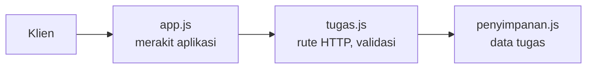

## Tujuan pembelajaran

Setelah mempelajari bab ini, kamu dapat:

- Menjelaskan prinsip REST: sumber daya, metode HTTP, kode status, dan format data yang konsisten.
- Merancang endpoint CRUD yang rapi (`GET`, `POST`, `PUT`, `PATCH`, `DELETE`).
- Membedakan `PUT` dan `PATCH`, serta memahami sifat *idempotent*.
- Menyusun API berlapis: penyimpanan, rute, dan aplikasi.
- Memvalidasi masukan, memberi paginasi, dan menyaring data lewat query.
- Menulis pengujian otomatis dengan `node:test` dan `node:assert`.
- Membedakan tes unit dari tes integrasi, dan menulis tes yang independen.
- Menambah fitur dengan mulai dari tes (merah, hijau).

Bab ini memakai Express (bab 21), class (bab 13), async (bab 12), dan modul bawaan `node:assert` (bab 14). Proyeknya ada di folder baru `api-tugas`.

## Pendahuluan: API sebagai kontrak

Pada bab 20 dan 21 kamu membuat API untuk produk. Sekarang kita mendalami dua hal yang membedakan API amatir dari API yang bisa diandalkan.

**Pertama, rancangan yang konsisten.** API dipakai oleh program lain (aplikasi ponsel, situs web, skrip), yang dibangun mengikuti "kontrak": jalur apa yang ada, metode apa yang dipakai, bentuk data apa yang dikirim, dan apa jawabannya. Kontrak yang rapi dan bisa ditebak membuat API mudah dipakai. Gaya perancangan yang paling umum disebut **REST** (*Representational State Transfer*).

**Kedua, pengujian otomatis.** Setiap kali kamu mengubah kode, bagaimana kamu tahu tidak ada yang rusak? Menjalankan server lalu mencoba semua jalur secara manual tidak bisa diulang dengan andal. **Tes otomatis** adalah kode kecil yang memeriksa perilaku programmu dan bisa dijalankan kapan pun dalam hitungan detik. Analogi: daftar periksa pesawat sebelum lepas landas. Pilot yang berpengalaman pun tidak mengandalkan ingatan.

## Prinsip REST

REST memandang API sebagai kumpulan **sumber daya** (*resource*), yaitu "benda" yang bisa kamu lihat atau ubah: tugas, pengguna, pesanan. Aturan praktisnya:

1. **Jalur adalah kata benda, bukan kata kerja.** Tindakannya ditentukan oleh metode HTTP. Tulis `GET /api/tugas`, bukan `/api/ambilSemuaTugas`. Biasanya berbentuk jamak.
2. **Metode HTTP menyatakan tindakan.**
3. **Kode status menyatakan hasil** dengan tepat (200, 201, 204, 400, 404, ...).
4. **Tanpa keadaan** (*stateless*): setiap permintaan membawa semua informasi yang dibutuhkan. Server tidak "mengingat" permintaan sebelumnya.
5. **Format data konsisten**, biasanya JSON, termasuk bentuk pesan error.

### Rancangan API tugas

| Tindakan | Metode dan jalur | Body | Berhasil | Gagal |
|---|---|---|---|---|
| Daftar tugas | `GET /api/tugas` | - | `200` | `400` (query salah) |
| Satu tugas | `GET /api/tugas/:id` | - | `200` | `400`, `404` |
| Buat tugas | `POST /api/tugas` | `{ judul }` | `201` + `Location` | `400` |
| Ganti seluruh tugas | `PUT /api/tugas/:id` | `{ judul, selesai }` | `200` | `400`, `404` |
| Ubah sebagian | `PATCH /api/tugas/:id` | `{ judul? , selesai? }` | `200` | `400`, `404` |
| Hapus tugas | `DELETE /api/tugas/:id` | - | `204` | `400`, `404` |

Operasi dasar ini disebut **CRUD**: *Create* (buat), *Read* (baca), *Update* (ubah), *Delete* (hapus).

### `PUT` atau `PATCH`?

| | `PUT` | `PATCH` |
|---|---|---|
| Arti | **Mengganti** seluruh sumber daya dengan data yang dikirim | **Mengubah sebagian** field saja |
| Field yang tidak dikirim | Dianggap salah (kita menolaknya dengan `400`) | Dibiarkan seperti semula |
| Contoh | `{ "judul": "baru", "selesai": true }` | `{ "selesai": true }` |

### Idempotent

Sebuah operasi **idempotent** jika mengulanginya berkali-kali memberi dampak yang sama seperti sekali. `GET`, `PUT`, dan `DELETE` idempotent: mengganti tugas dengan data yang sama dua kali menghasilkan keadaan yang sama, dan menghapus tugas dua kali meninggalkan keadaan yang sama (tugasnya tetap tidak ada). `POST` **tidak** idempotent: dua `POST` membuat dua tugas. Sifat ini penting saat klien mengulang permintaan karena koneksi putus.

Dalam API ini, `DELETE` kedua kali menjawab `404` (tugasnya sudah tidak ada). Itu pilihan yang sah; yang idempotent adalah **keadaan akhir** di server, bukan kode statusnya.

### Paginasi dan penyaringan

Daftar bisa sangat panjang, jadi API yang baik tidak mengirim semuanya sekaligus. Dua teknik lewat query string:

- **Penyaringan**: `GET /api/tugas?selesai=true` hanya menampilkan tugas yang selesai.
- **Paginasi** (*pagination*): `GET /api/tugas?halaman=2&batas=10` mengirim 10 data mulai dari halaman kedua. Respons membawa `total` agar klien tahu seberapa banyak data seluruhnya.

Batas atas `batas` harus ditetapkan (di sini 50), supaya klien tidak bisa meminta jutaan data sekaligus.

## Menyiapkan proyek

```bash
mkdir api-tugas
cd api-tugas
npm init -y
npm pkg set type=module
npm pkg set private=true --json
npm install express@5.3.0
npm pkg set scripts.start="node server.js"
npm pkg set scripts.test="node --test"
```

Output (contoh):

```text
added 65 packages, and audited 66 packages in 2s

30 packages are looking for funding
  run `npm fund` for details

found 0 vulnerabilities
```

Skrip `test` menjalankan `node --test`, penguji bawaan Node.js. Kamu akan memakainya lewat `npm test`.

## Arsitektur berlapis

Kita pisahkan kode menjadi tiga lapis dengan tanggung jawab berbeda:



| Lapis | Berkas | Tugas | Tidak boleh tahu |
|---|---|---|---|
| Penyimpanan | `penyimpanan.js` | Menyimpan dan mengambil data | Tentang HTTP |
| Rute | `tugas.js`, `validasi.js` | Memeriksa masukan, memanggil penyimpanan, memilih kode status | Cara data disimpan |
| Aplikasi | `app.js`, `server.js` | Merakit middleware, rute, dan error handler | - |

Manfaatnya besar: penyimpanan bisa diuji tanpa server, dan di bab 23 kita bisa **menukar** penyimpanan di memori dengan penyimpanan ke berkas tanpa mengubah rute. Kuncinya adalah `buatApp(penyimpanan)`, yang menerima penyimpanan dari luar (*dependency injection*).

## Membangun API

### Error khusus

```javascript title="api-tugas/galat.js"
export class GalatHttp extends Error {
  constructor(status, pesan) {
    super(pesan);
    this.status = status;
  }
}
```

### Penyimpanan

```javascript title="api-tugas/penyimpanan.js"
export class PenyimpananTugas {
  #tugas = [];
  #idBerikut = 1;

  semua({ selesai } = {}) {
    if (selesai === undefined) {
      return [...this.#tugas];
    }
    return this.#tugas.filter((t) => t.selesai === selesai);
  }

  cari(id) {
    const tugas = this.#tugas.find((t) => t.id === id);
    if (tugas === undefined) {
      return undefined;
    }
    return { ...tugas };
  }

  tambah(judul) {
    const baru = { id: this.#idBerikut++, judul, selesai: false };
    this.#tugas.push(baru);
    return { ...baru };
  }

  ubah(id, perubahan) {
    const indeks = this.#tugas.findIndex((t) => t.id === id);
    if (indeks === -1) {
      return undefined;
    }
    this.#tugas[indeks] = { ...this.#tugas[indeks], ...perubahan };
    return { ...this.#tugas[indeks] };
  }

  hapus(id) {
    const indeks = this.#tugas.findIndex((t) => t.id === id);
    if (indeks === -1) {
      return false;
    }
    this.#tugas.splice(indeks, 1);
    return true;
  }
}
```

Beberapa keputusan yang disengaja:

- Data disimpan di field privat `#tugas` (bab 13), sehingga tidak bisa diubah dari luar.
- Method mengembalikan **salinan** (`{ ...tugas }`), bukan objek aslinya. Kalau tidak, kode lain yang mengubah hasilnya akan diam-diam mengubah data di dalam penyimpanan. Salah satu tes nanti membuktikan hal ini.
- Penyimpanan tidak melempar error HTTP. Ia mengembalikan `undefined` atau `false` untuk "tidak ada", dan lapis rute yang menentukan itu `404`.

### Validasi

```javascript title="api-tugas/validasi.js"
import { GalatHttp } from "./galat.js";

export function validasiId(teks) {
  const id = Number(teks);
  if (!Number.isInteger(id) || id < 1) {
    throw new GalatHttp(400, "id harus bilangan bulat positif");
  }
  return id;
}

export function validasiJudul(judul) {
  if (typeof judul !== "string" || judul.trim() === "") {
    throw new GalatHttp(400, "judul wajib diisi");
  }
  if (judul.trim().length > 100) {
    throw new GalatHttp(400, "judul maksimal 100 karakter");
  }
  return judul.trim();
}

export function validasiSelesai(nilai) {
  if (typeof nilai !== "boolean") {
    throw new GalatHttp(400, "selesai harus true atau false");
  }
  return nilai;
}
```

Setiap fungsi validasi memeriksa satu hal, melempar `GalatHttp(400, ...)` jika salah, dan **mengembalikan nilai yang sudah bersih** (misalnya judul tanpa spasi di tepi).

### Rute

```javascript title="api-tugas/tugas.js"
import { Router } from "express";
import { GalatHttp } from "./galat.js";
import { validasiId, validasiJudul, validasiSelesai } from "./validasi.js";

export function buatRuteTugas(penyimpanan) {
  const rute = Router();

  function ambilAtau404(teksId) {
    const id = validasiId(teksId);
    const tugas = penyimpanan.cari(id);
    if (tugas === undefined) {
      throw new GalatHttp(404, `Tugas ${id} tidak ditemukan`);
    }
    return tugas;
  }

  rute.get("/", (req, res) => {
    const { selesai, halaman = "1", batas = "10" } = req.query;

    let saringan;
    if (selesai !== undefined) {
      if (selesai !== "true" && selesai !== "false") {
        throw new GalatHttp(400, "selesai harus true atau false");
      }
      saringan = { selesai: selesai === "true" };
    }

    const nomorHalaman = Number(halaman);
    const ukuran = Number(batas);
    if (!Number.isInteger(nomorHalaman) || nomorHalaman < 1) {
      throw new GalatHttp(400, "halaman harus bilangan bulat positif");
    }
    if (!Number.isInteger(ukuran) || ukuran < 1 || ukuran > 50) {
      throw new GalatHttp(400, "batas harus antara 1 dan 50");
    }

    const semua = penyimpanan.semua(saringan);
    const awal = (nomorHalaman - 1) * ukuran;
    res.json({
      data: semua.slice(awal, awal + ukuran),
      halaman: nomorHalaman,
      batas: ukuran,
      total: semua.length,
    });
  });

  rute.post("/", (req, res) => {
    const judul = validasiJudul(req.body?.judul);
    const baru = penyimpanan.tambah(judul);
    res.status(201).location(`/api/tugas/${baru.id}`).json(baru);
  });

  rute.get("/:id", (req, res) => {
    res.json(ambilAtau404(req.params.id));
  });

  rute.put("/:id", (req, res) => {
    const tugas = ambilAtau404(req.params.id);
    const judul = validasiJudul(req.body?.judul);
    const selesai = validasiSelesai(req.body?.selesai);
    res.json(penyimpanan.ubah(tugas.id, { judul, selesai }));
  });

  rute.patch("/:id", (req, res) => {
    const tugas = ambilAtau404(req.params.id);
    const { judul, selesai } = req.body || {};
    const perubahan = {};
    if (judul !== undefined) {
      perubahan.judul = validasiJudul(judul);
    }
    if (selesai !== undefined) {
      perubahan.selesai = validasiSelesai(selesai);
    }
    if (Object.keys(perubahan).length === 0) {
      throw new GalatHttp(400, "tidak ada yang diubah");
    }
    res.json(penyimpanan.ubah(tugas.id, perubahan));
  });

  rute.delete("/:id", (req, res) => {
    const tugas = ambilAtau404(req.params.id);
    penyimpanan.hapus(tugas.id);
    res.sendStatus(204);
  });

  return rute;
}
```

Bagian-bagian yang patut diperhatikan:

| Bagian | Penjelasan |
|---|---|
| `buatRuteTugas(penyimpanan)` | Fungsi yang **menerima** penyimpanan lalu membuat Router. Rute tidak membuat penyimpanannya sendiri |
| `ambilAtau404` | Fungsi bantu yang memvalidasi id, mengambil tugas, dan melempar 404. Dipakai di empat rute agar tidak berulang |
| `const { selesai, halaman = "1", batas = "10" } = req.query` | Destructuring dengan nilai bawaan (bab 9). Karena `req.query` selalu berisi teks, nilai bawaannya juga teks |
| Paginasi | `awal = (halaman - 1) * ukuran`, lalu `slice(awal, awal + ukuran)` mengambil satu halaman |
| `req.body?.judul` | `?.` mencegah `TypeError` jika klien tidak mengirim body sama sekali (`req.body` bernilai `undefined`) |
| `PUT` | Mewajibkan **kedua** field, `judul` dan `selesai` |
| `PATCH` | Memvalidasi hanya field yang ada, dan menolak jika tidak ada satu pun field yang dikirim |
| `res.sendStatus(204)` | Berhasil tanpa isi |

### Merakit aplikasi

```javascript title="api-tugas/app.js"
import express from "express";
import { GalatHttp } from "./galat.js";
import { PenyimpananTugas } from "./penyimpanan.js";
import { buatRuteTugas } from "./tugas.js";

export function buatApp(penyimpanan = new PenyimpananTugas()) {
  const app = express();
  app.disable("x-powered-by");

  app.use(express.json());
  app.use("/api/tugas", buatRuteTugas(penyimpanan));

  app.use((req, res) => {
    throw new GalatHttp(404, "Jalur tidak ditemukan");
  });

  app.use((error, req, res, next) => {
    if (error.type === "entity.parse.failed") {
      return res.status(400).json({ galat: "JSON tidak valid" });
    }
    if (error.type === "entity.too.large") {
      return res.status(413).json({ galat: "Body terlalu besar" });
    }
    if (error instanceof GalatHttp) {
      return res.status(error.status).json({ galat: error.message });
    }
    console.error(error);
    res.status(500).json({ galat: "Kesalahan server" });
  });

  return app;
}
```

```javascript title="api-tugas/server.js"
import { buatApp } from "./app.js";

const PORT = Number(process.env.PORT) || 3000;

const server = buatApp().listen(PORT, (error) => {
  if (error) {
    console.error("Gagal memulai server:", error.message);
    process.exitCode = 1;
    return;
  }
  console.log(`API tugas berjalan di http://localhost:${PORT}`);
});

process.on("SIGINT", () => {
  console.log("\nMenutup server...");
  server.close(() => console.log("Server ditutup"));
});
```

`buatApp(penyimpanan = new PenyimpananTugas())` memakai nilai bawaan: tanpa argumen, ia membuat penyimpanan baru. Server sungguhan memakainya begitu saja, sedangkan tes memberi penyimpanan segar untuk setiap kasus. Error handler menambah satu kasus: `entity.too.large` (body lebih besar dari 100 KB bawaan `express.json()`) dijawab `413`.

Server dijalankan dengan `npm start`:

```bash
# berjalan terus, hentikan dengan Ctrl + C
npm start
```

Output:

```text
> api-tugas@1.0.0 start
> node server.js

API tugas berjalan di http://localhost:3000
```

## Mencoba API

Untuk melihat seluruh siklus hidup sebuah tugas tanpa membuka terminal kedua, kita pakai fungsi bantu `mulaiServer`: ia menjalankan aplikasi di port acak dan menyediakan fungsi `panggil` untuk mengirim permintaan. Fungsi yang sama nanti menjadi dasar tes kita. Simpan sebagai `bantu-uji.js`:

```javascript title="api-tugas/bantu-uji.js"
import { createServer } from "node:http";
import { buatApp } from "./app.js";

export async function mulaiServer(penyimpanan) {
  const server = createServer(buatApp(penyimpanan));
  await new Promise((resolve) => server.listen(0, "127.0.0.1", resolve));
  const url = `http://127.0.0.1:${server.address().port}`;

  async function panggil(metode, jalur, body) {
    const respons = await fetch(url + jalur, {
      method: metode,
      headers: body === undefined ? {} : { "Content-Type": "application/json" },
      body: body === undefined ? undefined : typeof body === "string" ? body : JSON.stringify(body),
    });
    const teks = await respons.text();
    const isi = teks === "" ? undefined : JSON.parse(teks);
    return { status: respons.status, lokasi: respons.headers.get("location"), isi };
  }

  return {
    panggil,
    tutup: () =>
      new Promise((resolve) => {
        server.close(resolve);
        server.closeAllConnections();
      }),
  };
}
```

`panggil` mengirim permintaan (JSON diubah otomatis; string dikirim apa adanya untuk menguji JSON rusak) dan mengembalikan objek ringkas berisi `status`, `lokasi`, dan `isi`. Sekarang jalankan skenario `coba.js`:

```javascript title="api-tugas/coba.js"
import { PenyimpananTugas } from "./penyimpanan.js";
import { mulaiServer } from "./bantu-uji.js";

const app = await mulaiServer(new PenyimpananTugas());

async function tampil(metode, jalur, body) {
  const { status, lokasi, isi } = await app.panggil(metode, jalur, body);
  console.log(`${metode} ${jalur} -> ${status}`, isi === undefined ? "(kosong)" : isi);
  if (lokasi) {
    console.log("  Location:", lokasi);
  }
}

await tampil("POST", "/api/tugas", { judul: "belajar REST" });
await tampil("POST", "/api/tugas", { judul: "menulis tes" });
await tampil("PATCH", "/api/tugas/1", { selesai: true });
await tampil("GET", "/api/tugas?selesai=true");
await tampil("PUT", "/api/tugas/2", { judul: "menulis lebih banyak tes", selesai: false });
await tampil("GET", "/api/tugas");
await tampil("DELETE", "/api/tugas/1");
await tampil("GET", "/api/tugas/1");
await tampil("POST", "/api/tugas", { judul: "" });
await app.tutup();
```

```bash
node coba.js
```

Output:

```text
POST /api/tugas -> 201 { id: 1, judul: 'belajar REST', selesai: false }
  Location: /api/tugas/1
POST /api/tugas -> 201 { id: 2, judul: 'menulis tes', selesai: false }
  Location: /api/tugas/2
PATCH /api/tugas/1 -> 200 { id: 1, judul: 'belajar REST', selesai: true }
GET /api/tugas?selesai=true -> 200 {
  data: [ { id: 1, judul: 'belajar REST', selesai: true } ],
  halaman: 1,
  batas: 10,
  total: 1
}
PUT /api/tugas/2 -> 200 { id: 2, judul: 'menulis lebih banyak tes', selesai: false }
GET /api/tugas -> 200 {
  data: [
    { id: 1, judul: 'belajar REST', selesai: true },
    { id: 2, judul: 'menulis lebih banyak tes', selesai: false }
  ],
  halaman: 1,
  batas: 10,
  total: 2
}
DELETE /api/tugas/1 -> 204 (kosong)
GET /api/tugas/1 -> 404 { galat: 'Tugas 1 tidak ditemukan' }
POST /api/tugas -> 400 { galat: 'judul wajib diisi' }
```

Seluruh siklus berjalan: dibuat (`201`), diubah sebagian (`200`), disaring, diganti (`200`), dihapus (`204`), lalu diminta lagi (`404`). Masukan yang salah dijawab `400`.

## Pengujian otomatis

Mencoba manual seperti di atas berguna untuk eksplorasi, tetapi tidak bisa diulang dengan andal dan tidak memberi tahu kita secara otomatis jika ada yang rusak. **Tes otomatis** menuliskan pemeriksaan itu sebagai kode.

### Dua jenis tes yang akan kita tulis

| Jenis | Menguji | Kecepatan | Contoh di proyek ini |
|---|---|---|---|
| **Tes unit** | Satu bagian kecil secara terpisah | Sangat cepat | Class `PenyimpananTugas` |
| **Tes integrasi** | Beberapa bagian bekerja bersama | Lebih lambat | API lewat permintaan HTTP sungguhan |

### Alat: `node:test` dan `node:assert`

Node.js membawa penguji sendiri, `node:test`, dan modul `node:assert` (yang sudah kamu pakai di bab 14).

| Alat | Fungsi |
|---|---|
| `test(nama, fungsi)` atau `it(nama, fungsi)` | Satu kasus uji. Lulus jika fungsi selesai tanpa error, gagal jika melempar error |
| `describe(nama, fungsi)` | Mengelompokkan beberapa tes |
| `beforeEach(fungsi)` / `afterEach(fungsi)` | Dijalankan sebelum / sesudah **setiap** tes (untuk menyiapkan dan membersihkan) |
| `assert.equal(a, b)` | Memeriksa `a === b` |
| `assert.deepEqual(a, b)` | Memeriksa isi objek atau array sama |
| `assert.ok(nilai)` | Memeriksa nilai truthy |
| `assert.throws(fungsi, Kelas)` | Memeriksa fungsi melempar error |
| `assert.rejects(promise, Kelas)` | Sama, untuk Promise yang ditolak |

Selalu impor `assert` dari **`node:assert/strict`**, bukan `node:assert`. Versi tanpa `/strict` membandingkan dengan `==` yang longgar, sehingga `assert.equal(1, "1")` lolos padahal angka dan teks berbeda (lihat kesalahan umum).

Pola penulisan tes yang baik mengikuti tiga langkah **Arrange-Act-Assert**: siapkan keadaan, jalankan tindakan, lalu periksa hasilnya.

### Tes unit untuk penyimpanan

Buat folder `test`. Berkas di folder ini otomatis ditemukan oleh `node --test`.

```javascript title="api-tugas/test/penyimpanan.test.js"
import { describe, it, beforeEach } from "node:test";
import assert from "node:assert/strict";
import { PenyimpananTugas } from "../penyimpanan.js";

describe("PenyimpananTugas", () => {
  let simpanan;

  beforeEach(() => {
    simpanan = new PenyimpananTugas();
  });

  it("memberi id berurutan dan selesai=false pada tugas baru", () => {
    const a = simpanan.tambah("belajar");
    const b = simpanan.tambah("istirahat");
    assert.deepEqual(a, { id: 1, judul: "belajar", selesai: false });
    assert.equal(b.id, 2);
  });

  it("mengembalikan undefined untuk id yang tidak ada", () => {
    assert.equal(simpanan.cari(99), undefined);
    assert.equal(simpanan.ubah(99, { selesai: true }), undefined);
    assert.equal(simpanan.hapus(99), false);
  });

  it("menyaring berdasarkan selesai", () => {
    simpanan.tambah("a");
    simpanan.tambah("b");
    simpanan.ubah(1, { selesai: true });
    assert.deepEqual(simpanan.semua({ selesai: true }).map((t) => t.id), [1]);
    assert.deepEqual(simpanan.semua({ selesai: false }).map((t) => t.id), [2]);
    assert.equal(simpanan.semua().length, 2);
  });

  it("tidak membocorkan objek internal", () => {
    const tugas = simpanan.tambah("rahasia");
    tugas.judul = "diubah dari luar";
    assert.equal(simpanan.cari(1).judul, "rahasia");
  });

  it("menghapus tugas", () => {
    simpanan.tambah("sementara");
    assert.equal(simpanan.hapus(1), true);
    assert.equal(simpanan.cari(1), undefined);
  });
});
```

`beforeEach` membuat `PenyimpananTugas` yang **baru** sebelum setiap tes, sehingga tes tidak saling memengaruhi: tes ketiga tidak melihat sisa data dari tes pertama. Itulah syarat tes yang andal.

### Tes integrasi untuk API

Tes ini menjalankan server sungguhan di port acak, mengirim permintaan HTTP, dan memeriksa jawabannya.

```javascript title="api-tugas/test/api.test.js"
import { describe, it, beforeEach, afterEach } from "node:test";
import assert from "node:assert/strict";
import { PenyimpananTugas } from "../penyimpanan.js";
import { mulaiServer } from "../bantu-uji.js";

describe("API /api/tugas", () => {
  let app;

  beforeEach(async () => {
    app = await mulaiServer(new PenyimpananTugas());
  });

  afterEach(async () => {
    await app.tutup();
  });

  it("daftar awal kosong", async () => {
    const { status, isi } = await app.panggil("GET", "/api/tugas");
    assert.equal(status, 200);
    assert.deepEqual(isi, { data: [], halaman: 1, batas: 10, total: 0 });
  });

  it("POST membuat tugas dan memberi Location", async () => {
    const { status, lokasi, isi } = await app.panggil("POST", "/api/tugas", { judul: "  belajar API  " });
    assert.equal(status, 201);
    assert.equal(lokasi, "/api/tugas/1");
    assert.deepEqual(isi, { id: 1, judul: "belajar API", selesai: false });
  });

  it("POST menolak masukan yang salah", async () => {
    for (const body of [{}, { judul: "" }, { judul: 5 }, { judul: "x".repeat(101) }]) {
      const { status, isi } = await app.panggil("POST", "/api/tugas", body);
      assert.equal(status, 400);
      assert.ok(isi.galat);
    }
    const kosong = await app.panggil("POST", "/api/tugas");
    assert.equal(kosong.status, 400);
    const rusak = await app.panggil("POST", "/api/tugas", "{rusak");
    assert.deepEqual(rusak, { status: 400, lokasi: null, isi: { galat: "JSON tidak valid" } });
  });

  it("GET satu tugas, 404 jika tidak ada, 400 jika id buruk", async () => {
    await app.panggil("POST", "/api/tugas", { judul: "a" });
    assert.equal((await app.panggil("GET", "/api/tugas/1")).status, 200);
    assert.deepEqual((await app.panggil("GET", "/api/tugas/2")).isi, { galat: "Tugas 2 tidak ditemukan" });
    assert.equal((await app.panggil("GET", "/api/tugas/abc")).status, 400);
    assert.equal((await app.panggil("GET", "/api/tugas/0")).status, 400);
  });

  it("PUT mengganti seluruh tugas", async () => {
    await app.panggil("POST", "/api/tugas", { judul: "lama" });
    const { status, isi } = await app.panggil("PUT", "/api/tugas/1", { judul: "baru", selesai: true });
    assert.equal(status, 200);
    assert.deepEqual(isi, { id: 1, judul: "baru", selesai: true });
    assert.equal((await app.panggil("PUT", "/api/tugas/1", { judul: "tanpa selesai" })).status, 400);
  });

  it("PATCH hanya mengubah field yang dikirim", async () => {
    await app.panggil("POST", "/api/tugas", { judul: "tetap" });
    const { isi } = await app.panggil("PATCH", "/api/tugas/1", { selesai: true });
    assert.deepEqual(isi, { id: 1, judul: "tetap", selesai: true });
    assert.equal((await app.panggil("PATCH", "/api/tugas/1", {})).status, 400);
  });

  it("DELETE mengembalikan 204 lalu 404 pada pengulangan", async () => {
    await app.panggil("POST", "/api/tugas", { judul: "hapus aku" });
    assert.equal((await app.panggil("DELETE", "/api/tugas/1")).status, 204);
    assert.equal((await app.panggil("DELETE", "/api/tugas/1")).status, 404);
  });

  it("menyaring dan membagi halaman", async () => {
    for (let i = 1; i <= 5; i++) {
      await app.panggil("POST", "/api/tugas", { judul: `tugas ${i}` });
    }
    await app.panggil("PATCH", "/api/tugas/2", { selesai: true });
    await app.panggil("PATCH", "/api/tugas/4", { selesai: true });

    const selesai = await app.panggil("GET", "/api/tugas?selesai=true");
    assert.deepEqual(selesai.isi.data.map((t) => t.id), [2, 4]);

    const halaman2 = await app.panggil("GET", "/api/tugas?batas=2&halaman=2");
    assert.deepEqual(halaman2.isi, {
      data: [
        { id: 3, judul: "tugas 3", selesai: false },
        { id: 4, judul: "tugas 4", selesai: true },
      ],
      halaman: 2,
      batas: 2,
      total: 5,
    });

    for (const kueri of ["selesai=mungkin", "halaman=0", "batas=0", "batas=51", "batas=abc"]) {
      assert.equal((await app.panggil("GET", `/api/tugas?${kueri}`)).status, 400, kueri);
    }
  });

  it("jalur tidak dikenal dijawab 404 JSON", async () => {
    const { status, isi } = await app.panggil("GET", "/tidak-ada");
    assert.equal(status, 404);
    assert.deepEqual(isi, { galat: "Jalur tidak ditemukan" });
  });
});
```

Penjelasan struktur:

- `beforeEach` memulai server baru dengan penyimpanan baru, dan `afterEach` **menutupnya**. Setiap tes bekerja di dunia yang bersih, dan tidak ada server tersisa.
- Semua pemanggilan `app.panggil(...)` memakai `await`. Tanpa `await`, tes bisa selesai sebelum permintaannya (lihat kesalahan umum).
- `assert.equal(status, 400, kueri)` memakai argumen ketiga sebagai **pesan**: jika salah satu kueri gagal, pesan itu menunjukkan kueri mana.
- Tes yang menguji banyak kasus sekaligus (misalnya `for` atas daftar masukan salah) menghemat penulisan untuk kasus sejenis.

### Menjalankan tes

```bash
npm test
```

Output (angka waktu berbeda di setiap komputer, ditulis `...`):

```text
> api-tugas@1.0.0 test
> node --test

▶ API /api/tugas
  ✔ daftar awal kosong (...ms)
  ✔ POST membuat tugas dan memberi Location (...ms)
  ✔ POST menolak masukan yang salah (...ms)
  ✔ GET satu tugas, 404 jika tidak ada, 400 jika id buruk (...ms)
  ✔ PUT mengganti seluruh tugas (...ms)
  ✔ PATCH hanya mengubah field yang dikirim (...ms)
  ✔ DELETE mengembalikan 204 lalu 404 pada pengulangan (...ms)
  ✔ menyaring dan membagi halaman (...ms)
  ✔ jalur tidak dikenal dijawab 404 JSON (...ms)
✔ API /api/tugas (...ms)
▶ PenyimpananTugas
  ✔ memberi id berurutan dan selesai=false pada tugas baru (...ms)
  ✔ mengembalikan undefined untuk id yang tidak ada (...ms)
  ✔ menyaring berdasarkan selesai (...ms)
  ✔ tidak membocorkan objek internal (...ms)
  ✔ menghapus tugas (...ms)
✔ PenyimpananTugas (...ms)
ℹ tests 14
ℹ suites 2
ℹ pass 14
ℹ fail 0
ℹ cancelled 0
ℹ skipped 0
ℹ todo 0
ℹ duration_ms ...
```

`node --test` mencari berkas tes sendiri: berkas berakhiran `.test.js` (di mana pun), dan semua berkas di dalam folder bernama `test`. Ia menjalankan setiap berkas sebagai proses terpisah. Hasilnya: tanda ✔ untuk lulus dan ✖ untuk gagal, ringkasan jumlah di bawah, dan **exit code 1 jika ada tes yang gagal** (sehingga bisa dipakai oleh skrip otomasi).

Beberapa pilihan yang berguna:

| Perintah | Fungsi |
|---|---|
| `node --test` | Menjalankan semua tes yang ditemukan |
| `node --test test/api.test.js` | Menjalankan satu berkas |
| `node --test --test-name-pattern="PATCH"` | Menjalankan hanya tes yang namanya mengandung kata itu |
| `node --test --watch` | Menjalankan ulang tes setiap kali berkas berubah |
| `node --test --test-reporter=dot` | Format ringkas: satu titik per tes yang lulus |

## Tes dulu, baru kode

Alur kerja yang disukai banyak pengembang: tulis **tes yang gagal** untuk fitur yang belum ada (merah), buat fitur secukupnya agar lulus (hijau), lalu rapikan kodenya. Mari kita praktikkan dengan fitur baru: `hapusSelesai()`, yang menghapus semua tugas yang sudah selesai dan mengembalikan jumlah yang dihapus.

Langkah 1: tulis tesnya lebih dulu.

```javascript title="api-tugas/test/hapus-selesai.test.js"
import { describe, it, beforeEach } from "node:test";
import assert from "node:assert/strict";
import { PenyimpananTugas } from "../penyimpanan.js";

describe("hapusSelesai", () => {
  let simpanan;

  beforeEach(() => {
    simpanan = new PenyimpananTugas();
    simpanan.tambah("a");
    simpanan.tambah("b");
    simpanan.tambah("c");
    simpanan.ubah(1, { selesai: true });
    simpanan.ubah(3, { selesai: true });
  });

  it("menghapus hanya tugas yang selesai dan melaporkan jumlahnya", () => {
    assert.equal(simpanan.hapusSelesai(), 2);
    assert.deepEqual(simpanan.semua().map((t) => t.id), [2]);
  });

  it("mengembalikan 0 bila tidak ada yang selesai", () => {
    simpanan.hapusSelesai();
    assert.equal(simpanan.hapusSelesai(), 0);
    assert.equal(simpanan.semua().length, 1);
  });
});
```

Langkah 2: jalankan dan lihat **merah**, karena method-nya belum ada.

```bash
node --test test/hapus-selesai.test.js
```

Output (dipersingkat):

```text
▶ hapusSelesai
  ✖ menghapus hanya tugas yang selesai dan melaporkan jumlahnya (...ms)
  ✖ mengembalikan 0 bila tidak ada yang selesai (...ms)
✖ hapusSelesai (...ms)
ℹ tests 2
ℹ suites 1
ℹ pass 0
ℹ fail 2
...
TypeError: simpanan.hapusSelesai is not a function
...
TypeError: simpanan.hapusSelesai is not a function
```

Kegagalan ini **diharapkan** dan bermakna: pesan error menjelaskan persis apa yang kurang. Langkah 3: tambahkan method-nya di `penyimpanan.js` (baris yang disorot):

```javascript title="api-tugas/penyimpanan.js" hl_lines="44-48"
export class PenyimpananTugas {
  #tugas = [];
  #idBerikut = 1;

  semua({ selesai } = {}) {
    if (selesai === undefined) {
      return [...this.#tugas];
    }
    return this.#tugas.filter((t) => t.selesai === selesai);
  }

  cari(id) {
    const tugas = this.#tugas.find((t) => t.id === id);
    if (tugas === undefined) {
      return undefined;
    }
    return { ...tugas };
  }

  tambah(judul) {
    const baru = { id: this.#idBerikut++, judul, selesai: false };
    this.#tugas.push(baru);
    return { ...baru };
  }

  ubah(id, perubahan) {
    const indeks = this.#tugas.findIndex((t) => t.id === id);
    if (indeks === -1) {
      return undefined;
    }
    this.#tugas[indeks] = { ...this.#tugas[indeks], ...perubahan };
    return { ...this.#tugas[indeks] };
  }

  hapus(id) {
    const indeks = this.#tugas.findIndex((t) => t.id === id);
    if (indeks === -1) {
      return false;
    }
    this.#tugas.splice(indeks, 1);
    return true;
  }

  hapusSelesai() {
    const sebelum = this.#tugas.length;
    this.#tugas = this.#tugas.filter((t) => !t.selesai);
    return sebelum - this.#tugas.length;
  }
}
```

Langkah 4: jalankan lagi dan lihat **hijau**.

```bash
node --test test/hapus-selesai.test.js
```

Output (dipersingkat):

```text
▶ hapusSelesai
  ✔ menghapus hanya tugas yang selesai dan melaporkan jumlahnya (...ms)
  ✔ mengembalikan 0 bila tidak ada yang selesai (...ms)
✔ hapusSelesai (...ms)
ℹ tests 2
ℹ suites 1
ℹ pass 2
ℹ fail 0
...
```

Terakhir, jalankan **semua** tes untuk memastikan tidak ada yang rusak oleh perubahan ini:

```bash
npm test
```

Output (dipersingkat):

```text
...
ℹ tests 16
ℹ suites 3
ℹ pass 16
ℹ fail 0
...
```

Manfaat alur ini: kamu tahu persis kapan fitur selesai (tesnya hijau), dan 14 tes lama berfungsi sebagai jaring pengaman yang langsung memberi tahu jika perubahan baru merusak sesuatu (*regression*).

## Kesalahan umum

### 1. Tes yang saling bergantung

Jika tes B hanya lulus karena tes A sebelumnya sudah membuat data, urutan atau pemilihan tes akan merusaknya. Setiap tes harus menyiapkan keadaannya sendiri (itulah gunanya `beforeEach` yang membuat penyimpanan baru).

### 2. Lupa `await` di dalam tes

Tes yang tidak menunggu pekerjaan asinkronnya bisa tampak lulus padahal tidak memeriksa apa-apa. Simpan sebagai `salah/lupa-await.js` (di luar folder `test` agar tidak ikut terjalankan oleh `npm test`):

```javascript title="api-tugas/salah/lupa-await.js"
import { it } from "node:test";
import assert from "node:assert/strict";
import { PenyimpananTugas } from "../penyimpanan.js";
import { mulaiServer } from "../bantu-uji.js";

it("lupa await: seharusnya gagal tetapi tampak lulus", async () => {
  const app = await mulaiServer(new PenyimpananTugas());
  app.panggil("GET", "/api/tugas").then((respons) => {
    assert.equal(respons.status, 999);
  });
  await app.tutup();
});
```

```bash
node --test salah/lupa-await.js
```

Output (dipersingkat):

```text
✔ lupa await: seharusnya gagal tetapi tampak lulus (...ms)
...
generated asynchronous activity after the test ended
...
ℹ pass 1
ℹ fail 1
```

Tesnya sendiri bertanda ✔, tetapi berkas tes secara keseluruhan gagal, karena permintaan masih berjalan setelah tes dianggap selesai. Hasil seperti ini membingungkan dan tidak bisa dipercaya. **Perbaikan:** tulis `await app.panggil(...)` dan periksa hasilnya setelahnya.

### 3. Lupa menutup server di akhir tes

Server yang masih mendengarkan membuat proses tes tidak pernah selesai: tesnya sendiri lulus, tetapi `node --test` menggantung menunggu server. (Saya mencobanya sendiri: tes bertanda ✔, lalu proses tak kunjung berhenti sampai dihentikan paksa.) **Perbaikan:** selalu tutup server di `afterEach` atau `after`, seperti `app.tutup()` di atas.

### 4. Memakai `assert` versi longgar

Simpan sebagai `salah/assert-longgar.js`:

```javascript title="api-tugas/salah/assert-longgar.js"
import longgar from "node:assert";
import ketat from "node:assert/strict";

longgar.equal(1, "1");
console.log("longgar.equal(1, '1') lolos");

try {
  ketat.equal(1, "1");
} catch (e) {
  console.log("ketat.equal(1, '1') gagal:", e.code);
}

longgar.deepEqual({ a: 1 }, { a: "1" });
console.log("longgar.deepEqual lolos");
```

```bash
node salah/assert-longgar.js
```

Output:

```text
longgar.equal(1, '1') lolos
ketat.equal(1, '1') gagal: ERR_ASSERTION
longgar.deepEqual lolos
```

Tes yang lolos karena `1 == "1"` bisa menyembunyikan bug tipe data. Selalu impor dari **`node:assert/strict`**.

### 5. Menguji detail implementasi, bukan perilaku

Tes yang memeriksa nama variabel privat atau urutan panggilan internal akan rusak setiap kali kamu merapikan kode, walaupun perilakunya benar. Ujilah apa yang dijanjikan ke pemakai (hasil dan kode status), bukan cara kerjanya.

### 6. Memakai port tetap di tes

Tes yang mendengarkan port 3000 gagal jika port itu sedang dipakai, atau bentrok saat beberapa berkas tes berjalan bersamaan. Gunakan port `0` (acak), seperti `mulaiServer`.

### 7. Hanya menguji jalur yang benar

Tes yang hanya memeriksa masukan valid membiarkan bug di penanganan masukan salah. Pada contoh kita, setengah tes memeriksa penolakan (`400`, `404`). Uji batas-batasnya: kosong, tipe salah, terlalu panjang, nol, negatif.

### 8. Mengubah data lewat `GET`

`GET` harus aman: tidak mengubah apa pun di server. Perubahan data harus lewat `POST`, `PUT`, `PATCH`, atau `DELETE`.

### 9. Tidak membatasi paginasi

Tanpa batas atas pada `batas`, satu permintaan bisa meminta jutaan data dan membebani server. Pada rute kita, `batas > 50` ditolak dengan `400`.

### 10. Pesan error yang tidak konsisten

Jika sebagian error berbentuk `{ galat: "..." }`, sebagian teks biasa, dan sebagian HTML, klien harus menangani banyak bentuk. Satu error handler terpusat menjamin bentuk yang sama di semua tempat.

### 11. Status yang kurang tepat

`201` untuk pembuatan, `204` untuk berhasil tanpa isi, `404` untuk tidak ditemukan, `400` untuk masukan salah: kode status adalah bagian dari kontrak. Menjawab `200` untuk semuanya menyulitkan klien.

## Ringkasan

- **REST**: jalur berupa kata benda (sumber daya), tindakan lewat metode HTTP, hasil lewat kode status, tanpa keadaan di server, dan format JSON yang konsisten.
- **CRUD**: `POST` (buat, `201`), `GET` (baca, `200`), `PUT` (ganti seluruhnya, `200`), `PATCH` (ubah sebagian, `200`), `DELETE` (hapus, `204`).
- Operasi **idempotent** (`GET`, `PUT`, `DELETE`) memberi keadaan akhir yang sama jika diulang. `POST` tidak.
- Paginasi (`halaman`, `batas`) dan penyaringan lewat query. Beri batas atas yang wajar.
- Susun kode berlapis: **penyimpanan** (data), **rute** (HTTP dan validasi), **aplikasi** (perakitan). Berikan penyimpanan dari luar (`buatApp(penyimpanan)`) agar mudah diuji dan diganti.
- `node:test` + `node:assert/strict`: `describe`, `it`, `beforeEach`, `afterEach`, `assert.equal`, `assert.deepEqual`, `assert.throws`. Jalankan dengan `node --test` atau `npm test`.
- **Tes unit** menguji bagian kecil secara terpisah, **tes integrasi** menguji beberapa bagian lewat HTTP sungguhan di port acak.
- Setiap tes harus **independen**: siapkan keadaan baru di `beforeEach`, dan bersihkan (tutup server) di `afterEach`.
- Selalu `await` pekerjaan asinkron di dalam tes.
- **Merah, hijau, rapikan**: tulis tes yang gagal dulu, buat fiturnya, lalu pastikan semua tes tetap lulus.

## Latihan

Kerjakan sendiri dulu sebelum melihat jawaban. Latihan dijalankan dari folder `api-tugas`.

### Latihan 1: Assert longgar atau ketat?

Apa yang tercetak?

```javascript
import longgar from "node:assert";
import ketat from "node:assert/strict";

longgar.equal(1, "1");
console.log("A");

try {
  ketat.equal(1, "1");
  console.log("B");
} catch {
  console.log("C");
}
```

??? success "Jawaban"
    Output: `A` lalu `C`. `longgar.equal(1, "1")` lolos karena membandingkan dengan `==`, sehingga `A` tercetak. `ketat.equal(1, "1")` membandingkan dengan `===` dan melempar error, sehingga yang tercetak `C`.

### Latihan 2: Tes yang menemukan bug

Tulis `test/ubah.test.js` dengan dua tes untuk `PenyimpananTugas.ubah`: (1) `ubah(1, { judul: "baru" })` mengubah judul dan mempertahankan `selesai`, (2) `ubah(1, { id: 99, judul: "b" })` **tidak boleh** mengganti `id` tugas (hasilnya tetap `id: 1`). Jalankan, perhatikan hasilnya, lalu perbaiki.

??? success "Contoh jawaban"
    ```javascript title="api-tugas/test/ubah.test.js"
    import { describe, it } from "node:test";
    import assert from "node:assert/strict";
    import { PenyimpananTugas } from "../penyimpanan.js";

    describe("PenyimpananTugas.ubah", () => {
      it("mengubah judul dan mempertahankan selesai", () => {
        const simpanan = new PenyimpananTugas();
        simpanan.tambah("lama");
        assert.deepEqual(simpanan.ubah(1, { judul: "baru" }), { id: 1, judul: "baru", selesai: false });
      });

      it("tidak boleh mengganti id", () => {
        const simpanan = new PenyimpananTugas();
        simpanan.tambah("a");
        assert.equal(simpanan.ubah(1, { id: 99, judul: "b" }).id, 1);
      });
    });
    ```

    ```bash
    node --test test/ubah.test.js
    ```

    Output (dipersingkat):

    ```text
    ...
    ℹ tests 2
    ℹ suites 1
    ℹ pass 1
    ℹ fail 1
    ...
    ```

    Tes kedua **gagal**: `{ ...tugas, ...perubahan }` membiarkan `perubahan` menimpa `id`. Ini jenis kelemahan yang disebut *mass assignment*. Perbaikannya, jadikan `id` asli sebagai yang terakhir:

    ```javascript title="api-tugas/penyimpanan.js"
    export class PenyimpananTugas {
      #tugas = [];
      #idBerikut = 1;

      semua({ selesai } = {}) {
        if (selesai === undefined) {
          return [...this.#tugas];
        }
        return this.#tugas.filter((t) => t.selesai === selesai);
      }

      cari(id) {
        const tugas = this.#tugas.find((t) => t.id === id);
        if (tugas === undefined) {
          return undefined;
        }
        return { ...tugas };
      }

      tambah(judul) {
        const baru = { id: this.#idBerikut++, judul, selesai: false };
        this.#tugas.push(baru);
        return { ...baru };
      }

      ubah(id, perubahan) {
        const indeks = this.#tugas.findIndex((t) => t.id === id);
        if (indeks === -1) {
          return undefined;
        }
        this.#tugas[indeks] = { ...this.#tugas[indeks], ...perubahan, id };
        return { ...this.#tugas[indeks] };
      }

      hapus(id) {
        const indeks = this.#tugas.findIndex((t) => t.id === id);
        if (indeks === -1) {
          return false;
        }
        this.#tugas.splice(indeks, 1);
        return true;
      }

      hapusSelesai() {
        const sebelum = this.#tugas.length;
        this.#tugas = this.#tugas.filter((t) => !t.selesai);
        return sebelum - this.#tugas.length;
      }
    }
    ```

    ```bash
    node --test test/ubah.test.js
    ```

    ```text
    ...
    ℹ tests 2
    ℹ suites 1
    ℹ pass 2
    ℹ fail 0
    ...
    ```

### Latihan 3: Tes untuk judul

Tulis `test/judul.test.js` yang menguji lewat API: (1) judul `"  rapi  "` disimpan sebagai `"rapi"`, dan (2) judul tepat 100 karakter diterima (`201`) sedangkan 101 karakter ditolak (`400`).

??? success "Contoh jawaban"
    ```javascript title="api-tugas/test/judul.test.js"
    import { describe, it, beforeEach, afterEach } from "node:test";
    import assert from "node:assert/strict";
    import { PenyimpananTugas } from "../penyimpanan.js";
    import { mulaiServer } from "../bantu-uji.js";

    describe("validasi judul", () => {
      let app;

      beforeEach(async () => {
        app = await mulaiServer(new PenyimpananTugas());
      });

      afterEach(async () => {
        await app.tutup();
      });

      it("memangkas spasi di tepi", async () => {
        const { isi } = await app.panggil("POST", "/api/tugas", { judul: "  rapi  " });
        assert.equal(isi.judul, "rapi");
      });

      it("menerima 100 karakter dan menolak 101", async () => {
        assert.equal((await app.panggil("POST", "/api/tugas", { judul: "x".repeat(100) })).status, 201);
        assert.equal((await app.panggil("POST", "/api/tugas", { judul: "x".repeat(101) })).status, 400);
      });
    });
    ```

    ```bash
    node --test test/judul.test.js
    ```

    ```text
    ...
    ℹ tests 2
    ℹ suites 1
    ℹ pass 2
    ℹ fail 0
    ...
    ```

### Latihan 4: Halaman terakhir

Tulis `test/halaman.test.js`: setelah membuat 5 tugas, `?batas=2&halaman=3` harus berisi tepat 1 data, dan `?batas=2&halaman=4` berisi data kosong, dengan `total` tetap 5 pada keduanya.

??? success "Contoh jawaban"
    ```javascript title="api-tugas/test/halaman.test.js"
    import { describe, it, beforeEach, afterEach } from "node:test";
    import assert from "node:assert/strict";
    import { PenyimpananTugas } from "../penyimpanan.js";
    import { mulaiServer } from "../bantu-uji.js";

    describe("halaman terakhir", () => {
      let app;

      beforeEach(async () => {
        app = await mulaiServer(new PenyimpananTugas());
        for (let i = 1; i <= 5; i++) {
          await app.panggil("POST", "/api/tugas", { judul: `tugas ${i}` });
        }
      });

      afterEach(async () => {
        await app.tutup();
      });

      it("halaman 3 berisi satu data", async () => {
        const { isi } = await app.panggil("GET", "/api/tugas?batas=2&halaman=3");
        assert.equal(isi.data.length, 1);
        assert.equal(isi.total, 5);
      });

      it("halaman 4 kosong", async () => {
        const { isi } = await app.panggil("GET", "/api/tugas?batas=2&halaman=4");
        assert.deepEqual(isi.data, []);
        assert.equal(isi.total, 5);
      });
    });
    ```

    ```bash
    node --test test/halaman.test.js
    ```

    ```text
    ...
    ℹ tests 2
    ℹ suites 1
    ℹ pass 2
    ℹ fail 0
    ...
    ```

### Latihan 5: Id yang tidak ada

Tulis `test/tidak-ada.test.js` yang memeriksa bahwa `PUT`, `PATCH`, dan `DELETE` pada `/api/tugas/42` (yang tidak ada) sama-sama dijawab `404` dengan `{ galat: "Tugas 42 tidak ditemukan" }`.

??? success "Contoh jawaban"
    ```javascript title="api-tugas/test/tidak-ada.test.js"
    import { describe, it, beforeEach, afterEach } from "node:test";
    import assert from "node:assert/strict";
    import { PenyimpananTugas } from "../penyimpanan.js";
    import { mulaiServer } from "../bantu-uji.js";

    describe("id yang tidak ada", () => {
      let app;

      beforeEach(async () => {
        app = await mulaiServer(new PenyimpananTugas());
      });

      afterEach(async () => {
        await app.tutup();
      });

      it("PUT, PATCH, DELETE menjawab 404", async () => {
        const jawaban = [
          await app.panggil("PUT", "/api/tugas/42", { judul: "x", selesai: false }),
          await app.panggil("PATCH", "/api/tugas/42", { selesai: true }),
          await app.panggil("DELETE", "/api/tugas/42"),
        ];
        for (const { status, isi } of jawaban) {
          assert.equal(status, 404);
          assert.deepEqual(isi, { galat: "Tugas 42 tidak ditemukan" });
        }
      });
    });
    ```

    ```bash
    node --test test/tidak-ada.test.js
    ```

    ```text
    ...
    ℹ tests 1
    ℹ suites 1
    ℹ pass 1
    ℹ fail 0
    ...
    ```

### Latihan 6: Hanya yang belum selesai

Tulis `test/belum-selesai.test.js`: buat 3 tugas, tandai tugas ke-2 selesai, lalu `GET /api/tugas?selesai=false` harus mengembalikan tugas 1 dan 3 saja.

??? success "Contoh jawaban"
    ```javascript title="api-tugas/test/belum-selesai.test.js"
    import { describe, it, beforeEach, afterEach } from "node:test";
    import assert from "node:assert/strict";
    import { PenyimpananTugas } from "../penyimpanan.js";
    import { mulaiServer } from "../bantu-uji.js";

    describe("selesai=false", () => {
      let app;

      beforeEach(async () => {
        app = await mulaiServer(new PenyimpananTugas());
        for (const judul of ["a", "b", "c"]) {
          await app.panggil("POST", "/api/tugas", { judul });
        }
        await app.panggil("PATCH", "/api/tugas/2", { selesai: true });
      });

      afterEach(async () => {
        await app.tutup();
      });

      it("menampilkan hanya yang belum selesai", async () => {
        const { isi } = await app.panggil("GET", "/api/tugas?selesai=false");
        assert.deepEqual(isi.data.map((t) => t.id), [1, 3]);
        assert.equal(isi.total, 2);
      });
    });
    ```

    ```bash
    node --test test/belum-selesai.test.js
    ```

    ```text
    ...
    ℹ tests 1
    ℹ suites 1
    ℹ pass 1
    ℹ fail 0
    ...
    ```

### Latihan 7: Rancang API sendiri

Rancang tabel endpoint (metode, jalur, body, status berhasil, status gagal) untuk sumber daya `buku` dengan field `judul`, `penulis`, dan `tahun`, ditambah satu endpoint penyaringan berdasarkan `tahun`. Tidak perlu kode.

??? success "Contoh jawaban"
    | Tindakan | Metode dan jalur | Body | Berhasil | Gagal |
    |---|---|---|---|---|
    | Daftar buku (bisa disaring tahun) | `GET /api/buku?tahun=2005&halaman=1&batas=10` | - | `200` | `400` (query salah) |
    | Satu buku | `GET /api/buku/:id` | - | `200` | `400`, `404` |
    | Tambah buku | `POST /api/buku` | `{ judul, penulis, tahun }` | `201` + `Location` | `400` |
    | Ganti seluruh buku | `PUT /api/buku/:id` | `{ judul, penulis, tahun }` | `200` | `400`, `404` |
    | Ubah sebagian | `PATCH /api/buku/:id` | salah satu atau lebih dari field di atas | `200` | `400`, `404` |
    | Hapus buku | `DELETE /api/buku/:id` | - | `204` | `400`, `404` |

    Jalur memakai kata benda jamak atau kumpulan (`buku`), penyaringan lewat query (`tahun`), dan semua kegagalan memakai bentuk error yang sama seperti `{ galat: "..." }`.
