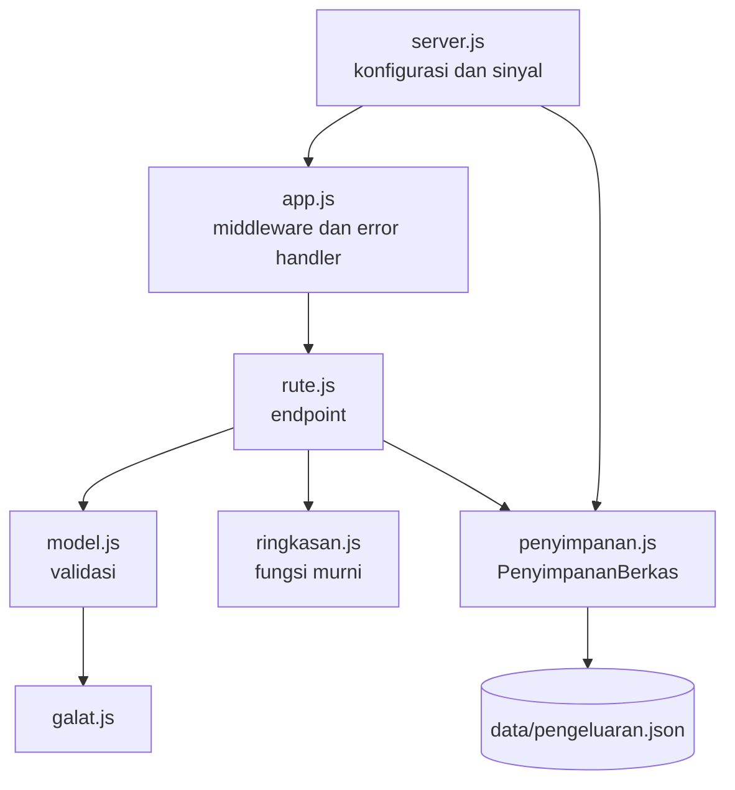

## Tujuan pembelajaran

Setelah mengerjakan bab ini, kamu dapat:

- Merancang dan membangun REST API utuh yang menggabungkan Express, penyimpanan ke berkas, konfigurasi lewat lingkungan, dan pengujian otomatis.
- Menyusun proyek berlapis yang mudah diuji dan mudah diubah.
- Menulis data ke berkas secara aman: antrean tulis dan penulisan atomik.
- Memvalidasi masukan dengan ketat dan menolak field yang tidak diizinkan.
- Mengatur server agar dimulai, berjalan, dan berhenti dengan rapi.
- Menulis tes unit dan integrasi yang independen, termasuk tes yang memakai berkas sementara.
- Menyebutkan langkah-langkah yang masih diperlukan sebelum sebuah API layak dipakai di produksi.

Ini bab penutup bagian Node.js. Seperti bab 14 di bagian JavaScript Dasar, tidak ada konsep besar yang baru. Tugasmu adalah **menyusun** semua yang sudah kamu pelajari menjadi sebuah program yang nyata.

## Pendahuluan: dari terminal ke layanan

Di bab 14 kamu membangun **Pencatat Pengeluaran** sebagai program baris perintah: satu orang, satu komputer, satu perintah pada satu waktu. Sekarang kita ubah menjadi **layanan web** (REST API) yang bisa dipakai oleh aplikasi apa pun: situs web, aplikasi ponsel, atau skrip. Fungsinya sama (mencatat pengeluaran, melihat daftar, meringkas per kategori), tetapi bentuknya berbeda, dan kita mengerjakannya dengan standar yang lebih tinggi.

Berikut alat dari bagian Node.js yang akan terpakai:

| Bagian proyek | Konsep | Bab |
|---|---|---|
| Paket dan skrip proyek | npm, `package.json`, `scripts` | 16 |
| Alamat berkas, salinan mendalam, tanggal | `path`, `import.meta.dirname`, `structuredClone` | 17 |
| Konfigurasi, penutupan rapi | `process.env`, `--env-file`, `SIGINT`, `SIGTERM` | 18 |
| Berkas data dan antrean tulis | `fs/promises`, Promise | 12, 19 |
| Server dan routing | HTTP, Express, middleware, `Router` | 20, 21 |
| Rancangan endpoint dan paginasi | REST, kode status | 22 |
| Pengujian | `node:test`, `node:assert/strict` | 22 |
| Model, error khusus | Class, `extends Error`, validasi | 13 |

## Rancangan

### Endpoint

| Tindakan | Metode dan jalur | Keterangan |
|---|---|---|
| Cek kesehatan | `GET /health` | Dipakai alat pemantau untuk tahu apakah server hidup |
| Daftar | `GET /api/pengeluaran` | Query: `kategori`, `bulan` (`YYYY-MM`), `halaman`, `batas` |
| Tambah | `POST /api/pengeluaran` | Body: `jumlah`, `kategori`, `deskripsi`, `tanggal` (opsional, bawaan hari ini) |
| Satu data | `GET /api/pengeluaran/:id` | `404` jika tidak ada |
| Ubah sebagian | `PATCH /api/pengeluaran/:id` | Hanya field yang diizinkan |
| Hapus | `DELETE /api/pengeluaran/:id` | `204` |
| Ringkasan | `GET /api/ringkasan` | Query: `bulan`. Berisi total dan rincian per kategori |

### Struktur

```text
api-pengeluaran/
  package.json
  .gitignore
  .env.example
  server.js             menyalakan server (konfigurasi, penutupan rapi)
  klien.js              skrip untuk mencoba server yang berjalan
  bantu-uji.js          fungsi bantu untuk tes
  src/
    galat.js            error yang membawa kode status
    model.js            validasi dan pembentukan data pengeluaran
    ringkasan.js        fungsi murni: total dan rincian per kategori
    penyimpanan.js      class PenyimpananBerkas (baca dan tulis JSON)
    rute.js             semua endpoint
    app.js              merakit aplikasi Express
  test/
    ringkasan.test.js
    penyimpanan.test.js
    api.test.js
```



Pembagian ini sama dengan bab 22, ditambah dua prinsip:

- `server.js` hanya berurusan dengan dunia luar (port, berkas, sinyal). Semua logika ada di `src/`.
- `buatApp` menerima semua yang berubah-ubah dari luar: **penyimpanan**, **jam** (`sekarang`), dan **pencatat log** (`catat`). Di tes, kita memberi penyimpanan di berkas sementara, jam tetap, dan log yang dimatikan, sehingga tes tidak bergantung pada kapan atau di mana ia dijalankan.

## Menyiapkan proyek

```bash
mkdir api-pengeluaran
cd api-pengeluaran
npm init -y
npm pkg set type=module
npm pkg set private=true --json
npm install express@5.3.0
npm pkg set scripts.start="node server.js"
npm pkg set scripts.dev="node --watch --env-file-if-exists=.env server.js"
npm pkg set scripts.test="node --test"
```

Output (contoh):

```text
added 65 packages, and audited 66 packages in 2s

30 packages are looking for funding
  run `npm fund` for details

found 0 vulnerabilities
```

Tiga skrip: `npm start` menjalankan server, `npm run dev` menjalankannya dengan `--watch` (restart otomatis saat kode berubah) dan memuat `.env` bila ada, dan `npm test` menjalankan semua tes (bab 16 dan 22).

Dua berkas pendukung (bab 18). `.gitignore` menjaga hal yang tidak boleh masuk Git, dan `.env.example` mendokumentasikan variabel yang dikenali program:

```text title="api-pengeluaran/.gitignore"
node_modules/
data/
.env
```

```text title="api-pengeluaran/.env.example"
# Salin menjadi .env lalu sesuaikan
PORT=3000
BERKAS_DATA=./data/pengeluaran.json
```

Folder `data/` ikut diabaikan Git karena isinya data pengguna, bukan kode.

## Kode

### Error yang membawa status

```javascript title="api-pengeluaran/src/galat.js"
export class GalatHttp extends Error {
  constructor(status, pesan) {
    super(pesan);
    this.status = status;
  }
}
```

### Model: validasi dan pembentukan data

Semua aturan tentang bentuk data yang sah ada di satu tempat.

```javascript title="api-pengeluaran/src/model.js"
import { GalatHttp } from "./galat.js";

export function validasiId(teks) {
  const id = Number(teks);
  if (!Number.isInteger(id) || id < 1) {
    throw new GalatHttp(400, "id harus bilangan bulat positif");
  }
  return id;
}

export function validasiJumlah(jumlah) {
  if (typeof jumlah !== "number" || !Number.isFinite(jumlah) || jumlah <= 0) {
    throw new GalatHttp(400, "jumlah harus angka lebih dari 0");
  }
  return jumlah;
}

export function validasiTeks(nama, nilai) {
  if (typeof nilai !== "string" || nilai.trim() === "") {
    throw new GalatHttp(400, `${nama} wajib diisi`);
  }
  if (nilai.trim().length > 100) {
    throw new GalatHttp(400, `${nama} maksimal 100 karakter`);
  }
  return nilai.trim();
}

export function validasiTanggal(tanggal) {
  const bentukBenar =
    typeof tanggal === "string" && tanggal.length === 10 && tanggal[4] === "-" && tanggal[7] === "-";
  const objek = bentukBenar ? new Date(`${tanggal}T00:00:00Z`) : undefined;
  const valid =
    objek !== undefined && !Number.isNaN(objek.getTime()) && objek.toISOString().slice(0, 10) === tanggal;
  if (!valid) {
    throw new GalatHttp(400, "tanggal harus berformat YYYY-MM-DD yang valid");
  }
  return tanggal;
}

export function validasiBulan(bulan) {
  const bentukBenar = typeof bulan === "string" && bulan.length === 7 && bulan[4] === "-";
  const nomor = Number(bulan?.slice(5));
  if (!bentukBenar || !Number.isInteger(Number(bulan.slice(0, 4))) || nomor < 1 || nomor > 12) {
    throw new GalatHttp(400, "bulan harus berformat YYYY-MM");
  }
  return bulan;
}

export function buatPengeluaran(data = {}, sekarang = () => new Date()) {
  return {
    jumlah: validasiJumlah(data.jumlah),
    kategori: validasiTeks("kategori", data.kategori).toLowerCase(),
    deskripsi: validasiTeks("deskripsi", data.deskripsi),
    tanggal: data.tanggal === undefined ? sekarang().toLocaleDateString("sv-SE") : validasiTanggal(data.tanggal),
  };
}

export function bersihkanPerubahan(data = {}) {
  const perubahan = {};
  if (data.jumlah !== undefined) {
    perubahan.jumlah = validasiJumlah(data.jumlah);
  }
  if (data.kategori !== undefined) {
    perubahan.kategori = validasiTeks("kategori", data.kategori).toLowerCase();
  }
  if (data.deskripsi !== undefined) {
    perubahan.deskripsi = validasiTeks("deskripsi", data.deskripsi);
  }
  if (data.tanggal !== undefined) {
    perubahan.tanggal = validasiTanggal(data.tanggal);
  }
  if (Object.keys(perubahan).length === 0) {
    throw new GalatHttp(400, "tidak ada yang diubah");
  }
  return perubahan;
}
```

Beberapa keputusan penting di sini:

| Keputusan | Alasan |
|---|---|
| `validasiTanggal` membuat `Date` lalu membandingkan `toISOString()` dengan masukan | `new Date("2025-02-30")` bisa dianggap sah oleh sebagian parser (menggeser ke Maret). Dengan membandingkan hasilnya kembali dengan teks asli, tanggal yang tidak ada di kalender, seperti 30 Februari, ditolak. Akhiran `T00:00:00Z` membuat perhitungannya UTC sehingga tidak bergantung zona waktu |
| `sekarang().toLocaleDateString("sv-SE")` untuk tanggal bawaan | Lihat bagian di bawah: ini memberi tanggal **lokal** berformat `YYYY-MM-DD` |
| `bersihkanPerubahan` hanya membaca field yang dikenal | Ini adalah **daftar putih** (*allowlist*): field lain di body, misalnya `id`, diabaikan. Tanpa itu, klien bisa menyelipkan field yang tidak seharusnya mereka ubah (*mass assignment*, yang kamu temui di latihan bab 22) |
| Batas 100 karakter pada teks | Mencegah data raksasa masuk ke berkas |
| `kategori` selalu huruf kecil | `Makan` dan `makan` dianggap sama |

### Ringkasan: fungsi murni

Kode ini diambil dari bab 14, tanpa perubahan:

```javascript title="api-pengeluaran/src/ringkasan.js"
export const total = (daftar) => daftar.reduce((jumlah, p) => jumlah + p.jumlah, 0);

export function perKategori(daftar) {
  const jumlahTotal = total(daftar);
  const peta = {};

  for (const p of daftar) {
    if (!(p.kategori in peta)) {
      peta[p.kategori] = 0;
    }
    peta[p.kategori] += p.jumlah;
  }

  return Object.entries(peta)
    .map(([kategori, subtotal]) => ({
      kategori,
      subtotal,
      persen: Math.round((subtotal / jumlahTotal) * 100),
    }))
    .sort((a, b) => b.subtotal - a.subtotal);
}
```

Fungsi ini sengaja tidak tahu apa pun tentang HTTP atau berkas. Itu sebabnya ia bisa dipakai ulang begitu saja dari program baris perintah ke API, dan diuji dengan mudah.

### Penyimpanan ke berkas

Inilah bagian paling rumit dan paling menarik dari proyek ini.

```javascript title="api-pengeluaran/src/penyimpanan.js"
import { readFile, writeFile, rename, mkdir } from "node:fs/promises";
import { dirname } from "node:path";

export class PenyimpananBerkas {
  #berkas;
  #data = [];
  #idBerikut = 1;
  #antrian = Promise.resolve();

  constructor(berkas) {
    this.#berkas = berkas;
  }

  async muat() {
    let teks;
    try {
      teks = await readFile(this.#berkas, "utf8");
    } catch (error) {
      if (error.code === "ENOENT") {
        return;
      }
      throw error;
    }

    let data;
    try {
      data = JSON.parse(teks);
    } catch {
      throw new Error(`Berkas data rusak: ${this.#berkas}`);
    }
    if (!Array.isArray(data)) {
      throw new Error(`Isi berkas data harus berupa array: ${this.#berkas}`);
    }

    this.#data = data;
    this.#idBerikut = data.reduce((maks, p) => (p.id > maks ? p.id : maks), 0) + 1;
  }

  semua() {
    return structuredClone(this.#data);
  }

  cari(id) {
    const ditemukan = this.#data.find((p) => p.id === id);
    return ditemukan === undefined ? undefined : structuredClone(ditemukan);
  }

  async tambah(data) {
    const baru = { id: this.#idBerikut++, ...data };
    this.#data.push(baru);
    await this.#simpan();
    return structuredClone(baru);
  }

  async ubah(id, perubahan) {
    const indeks = this.#data.findIndex((p) => p.id === id);
    if (indeks === -1) {
      return undefined;
    }
    this.#data[indeks] = { ...this.#data[indeks], ...perubahan, id };
    await this.#simpan();
    return structuredClone(this.#data[indeks]);
  }

  async hapus(id) {
    const indeks = this.#data.findIndex((p) => p.id === id);
    if (indeks === -1) {
      return false;
    }
    this.#data.splice(indeks, 1);
    await this.#simpan();
    return true;
  }

  #simpan() {
    const tulis = async () => {
      const sementara = `${this.#berkas}.tmp`;
      await mkdir(dirname(this.#berkas), { recursive: true });
      await writeFile(sementara, JSON.stringify(this.#data, null, 2));
      await rename(sementara, this.#berkas);
    };
    this.#antrian = this.#antrian.then(tulis, tulis);
    return this.#antrian;
  }
}
```

Cara kerjanya:

1. **Memori sebagai sumber utama.** Data dibaca dari berkas **sekali** di `muat()`, lalu disimpan di `#data`. Pembacaan (`semua`, `cari`) langsung dari memori, jadi cepat. Setiap perubahan ditulis kembali ke berkas.
2. **Salinan, bukan aslinya.** Method mengembalikan `structuredClone(...)` (bab 17), sehingga kode luar tidak bisa mengubah data internal secara diam-diam.
3. **Id tidak bisa ditimpa.** `{ ...lama, ...perubahan, id }` menaruh `id` asli di akhir. Ini perbaikan dari latihan bab 22.
4. **Id tidak dipakai ulang.** `#idBerikut` dihitung dari id terbesar yang ada saat `muat()`, lalu naik setiap kali ada tambahan.
5. **Antrean tulis (`#antrian`).** Bayangkan dua permintaan `POST` datang bersamaan, dan keduanya menulis berkas pada saat yang sama. Hasilnya bisa saling menimpa atau berkas rusak. Karena itu semua penulisan **dirantai** pada satu Promise: `this.#antrian = this.#antrian.then(tulis, tulis)` berarti "setelah penulisan sebelumnya selesai, baru jalankan yang ini". Argumen kedua `tulis` memastikan antrean tetap jalan walaupun penulisan sebelumnya gagal. Tes nanti membuktikannya dengan 20 penambahan serentak.
6. **Penulisan atomik.** Data ditulis ke berkas sementara (`.tmp`) lebih dulu, baru diganti nama menjadi berkas sebenarnya dengan `rename`. Penggantian nama berlangsung sekaligus, sehingga jika program mati di tengah penulisan, berkas asli tidak pernah menjadi setengah-tertulis. Yang rusak paling-paling berkas `.tmp`.
7. **Berkas rusak ditolak dengan pesan jelas**, bukan diabaikan: lebih baik server menolak menyala daripada diam-diam membuang data pengguna.

### Rute

```javascript title="api-pengeluaran/src/rute.js"
import { Router } from "express";
import { GalatHttp } from "./galat.js";
import { buatPengeluaran, bersihkanPerubahan, validasiBulan, validasiId } from "./model.js";
import { perKategori, total } from "./ringkasan.js";

function saring(daftar, { kategori, bulan }) {
  let hasil = daftar;
  if (kategori !== undefined) {
    if (typeof kategori !== "string") {
      throw new GalatHttp(400, "kategori hanya boleh satu nilai");
    }
    hasil = hasil.filter((p) => p.kategori === kategori.toLowerCase());
  }
  if (bulan !== undefined) {
    validasiBulan(bulan);
    hasil = hasil.filter((p) => p.tanggal.startsWith(bulan));
  }
  return hasil;
}

export function buatRute(penyimpanan, sekarang) {
  const rute = Router();

  function ambilAtau404(teksId) {
    const id = validasiId(teksId);
    const ditemukan = penyimpanan.cari(id);
    if (ditemukan === undefined) {
      throw new GalatHttp(404, `Pengeluaran ${id} tidak ditemukan`);
    }
    return ditemukan;
  }

  rute.get("/health", (req, res) => {
    res.json({ status: "ok" });
  });

  rute.get("/api/pengeluaran", (req, res) => {
    const { kategori, bulan, halaman = "1", batas = "10" } = req.query;
    const nomorHalaman = Number(halaman);
    const ukuran = Number(batas);
    if (!Number.isInteger(nomorHalaman) || nomorHalaman < 1) {
      throw new GalatHttp(400, "halaman harus bilangan bulat positif");
    }
    if (!Number.isInteger(ukuran) || ukuran < 1 || ukuran > 50) {
      throw new GalatHttp(400, "batas harus antara 1 dan 50");
    }

    const cocok = saring(penyimpanan.semua(), { kategori, bulan });
    const awal = (nomorHalaman - 1) * ukuran;
    res.json({
      data: cocok.slice(awal, awal + ukuran),
      halaman: nomorHalaman,
      batas: ukuran,
      total: cocok.length,
    });
  });

  rute.post("/api/pengeluaran", async (req, res) => {
    const baru = await penyimpanan.tambah(buatPengeluaran(req.body, sekarang));
    res.status(201).location(`/api/pengeluaran/${baru.id}`).json(baru);
  });

  rute.get("/api/pengeluaran/:id", (req, res) => {
    res.json(ambilAtau404(req.params.id));
  });

  rute.patch("/api/pengeluaran/:id", async (req, res) => {
    const ada = ambilAtau404(req.params.id);
    const diubah = await penyimpanan.ubah(ada.id, bersihkanPerubahan(req.body));
    res.json(diubah);
  });

  rute.delete("/api/pengeluaran/:id", async (req, res) => {
    const ada = ambilAtau404(req.params.id);
    await penyimpanan.hapus(ada.id);
    res.sendStatus(204);
  });

  rute.get("/api/ringkasan", (req, res) => {
    const cocok = saring(penyimpanan.semua(), { bulan: req.query.bulan });
    res.json({
      jumlahCatatan: cocok.length,
      total: total(cocok),
      perKategori: perKategori(cocok),
    });
  });

  return rute;
}
```

Perhatikan bahwa handler yang menulis (`POST`, `PATCH`, `DELETE`) adalah `async` dan memakai `await`. Pada Express 5, error yang dilempar di handler `async` otomatis diteruskan ke error handler (bab 21), jadi tidak perlu `try...catch`.

Satu detail kecil tetapi penting ada di `saring`: nilai query bisa berupa **array** jika klien mengulang namanya (`?kategori=a&kategori=b`). Tanpa pemeriksaan `typeof`, `kategori.toLowerCase()` akan melempar `TypeError` dan klien mendapat `500` karena kesalahannya sendiri. Masukan yang salah selalu harus dijawab `400`.

### Aplikasi dan server

```javascript title="api-pengeluaran/src/app.js"
import express from "express";
import { GalatHttp } from "./galat.js";
import { buatRute } from "./rute.js";

export function buatApp({ penyimpanan, sekarang = () => new Date(), catat = () => {} }) {
  const app = express();
  app.disable("x-powered-by");

  app.use((req, res, next) => {
    res.on("finish", () => catat(`${req.method} ${req.originalUrl} ${res.statusCode}`));
    next();
  });

  app.use(express.json());
  app.use(buatRute(penyimpanan, sekarang));

  app.use((req, res) => {
    throw new GalatHttp(404, "Jalur tidak ditemukan");
  });

  app.use((error, req, res, next) => {
    if (error.type === "entity.parse.failed") {
      return res.status(400).json({ galat: "JSON tidak valid" });
    }
    if (error.type === "entity.too.large") {
      return res.status(413).json({ galat: "Body terlalu besar" });
    }
    if (error instanceof GalatHttp) {
      return res.status(error.status).json({ galat: error.message });
    }
    console.error(error);
    res.status(500).json({ galat: "Kesalahan server" });
  });

  return app;
}
```

```javascript title="api-pengeluaran/server.js"
import { join } from "node:path";
import { buatApp } from "./src/app.js";
import { PenyimpananBerkas } from "./src/penyimpanan.js";

const PORT = Number(process.env.PORT) || 3000;
const BERKAS_DATA = process.env.BERKAS_DATA || join(import.meta.dirname, "data", "pengeluaran.json");

const penyimpanan = new PenyimpananBerkas(BERKAS_DATA);

try {
  await penyimpanan.muat();
} catch (error) {
  console.error("Gagal memuat data:", error.message);
  process.exit(1);
}

const app = buatApp({ penyimpanan, catat: console.log });

const server = app.listen(PORT, (error) => {
  if (error) {
    console.error("Gagal memulai server:", error.message);
    process.exit(1);
  }
  console.log(`API pengeluaran berjalan di http://localhost:${PORT}`);
  console.log(`Data disimpan di ${BERKAS_DATA}`);
});

function tutup(sinyal) {
  console.log(`\nMenerima ${sinyal}, menutup server...`);
  server.close(() => {
    console.log("Server ditutup");
  });
}

process.on("SIGINT", () => tutup("SIGINT"));
process.on("SIGTERM", () => tutup("SIGTERM"));
```

Hal yang patut dicatat pada `server.js`:

- **Konfigurasi dari lingkungan** (bab 18): `PORT` dan `BERKAS_DATA`, masing-masing dengan nilai bawaan. Alamat bawaan berkas dibentuk dari `import.meta.dirname` (bab 17), sehingga tidak bergantung pada folder tempat `node` dijalankan. Ini menyelesaikan kesalahan umum pertama di bab 14.
- **Gagal cepat saat memulai.** Jika data tidak bisa dimuat atau port gagal dipakai, program mencetak pesan jelas lalu berhenti dengan exit code 1, bukan berjalan setengah rusak.
- **Penutupan rapi** pada `SIGINT` (Ctrl + C) dan `SIGTERM` (permintaan berhenti dari sistem): `server.close()` berhenti menerima koneksi baru dan menunggu yang sedang berjalan selesai.
- Pencatat log `catat: console.log` hanya dipasang di sini. Di tes, `catat` bernilai fungsi kosong sehingga keluaran tes bersih.

## Menjalankan dan mencoba

Jalankan server:

```bash
# berjalan terus, hentikan dengan Ctrl + C
npm start
```

Output:

```text
> api-pengeluaran@1.0.0 start
> node server.js

API pengeluaran berjalan di http://localhost:3000
Data disimpan di C:\Users\kamu\api-pengeluaran\data\pengeluaran.json
```

Biarkan server berjalan, buka terminal kedua, dan jalankan skrip klien yang mengirim serangkaian permintaan:

```javascript title="api-pengeluaran/klien.js"
const PORT = Number(process.env.PORT) || 3000;
const dasar = `http://localhost:${PORT}`;

async function panggil(metode, jalur, body) {
  const respons = await fetch(dasar + jalur, {
    method: metode,
    headers: body === undefined ? {} : { "Content-Type": "application/json" },
    body: body === undefined ? undefined : JSON.stringify(body),
  });
  const teks = await respons.text();
  console.log(`${metode} ${jalur} -> ${respons.status}`, teks);
}

await panggil("POST", "/api/pengeluaran", { jumlah: 15000, kategori: "makan", deskripsi: "Nasi goreng", tanggal: "2025-03-01" });
await panggil("POST", "/api/pengeluaran", { jumlah: 8000, kategori: "transport", deskripsi: "Ojek ke kampus", tanggal: "2025-03-01" });
await panggil("POST", "/api/pengeluaran", { jumlah: 25000, kategori: "makan", deskripsi: "Makan siang bersama", tanggal: "2025-04-02" });
await panggil("POST", "/api/pengeluaran", { jumlah: 120000, kategori: "belanja", deskripsi: "Buku pemrograman", tanggal: "2025-04-03" });

await panggil("GET", "/api/pengeluaran?kategori=makan");
await panggil("GET", "/api/pengeluaran?bulan=2025-04&batas=1");
await panggil("GET", "/api/ringkasan");
await panggil("GET", "/api/ringkasan?bulan=2025-03");

await panggil("PATCH", "/api/pengeluaran/2", { jumlah: 9000 });
await panggil("DELETE", "/api/pengeluaran/1");
await panggil("GET", "/api/pengeluaran/1");
await panggil("POST", "/api/pengeluaran", { jumlah: -5, kategori: "makan", deskripsi: "salah" });
```

```bash
# butuh server berjalan (mulai dari data kosong)
node klien.js
```

Output:

```text
POST /api/pengeluaran -> 201 {"id":1,"jumlah":15000,"kategori":"makan","deskripsi":"Nasi goreng","tanggal":"2025-03-01"}
POST /api/pengeluaran -> 201 {"id":2,"jumlah":8000,"kategori":"transport","deskripsi":"Ojek ke kampus","tanggal":"2025-03-01"}
POST /api/pengeluaran -> 201 {"id":3,"jumlah":25000,"kategori":"makan","deskripsi":"Makan siang bersama","tanggal":"2025-04-02"}
POST /api/pengeluaran -> 201 {"id":4,"jumlah":120000,"kategori":"belanja","deskripsi":"Buku pemrograman","tanggal":"2025-04-03"}
GET /api/pengeluaran?kategori=makan -> 200 {"data":[{"id":1,"jumlah":15000,"kategori":"makan","deskripsi":"Nasi goreng","tanggal":"2025-03-01"},{"id":3,"jumlah":25000,"kategori":"makan","deskripsi":"Makan siang bersama","tanggal":"2025-04-02"}],"halaman":1,"batas":10,"total":2}
GET /api/pengeluaran?bulan=2025-04&batas=1 -> 200 {"data":[{"id":3,"jumlah":25000,"kategori":"makan","deskripsi":"Makan siang bersama","tanggal":"2025-04-02"}],"halaman":1,"batas":1,"total":2}
GET /api/ringkasan -> 200 {"jumlahCatatan":4,"total":168000,"perKategori":[{"kategori":"belanja","subtotal":120000,"persen":71},{"kategori":"makan","subtotal":40000,"persen":24},{"kategori":"transport","subtotal":8000,"persen":5}]}
GET /api/ringkasan?bulan=2025-03 -> 200 {"jumlahCatatan":2,"total":23000,"perKategori":[{"kategori":"makan","subtotal":15000,"persen":65},{"kategori":"transport","subtotal":8000,"persen":35}]}
PATCH /api/pengeluaran/2 -> 200 {"id":2,"jumlah":9000,"kategori":"transport","deskripsi":"Ojek ke kampus","tanggal":"2025-03-01"}
DELETE /api/pengeluaran/1 -> 204 
GET /api/pengeluaran/1 -> 404 {"galat":"Pengeluaran 1 tidak ditemukan"}
POST /api/pengeluaran -> 400 {"galat":"jumlah harus angka lebih dari 0"}
```

Di terminal server, middleware pencatat menampilkan satu baris untuk setiap permintaan:

```text
POST /api/pengeluaran 201
POST /api/pengeluaran 201
POST /api/pengeluaran 201
POST /api/pengeluaran 201
GET /api/pengeluaran?kategori=makan 200
GET /api/pengeluaran?bulan=2025-04&batas=1 200
GET /api/ringkasan 200
GET /api/ringkasan?bulan=2025-03 200
PATCH /api/pengeluaran/2 200
DELETE /api/pengeluaran/1 204
GET /api/pengeluaran/1 404
POST /api/pengeluaran 400
```

Setelah klien selesai, berkas `data/pengeluaran.json` berisi tiga catatan yang tersisa (id 2, 3, dan 4, karena id 1 dihapus):

```json
[
  {
    "id": 2,
    "jumlah": 9000,
    "kategori": "transport",
    "deskripsi": "Ojek ke kampus",
    "tanggal": "2025-03-01"
  },
  ...
]
```

Hentikan server dengan `Ctrl + C` (tampil `Menerima SIGINT, menutup server...` lalu `Server ditutup`), nyalakan lagi dengan `npm start`, dan periksa bahwa **datanya masih ada**:

```bash
# butuh server berjalan
curl http://localhost:3000/api/ringkasan
```

Output:

```text
{"jumlahCatatan":3,"total":154000,"perKategori":[{"kategori":"belanja","subtotal":120000,"persen":78},{"kategori":"makan","subtotal":25000,"persen":16},{"kategori":"transport","subtotal":9000,"persen":6}]}
```

Totalnya 154.000 (9.000 + 25.000 + 120.000): hasil `PATCH` dan `DELETE` tadi bertahan setelah server dimulai ulang. Inilah perbedaan terbesar dari API di bab 22 yang datanya hilang setiap kali server berhenti. Endpoint kesehatan juga bisa dicoba (`curl http://localhost:3000/health` menjawab `{"status":"ok"}`).

(Di PowerShell, gunakan `curl.exe`, atau `Invoke-RestMethod`.)

### Tentang tanggal bawaan

Pada `buatPengeluaran`, tanggal bawaan dibuat dengan `sekarang().toLocaleDateString("sv-SE")`. Pilihan ini sengaja dan memperbaiki kelemahan kecil di bab 14, yang memakai `new Date().toISOString().slice(0, 10)`. `toISOString()` selalu memakai **UTC**, sehingga di Indonesia (UTC+7 sampai UTC+9) pengeluaran yang dicatat dini hari tercatat dengan **tanggal kemarin**. Locale Swedia (`sv-SE`) kebetulan menulis tanggal sebagai `YYYY-MM-DD`, dan `toLocaleDateString` memakai zona waktu **lokal**, sehingga hasilnya sesuai tanggal di jam dinding pemakai:

| Waktu (zona Asia/Jakarta) | `toISOString().slice(0, 10)` | `toLocaleDateString("sv-SE")` |
|---|---|---|
| 1 Maret 2025, pukul 03.00 | `2025-02-28` (keliru) | `2025-03-01` |
| 1 Maret 2025, pukul 23.30 | `2025-03-01` | `2025-03-01` |

Perhatikan bahwa pada API ini jam adalah parameter (`sekarang`). Itulah yang membuat tes tanggal bawaan bisa dijalankan dengan jam tetap di komputer mana pun.

## Pengujian

Tes membuktikan semua yang dikatakan bab ini. Pertama, fungsi murni:

```javascript title="api-pengeluaran/test/ringkasan.test.js"
import { describe, it } from "node:test";
import assert from "node:assert/strict";
import { perKategori, total } from "../src/ringkasan.js";

const contoh = [
  { id: 1, jumlah: 15000, kategori: "makan" },
  { id: 2, jumlah: 25000, kategori: "makan" },
  { id: 3, jumlah: 120000, kategori: "belanja" },
  { id: 4, jumlah: 8000, kategori: "transport" },
];

describe("ringkasan", () => {
  it("menjumlahkan seluruh pengeluaran", () => {
    assert.equal(total(contoh), 168000);
    assert.equal(total([]), 0);
  });

  it("mengelompokkan per kategori, terbesar lebih dulu, dengan persen", () => {
    assert.deepEqual(perKategori(contoh), [
      { kategori: "belanja", subtotal: 120000, persen: 71 },
      { kategori: "makan", subtotal: 40000, persen: 24 },
      { kategori: "transport", subtotal: 8000, persen: 5 },
    ]);
  });

  it("mengembalikan array kosong jika tidak ada data", () => {
    assert.deepEqual(perKategori([]), []);
  });
});
```

Kedua, penyimpanan, memakai folder sementara yang dibuat dan dihapus untuk setiap tes agar tidak menyentuh data sungguhan:

```javascript title="api-pengeluaran/test/penyimpanan.test.js"
import { describe, it, beforeEach, afterEach } from "node:test";
import assert from "node:assert/strict";
import { mkdtemp, readFile, writeFile, rm } from "node:fs/promises";
import { tmpdir } from "node:os";
import { join } from "node:path";
import { PenyimpananBerkas } from "../src/penyimpanan.js";

describe("PenyimpananBerkas", () => {
  let folder;
  let berkas;

  beforeEach(async () => {
    folder = await mkdtemp(join(tmpdir(), "uji-simpan-"));
    berkas = join(folder, "data", "pengeluaran.json");
  });

  afterEach(async () => {
    await rm(folder, { recursive: true, force: true });
  });

  it("dimulai kosong jika berkas belum ada", async () => {
    const simpanan = new PenyimpananBerkas(berkas);
    await simpanan.muat();
    assert.deepEqual(simpanan.semua(), []);
  });

  it("menyimpan ke berkas dan memuatnya kembali", async () => {
    const pertama = new PenyimpananBerkas(berkas);
    await pertama.muat();
    await pertama.tambah({ jumlah: 1000, kategori: "makan" });
    await pertama.tambah({ jumlah: 2000, kategori: "minum" });

    const kedua = new PenyimpananBerkas(berkas);
    await kedua.muat();
    assert.deepEqual(kedua.semua().map((p) => p.id), [1, 2]);

    const baru = await kedua.tambah({ jumlah: 3000, kategori: "lain" });
    assert.equal(baru.id, 3);
  });

  it("menulis semua penambahan serentak tanpa ada yang hilang", async () => {
    const simpanan = new PenyimpananBerkas(berkas);
    await simpanan.muat();
    await Promise.all(Array.from({ length: 20 }, (_, i) => simpanan.tambah({ jumlah: i + 1 })));

    const dariBerkas = JSON.parse(await readFile(berkas, "utf8"));
    assert.equal(dariBerkas.length, 20);
    assert.equal(new Set(dariBerkas.map((p) => p.id)).size, 20);
  });

  it("mengubah dan menghapus, serta tidak mengganti id", async () => {
    const simpanan = new PenyimpananBerkas(berkas);
    await simpanan.muat();
    await simpanan.tambah({ jumlah: 1000 });
    const diubah = await simpanan.ubah(1, { id: 99, jumlah: 5000 });
    assert.deepEqual(diubah, { id: 1, jumlah: 5000 });
    assert.equal(await simpanan.ubah(42, { jumlah: 1 }), undefined);
    assert.equal(await simpanan.hapus(1), true);
    assert.equal(await simpanan.hapus(1), false);
  });

  it("tidak membocorkan objek internal", async () => {
    const simpanan = new PenyimpananBerkas(berkas);
    await simpanan.muat();
    await simpanan.tambah({ jumlah: 1000, rincian: { a: 1 } });
    const salinan = simpanan.cari(1);
    salinan.rincian.a = 999;
    assert.equal(simpanan.cari(1).rincian.a, 1);
  });

  it("menolak berkas yang rusak atau bukan array", async () => {
    const simpanan = new PenyimpananBerkas(berkas);
    await writeFile(join(folder, "rusak.json"), "{rusak");
    await writeFile(join(folder, "objek.json"), "{}");

    await assert.rejects(new PenyimpananBerkas(join(folder, "rusak.json")).muat(), /rusak/);
    await assert.rejects(new PenyimpananBerkas(join(folder, "objek.json")).muat(), /array/);
    assert.deepEqual(simpanan.semua(), []);
  });
});
```

Tiga hal baru: `mkdtemp` membuat folder sementara dengan nama acak, `rm(..., { recursive: true })` menghapusnya di `afterEach`, dan `assert.rejects(promise, pola)` memeriksa bahwa sebuah Promise ditolak dengan pesan yang cocok dengan pola. (Pola `/rusak/` adalah *ekspresi reguler*, yaitu cara menulis pola teks. Di sini artinya "pesan mengandung kata rusak".)

Dua hal kecil lain pada tes "menulis semua penambahan serentak": `Array.from({ length: 20 }, (_, i) => ...)` membuat array berisi 20 elemen, dengan memanggil fungsi yang diberikan untuk setiap indeks `i` (garis bawah `_` adalah nama untuk parameter yang tidak dipakai), sehingga menghasilkan 20 pemanggilan `tambah` sekaligus. Sedangkan `new Set(daftar)` membuat himpunan yang hanya menyimpan nilai **unik**; jika `.size`-nya 20, berarti ke-20 id berbeda semua.

Ketiga, fungsi bantu dan tes API. Fungsi bantu menjalankan aplikasi lengkap di port acak, dengan penyimpanan di berkas sementara:

```javascript title="api-pengeluaran/bantu-uji.js"
import { createServer } from "node:http";
import { mkdtemp, rm } from "node:fs/promises";
import { tmpdir } from "node:os";
import { join } from "node:path";
import { buatApp } from "./src/app.js";
import { PenyimpananBerkas } from "./src/penyimpanan.js";

export async function mulaiServer({ berkas, sekarang } = {}) {
  let folderSementara;
  if (berkas === undefined) {
    folderSementara = await mkdtemp(join(tmpdir(), "uji-pengeluaran-"));
    berkas = join(folderSementara, "data.json");
  }

  const penyimpanan = new PenyimpananBerkas(berkas);
  await penyimpanan.muat();

  const server = createServer(buatApp({ penyimpanan, sekarang }));
  await new Promise((resolve) => server.listen(0, "127.0.0.1", resolve));
  const url = `http://127.0.0.1:${server.address().port}`;

  async function panggil(metode, jalur, body) {
    const respons = await fetch(url + jalur, {
      method: metode,
      headers: body === undefined ? {} : { "Content-Type": "application/json" },
      body: body === undefined ? undefined : typeof body === "string" ? body : JSON.stringify(body),
    });
    const teks = await respons.text();
    const isi = teks === "" ? undefined : JSON.parse(teks);
    return { status: respons.status, lokasi: respons.headers.get("location"), isi };
  }

  return {
    berkas,
    panggil,
    tutup: async () => {
      await new Promise((resolve) => {
        server.close(resolve);
        server.closeAllConnections();
      });
      if (folderSementara !== undefined) {
        await rm(folderSementara, { recursive: true, force: true });
      }
    },
  };
}
```

```javascript title="api-pengeluaran/test/api.test.js"
import { describe, it, beforeEach, afterEach } from "node:test";
import assert from "node:assert/strict";
import { mulaiServer } from "../bantu-uji.js";

const sekarang = () => new Date(2025, 2, 15, 23, 30);

describe("API pengeluaran", () => {
  let app;

  beforeEach(async () => {
    app = await mulaiServer({ sekarang });
  });

  afterEach(async () => {
    await app.tutup();
  });

  async function isiContoh() {
    await app.panggil("POST", "/api/pengeluaran", { jumlah: 15000, kategori: "Makan", deskripsi: "Nasi goreng", tanggal: "2025-03-01" });
    await app.panggil("POST", "/api/pengeluaran", { jumlah: 8000, kategori: "transport", deskripsi: "Ojek", tanggal: "2025-03-01" });
    await app.panggil("POST", "/api/pengeluaran", { jumlah: 25000, kategori: "makan", deskripsi: "Makan siang", tanggal: "2025-04-02" });
  }

  it("health check", async () => {
    assert.deepEqual(await app.panggil("GET", "/health"), { status: 200, lokasi: null, isi: { status: "ok" } });
  });

  it("POST membuat pengeluaran dengan kategori huruf kecil dan tanggal bawaan lokal", async () => {
    const { status, lokasi, isi } = await app.panggil("POST", "/api/pengeluaran", {
      jumlah: 15000,
      kategori: "  Makan ",
      deskripsi: "Nasi goreng",
    });
    assert.equal(status, 201);
    assert.equal(lokasi, "/api/pengeluaran/1");
    assert.deepEqual(isi, { id: 1, jumlah: 15000, kategori: "makan", deskripsi: "Nasi goreng", tanggal: "2025-03-15" });
  });

  it("POST menolak masukan yang salah", async () => {
    const dasar = { jumlah: 1000, kategori: "makan", deskripsi: "x", tanggal: "2025-03-01" };
    const salah = [
      { ...dasar, jumlah: 0 },
      { ...dasar, jumlah: "1000" },
      { ...dasar, kategori: "" },
      { ...dasar, deskripsi: 5 },
      { ...dasar, tanggal: "2025/03/01" },
      { ...dasar, tanggal: "2025-02-30" },
      { ...dasar, tanggal: "kemarin" },
      {},
    ];
    for (const body of salah) {
      const { status, isi } = await app.panggil("POST", "/api/pengeluaran", body);
      assert.equal(status, 400, JSON.stringify(body));
      assert.ok(isi.galat);
    }
    assert.equal((await app.panggil("POST", "/api/pengeluaran")).status, 400);
    assert.equal((await app.panggil("POST", "/api/pengeluaran", "{rusak")).isi.galat, "JSON tidak valid");
  });

  it("menyaring berdasarkan kategori dan bulan", async () => {
    await isiContoh();
    const makan = await app.panggil("GET", "/api/pengeluaran?kategori=MAKAN");
    assert.deepEqual(makan.isi.data.map((p) => p.id), [1, 3]);

    const maret = await app.panggil("GET", "/api/pengeluaran?bulan=2025-03");
    assert.deepEqual(maret.isi.data.map((p) => p.id), [1, 2]);

    const gabungan = await app.panggil("GET", "/api/pengeluaran?kategori=makan&bulan=2025-03");
    assert.deepEqual(gabungan.isi.data.map((p) => p.id), [1]);
    assert.equal(gabungan.isi.total, 1);
  });

  it("menolak query yang salah", async () => {
    for (const kueri of ["bulan=2025-13", "bulan=maret", "kategori=a&kategori=b", "halaman=0", "batas=51"]) {
      assert.equal((await app.panggil("GET", `/api/pengeluaran?${kueri}`)).status, 400, kueri);
    }
  });

  it("GET, PATCH, dan DELETE satu pengeluaran", async () => {
    await isiContoh();
    assert.equal((await app.panggil("GET", "/api/pengeluaran/2")).isi.deskripsi, "Ojek");

    const diubah = await app.panggil("PATCH", "/api/pengeluaran/2", { jumlah: 9000, id: 99 });
    assert.deepEqual(diubah.isi, { id: 2, jumlah: 9000, kategori: "transport", deskripsi: "Ojek", tanggal: "2025-03-01" });
    assert.equal((await app.panggil("PATCH", "/api/pengeluaran/2", { tanggal: "2025-13-01" })).status, 400);
    assert.equal((await app.panggil("PATCH", "/api/pengeluaran/2", {})).status, 400);

    assert.equal((await app.panggil("DELETE", "/api/pengeluaran/2")).status, 204);
    assert.equal((await app.panggil("GET", "/api/pengeluaran/2")).status, 404);
    assert.equal((await app.panggil("DELETE", "/api/pengeluaran/2")).status, 404);
    assert.equal((await app.panggil("GET", "/api/pengeluaran/abc")).status, 400);
  });

  it("ringkasan semua data dan per bulan", async () => {
    await isiContoh();
    const semua = await app.panggil("GET", "/api/ringkasan");
    assert.deepEqual(semua.isi, {
      jumlahCatatan: 3,
      total: 48000,
      perKategori: [
        { kategori: "makan", subtotal: 40000, persen: 83 },
        { kategori: "transport", subtotal: 8000, persen: 17 },
      ],
    });

    const maret = await app.panggil("GET", "/api/ringkasan?bulan=2025-03");
    assert.equal(maret.isi.total, 23000);
    assert.equal(maret.isi.jumlahCatatan, 2);

    const kosong = await app.panggil("GET", "/api/ringkasan?bulan=2030-01");
    assert.deepEqual(kosong.isi, { jumlahCatatan: 0, total: 0, perKategori: [] });
  });

  it("jalur tidak dikenal dijawab 404 JSON", async () => {
    assert.deepEqual(await app.panggil("GET", "/tidak-ada"), { status: 404, lokasi: null, isi: { galat: "Jalur tidak ditemukan" } });
  });
});

describe("data bertahan setelah server dimulai ulang", () => {
  it("memuat kembali pengeluaran dari berkas yang sama", async () => {
    const pertama = await mulaiServer();
    await pertama.panggil("POST", "/api/pengeluaran", { jumlah: 5000, kategori: "kopi", deskripsi: "Latte", tanggal: "2025-03-01" });
    const berkas = pertama.berkas;

    const kedua = await mulaiServer({ berkas });
    const { isi } = await kedua.panggil("GET", "/api/pengeluaran");
    assert.equal(isi.total, 1);
    assert.equal(isi.data[0].deskripsi, "Latte");

    const baru = await kedua.panggil("POST", "/api/pengeluaran", { jumlah: 1000, kategori: "kopi", deskripsi: "Espresso", tanggal: "2025-03-02" });
    assert.equal(baru.isi.id, 2);

    await kedua.tutup();
    await pertama.tutup();
  });
});
```

Beberapa hal pada tes API:

- `sekarang = () => new Date(2025, 2, 15, 23, 30)` membuat jam tetap: 15 Maret 2025 pukul 23.30 **waktu lokal** (bulan dihitung dari 0, jadi `2` adalah Maret). Tes tanggal bawaan lulus di zona waktu mana pun, termasuk tepat menjelang tengah malam, saat kesalahan UTC paling mudah muncul. Pernah dicoba di empat zona waktu berbeda.
- Setiap tes mendapat server dan berkas sementara sendiri, yang dibersihkan di `afterEach`.
- Tes terakhir menyalakan **dua server berurutan di berkas yang sama** untuk membuktikan data bertahan setelah restart.

Jalankan semuanya:

```bash
npm test
```

Output (angka waktu berbeda di setiap komputer, ditulis `...`):

```text
> api-pengeluaran@1.0.0 test
> node --test

▶ API pengeluaran
  ✔ health check (...ms)
  ✔ POST membuat pengeluaran dengan kategori huruf kecil dan tanggal bawaan lokal (...ms)
  ✔ POST menolak masukan yang salah (...ms)
  ✔ menyaring berdasarkan kategori dan bulan (...ms)
  ✔ menolak query yang salah (...ms)
  ✔ GET, PATCH, dan DELETE satu pengeluaran (...ms)
  ✔ ringkasan semua data dan per bulan (...ms)
  ✔ jalur tidak dikenal dijawab 404 JSON (...ms)
✔ API pengeluaran (...ms)
▶ data bertahan setelah server dimulai ulang
  ✔ memuat kembali pengeluaran dari berkas yang sama (...ms)
✔ data bertahan setelah server dimulai ulang (...ms)
▶ PenyimpananBerkas
  ✔ dimulai kosong jika berkas belum ada (...ms)
  ✔ menyimpan ke berkas dan memuatnya kembali (...ms)
  ✔ menulis semua penambahan serentak tanpa ada yang hilang (...ms)
  ✔ mengubah dan menghapus, serta tidak mengganti id (...ms)
  ✔ tidak membocorkan objek internal (...ms)
  ✔ menolak berkas yang rusak atau bukan array (...ms)
✔ PenyimpananBerkas (...ms)
▶ ringkasan
  ✔ menjumlahkan seluruh pengeluaran (...ms)
  ✔ mengelompokkan per kategori, terbesar lebih dulu, dengan persen (...ms)
  ✔ mengembalikan array kosong jika tidak ada data (...ms)
✔ ringkasan (...ms)
ℹ tests 18
ℹ suites 4
ℹ pass 18
ℹ fail 0
ℹ cancelled 0
ℹ skipped 0
ℹ todo 0
ℹ duration_ms ...
```

## Menuju produksi

API ini sudah rapi, teruji, dan datanya bertahan. Tetapi **belum siap** untuk dibuka ke internet. Daftar berikut menunjukkan apa yang masih kurang, sebagai peta belajarmu selanjutnya:

| Bidang | Yang perlu ditambahkan | Alasannya |
|---|---|---|
| **Database** | Ganti berkas JSON dengan database sungguhan (SQLite, PostgreSQL, MongoDB) | Berkas JSON ditulis ulang seluruhnya pada setiap perubahan dan hanya aman dipakai oleh **satu** proses server. Database menangani banyak pengguna, pencarian cepat, dan transaksi |
| **Autentikasi dan otorisasi** | Login (misalnya token JWT atau sesi), dan aturan siapa boleh mengakses data siapa | Saat ini siapa pun bisa membaca dan mengubah semua data. Setiap pengguna seharusnya hanya melihat pengeluarannya sendiri |
| **Validasi lebih kuat** | Pustaka validasi skema (misalnya Zod atau Ajv) | Aturan validasi yang panjang lebih mudah dirawat sebagai skema deklaratif |
| **Keamanan HTTP** | Header keamanan (`helmet`), pembatasan laju permintaan (*rate limiting*), CORS yang diatur, HTTPS | Melindungi dari penyalahgunaan dan serangan umum |
| **Logging** | Log terstruktur dengan tingkat (info, peringatan, error) dan identitas permintaan | `console.log` tidak cukup untuk menelusuri masalah di server |
| **Konfigurasi dan rahasia** | Variabel lingkungan untuk semua pengaturan, pengelola rahasia | Kata sandi dan kunci tidak boleh ada di kode |
| **Proses dan pemantauan** | Pengelola proses atau kontainer (misalnya Docker) yang menyalakan ulang server jika mati, dan pemantauan yang memakai `GET /health` | Server harus pulih sendiri |
| **Dokumentasi** | Spesifikasi OpenAPI | Agar pemakai API tahu kontraknya tanpa membaca kode |
| **Integrasi berkelanjutan** | Menjalankan `npm test` otomatis di setiap perubahan kode (misalnya GitHub Actions) | Tes yang tidak pernah dijalankan tidak berguna |
| **TypeScript** | Menambah tipe statis pada JavaScript | Menangkap kesalahan tipe sebelum kode dijalankan |

Hampir semua hal di atas dibangun di atas konsep yang sudah kamu kuasai. Kamu tidak perlu menguasai semuanya sekaligus; ambil satu per satu sesuai kebutuhan proyekmu.

## Kesalahan umum pada proyek ini

### 1. Menulis berkas dari banyak permintaan tanpa antrean

Dua penulisan serentak ke berkas yang sama bisa saling menimpa atau merusak berkas. Rantai `#antrian` memastikan penulisan berurutan, dan tes dengan 20 penambahan serentak membuktikannya.

### 2. Menulis langsung ke berkas tujuan

Jika program berhenti (listrik mati, `kill`) saat menulis, berkas bisa tinggal setengah. Tulis ke berkas sementara lalu `rename`.

### 3. Lupa `await penyimpanan.muat()` saat memulai

Tanpanya, server menyala dengan data kosong dan menimpa berkas lama begitu ada penulisan pertama. Itu sebabnya `server.js` menunggu `muat()` dan berhenti jika gagal.

### 4. Percaya pada body dan query

Selalu validasi tipe, panjang, dan format, termasuk kemungkinan nilai berupa array (`?kategori=a&kategori=b`). Masukan yang salah dijawab `400`, tidak boleh sampai menjadi `500`.

### 5. Menerima field apa pun dari klien

`penyimpanan.ubah(id, req.body)` memungkinkan klien mengganti `id` atau field internal. Gunakan daftar putih seperti `bersihkanPerubahan`.

### 6. Tes yang memakai data sungguhan

Tes yang menulis ke `data/pengeluaran.json` merusak data pengembangan dan saling bentrok. Gunakan folder sementara untuk setiap tes.

### 7. Tes yang bergantung pada jam atau zona waktu

Tes yang memakai `new Date()` langsung bisa lulus pagi hari dan gagal tengah malam, atau lulus di Jakarta dan gagal di komputer lain. Jadikan jam sebagai parameter, seperti `sekarang`.

### 8. Memakai UTC untuk tanggal yang dilihat manusia

Seperti pada bagian tanggal bawaan: `toISOString()` memakai UTC dan bisa meleset sehari bagi pengguna di zona waktu lain.

### 9. Membocorkan detail error

Kirim pesan umum `Kesalahan server` ke klien dan catat detailnya di server (`console.error`), seperti yang dilakukan error handler di `app.js`.

### 10. Mengira data di berkas JSON cukup untuk produksi

Cocok untuk belajar dan alat kecil pribadi, tetapi bukan untuk layanan dengan banyak pengguna. Lihat tabel "Menuju produksi".

## Ringkasan

- Proyek akhir ini mengubah program baris perintah (bab 14) menjadi **REST API** dengan Express, penyimpanan ke berkas, konfigurasi lewat lingkungan, dan 18 tes otomatis.
- Susunan berlapis: **model/validasi**, **fungsi murni**, **penyimpanan**, **rute**, **aplikasi**, dan **server**. `buatApp` menerima penyimpanan, jam, dan pencatat log dari luar sehingga mudah diuji.
- Penyimpanan berkas yang aman: baca sekali ke memori, **antrean tulis** untuk mencegah balapan data, **penulisan atomik** (berkas sementara lalu `rename`), dan salinan dengan `structuredClone`.
- Validasi ketat dengan **daftar putih** field dan pesan error yang jelas. Masukan salah dijawab `400`, bukan `500`.
- Konfigurasi dari lingkungan (`PORT`, `BERKAS_DATA`), gagal cepat saat memulai, dan penutupan rapi pada `SIGINT` dan `SIGTERM`.
- Tanggal untuk manusia memakai waktu **lokal** (`toLocaleDateString("sv-SE")`), bukan UTC.
- Tes yang andal: independen, memakai berkas sementara, jam tetap, dan server di port acak.
- Masih banyak yang diperlukan menuju produksi: database, autentikasi, keamanan, logging, pemantauan, dokumentasi, dan CI.

## Latihan

Karena ini bab proyek, latihannya berupa tes dan perluasan untuk proyek `api-pengeluaran`. Jalankan di folder proyek itu. Latihan 1 sampai 6 punya contoh jawaban yang dijalankan, dan latihan 7 berupa pertanyaan terbuka.

### Latihan 1: Tes penyaringan bulan

Tulis `test/bulan.test.js`: tambah tiga pengeluaran pada `2025-03-31`, `2025-04-01`, dan `2025-04-30`, lalu pastikan `?bulan=2025-04` hanya mengembalikan dua yang terakhir, dan `?bulan=2025-05` tidak mengembalikan apa pun.

??? success "Contoh jawaban"
    ```javascript title="api-pengeluaran/test/bulan.test.js"
    import { describe, it, beforeEach, afterEach } from "node:test";
    import assert from "node:assert/strict";
    import { mulaiServer } from "../bantu-uji.js";

    describe("penyaringan bulan", () => {
      let app;

      beforeEach(async () => {
        app = await mulaiServer();
        for (const tanggal of ["2025-03-31", "2025-04-01", "2025-04-30"]) {
          await app.panggil("POST", "/api/pengeluaran", { jumlah: 1000, kategori: "x", deskripsi: tanggal, tanggal });
        }
      });

      afterEach(async () => {
        await app.tutup();
      });

      it("hanya mengembalikan data pada bulan yang diminta", async () => {
        const april = await app.panggil("GET", "/api/pengeluaran?bulan=2025-04");
        assert.deepEqual(april.isi.data.map((p) => p.tanggal), ["2025-04-01", "2025-04-30"]);

        const mei = await app.panggil("GET", "/api/pengeluaran?bulan=2025-05");
        assert.equal(mei.isi.total, 0);
      });
    });
    ```

    ```bash
    node --test test/bulan.test.js
    ```

    ```text
    ...
    ℹ tests 1
    ℹ suites 1
    ℹ pass 1
    ℹ fail 0
    ...
    ```

### Latihan 2: Mengubah tanggal menjadi tidak valid

Tulis `test/patch-tanggal.test.js`: `PATCH` dengan `tanggal` `"2025-02-30"` harus `400` dan **tidak boleh mengubah** data. Pastikan lewat `GET` bahwa tanggalnya masih yang lama.

??? success "Contoh jawaban"
    ```javascript title="api-pengeluaran/test/patch-tanggal.test.js"
    import { describe, it, beforeEach, afterEach } from "node:test";
    import assert from "node:assert/strict";
    import { mulaiServer } from "../bantu-uji.js";

    describe("PATCH tanggal tidak valid", () => {
      let app;

      beforeEach(async () => {
        app = await mulaiServer();
        await app.panggil("POST", "/api/pengeluaran", { jumlah: 1000, kategori: "x", deskripsi: "a", tanggal: "2025-03-01" });
      });

      afterEach(async () => {
        await app.tutup();
      });

      it("ditolak dan data tetap utuh", async () => {
        const salah = await app.panggil("PATCH", "/api/pengeluaran/1", { tanggal: "2025-02-30" });
        assert.equal(salah.status, 400);

        const sesudah = await app.panggil("GET", "/api/pengeluaran/1");
        assert.equal(sesudah.isi.tanggal, "2025-03-01");
      });
    });
    ```

    ```bash
    node --test test/patch-tanggal.test.js
    ```

    ```text
    ...
    ℹ tests 1
    ℹ suites 1
    ℹ pass 1
    ℹ fail 0
    ...
    ```

### Latihan 3: Berkas berisi `null`

Tambahkan tes pada `PenyimpananBerkas` (berkas `test/null.test.js`): jika isi berkas adalah JSON `null`, `muat()` harus ditolak dengan pesan yang mengandung kata `array`. Pakai folder sementara.

??? success "Contoh jawaban"
    ```javascript title="api-pengeluaran/test/null.test.js"
    import { describe, it, beforeEach, afterEach } from "node:test";
    import assert from "node:assert/strict";
    import { mkdtemp, writeFile, rm } from "node:fs/promises";
    import { tmpdir } from "node:os";
    import { join } from "node:path";
    import { PenyimpananBerkas } from "../src/penyimpanan.js";

    describe("berkas berisi null", () => {
      let folder;

      beforeEach(async () => {
        folder = await mkdtemp(join(tmpdir(), "uji-null-"));
      });

      afterEach(async () => {
        await rm(folder, { recursive: true, force: true });
      });

      it("ditolak karena bukan array", async () => {
        const berkas = join(folder, "null.json");
        await writeFile(berkas, "null");
        await assert.rejects(new PenyimpananBerkas(berkas).muat(), /array/);
      });
    });
    ```

    ```bash
    node --test test/null.test.js
    ```

    ```text
    ...
    ℹ tests 1
    ℹ suites 1
    ℹ pass 1
    ℹ fail 0
    ...
    ```

### Latihan 4: Halaman dan batas yang bukan angka

Tulis `test/paginasi.test.js` yang memeriksa bahwa `?halaman=abc`, `?batas=abc`, `?halaman=1.5`, dan `?batas=-1` semuanya dijawab `400`.

??? success "Contoh jawaban"
    ```javascript title="api-pengeluaran/test/paginasi.test.js"
    import { describe, it, beforeEach, afterEach } from "node:test";
    import assert from "node:assert/strict";
    import { mulaiServer } from "../bantu-uji.js";

    describe("paginasi tidak valid", () => {
      let app;

      beforeEach(async () => {
        app = await mulaiServer();
      });

      afterEach(async () => {
        await app.tutup();
      });

      it("menolak halaman dan batas yang bukan bilangan bulat positif", async () => {
        for (const kueri of ["halaman=abc", "batas=abc", "halaman=1.5", "batas=-1"]) {
          const { status } = await app.panggil("GET", `/api/pengeluaran?${kueri}`);
          assert.equal(status, 400, kueri);
        }
      });
    });
    ```

    ```bash
    node --test test/paginasi.test.js
    ```

    ```text
    ...
    ℹ tests 1
    ℹ suites 1
    ℹ pass 1
    ℹ fail 0
    ...
    ```

### Latihan 5: Middleware kunci API

Buat `src/kunci.js` yang mengekspor `periksaKunci(kunciBenar)`, middleware Express yang menjawab `401` dengan `{ galat: "kunci API salah atau tidak ada" }` jika header `x-api-key` tidak sama dengan `kunciBenar`. Tulis `test/kunci.test.js` yang memasangnya di aplikasi Express kecil dan menguji tanpa kunci, kunci salah, dan kunci benar.

??? success "Contoh jawaban"
    ```javascript title="api-pengeluaran/src/kunci.js"
    export function periksaKunci(kunciBenar) {
      return (req, res, next) => {
        if (req.get("x-api-key") !== kunciBenar) {
          res.status(401).json({ galat: "kunci API salah atau tidak ada" });
          return;
        }
        next();
      };
    }
    ```

    ```javascript title="api-pengeluaran/test/kunci.test.js"
    import { describe, it, beforeEach, afterEach } from "node:test";
    import assert from "node:assert/strict";
    import { createServer } from "node:http";
    import express from "express";
    import { periksaKunci } from "../src/kunci.js";

    describe("periksaKunci", () => {
      let server;
      let url;

      beforeEach(async () => {
        const app = express();
        app.get("/rahasia", periksaKunci("abc123"), (req, res) => res.json({ isi: "data" }));
        server = createServer(app);
        await new Promise((resolve) => server.listen(0, "127.0.0.1", resolve));
        url = `http://127.0.0.1:${server.address().port}/rahasia`;
      });

      afterEach(async () => {
        await new Promise((resolve) => {
          server.close(resolve);
          server.closeAllConnections();
        });
      });

      it("menolak tanpa kunci dan kunci salah, menerima kunci benar", async () => {
        const tanpa = await fetch(url);
        assert.equal(tanpa.status, 401);
        assert.deepEqual(await tanpa.json(), { galat: "kunci API salah atau tidak ada" });

        const salah = await fetch(url, { headers: { "x-api-key": "salah" } });
        assert.equal(salah.status, 401);

        const benar = await fetch(url, { headers: { "x-api-key": "abc123" } });
        assert.equal(benar.status, 200);
        assert.deepEqual(await benar.json(), { isi: "data" });
      });
    });
    ```

    ```bash
    node --test test/kunci.test.js
    ```

    ```text
    ...
    ℹ tests 1
    ℹ suites 1
    ℹ pass 1
    ℹ fail 0
    ...
    ```

    Untuk benar-benar melindungi API, pasang dengan `app.use("/api", periksaKunci(process.env.API_KEY))` di `buatApp`, dan ambil kuncinya dari lingkungan, bukan dari kode. Kunci tunggal bersama hanyalah perlindungan dasar; autentikasi per pengguna butuh cara yang lebih lengkap.

### Latihan 6: Penambahan serentak lewat API

Tulis `test/serentak.test.js`: kirim 10 `POST` serentak (`Promise.all`) lewat API, lalu pastikan semuanya `201`, ke-10 id unik, dan `GET /api/pengeluaran?batas=50` mengembalikan `total` 10.

??? success "Contoh jawaban"
    ```javascript title="api-pengeluaran/test/serentak.test.js"
    import { describe, it, beforeEach, afterEach } from "node:test";
    import assert from "node:assert/strict";
    import { mulaiServer } from "../bantu-uji.js";

    describe("penambahan serentak", () => {
      let app;

      beforeEach(async () => {
        app = await mulaiServer();
      });

      afterEach(async () => {
        await app.tutup();
      });

      it("10 POST serentak menghasilkan 10 id unik", async () => {
        const jawaban = await Promise.all(
          Array.from({ length: 10 }, (_, i) =>
            app.panggil("POST", "/api/pengeluaran", { jumlah: 1000 + i, kategori: "x", deskripsi: `n${i}`, tanggal: "2025-03-01" }),
          ),
        );
        assert.ok(jawaban.every((j) => j.status === 201));
        assert.equal(new Set(jawaban.map((j) => j.isi.id)).size, 10);

        const daftar = await app.panggil("GET", "/api/pengeluaran?batas=50");
        assert.equal(daftar.isi.total, 10);
      });
    });
    ```

    ```bash
    node --test test/serentak.test.js
    ```

    ```text
    ...
    ℹ tests 1
    ℹ suites 1
    ℹ pass 1
    ℹ fail 0
    ...
    ```

### Latihan 7: Peta menuju produksi (terbuka)

Pilih **tiga** butir dari tabel "Menuju produksi" yang menurutmu paling mendesak untuk `api-pengeluaran` jika akan dipakai oleh seratus teman. Untuk masing-masing, tulis satu paragraf: apa risikonya jika dibiarkan, dan langkah pertama yang akan kamu ambil. Tidak ada jawaban baku.

## Penutup bagian Node.js

Dengan bab ini, kamu telah menempuh seluruh jalur: dari variabel pertama di JavaScript Dasar, sampai layanan web yang menyimpan data, melayani permintaan, dan diuji otomatis. Beberapa kebiasaan yang layak dibawa ke proyek-proyek berikutnya:

- Pecah kode menjadi bagian kecil dengan satu tugas, dan berikan hal yang berubah-ubah dari luar (penyimpanan, jam, log).
- Validasi di pintu masuk, dan jawab masukan salah dengan kode status yang tepat.
- Pisahkan logika murni dari hal yang menyentuh dunia luar, supaya mudah diuji.
- Tulis tes untuk yang penting, dan buat tes independen dari urutan, jam, dan data sungguhan.
- Utamakan fitur bawaan Node.js sebelum menambah paket, dan pilih paket dengan hati-hati.
- Baca pesan error dan dokumentasi resmi dengan teliti sebelum menebak.

Selanjutnya kamu bisa melangkah ke database, autentikasi, TypeScript, kerangka web lain, atau membangun antarmuka web yang memanggil API ini. Dasar yang kamu miliki sekarang cukup untuk mempelajari semuanya.
